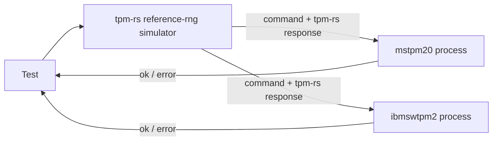

# Differential Testing (`tpm-rs` vs. C Reference TPMs `mstpm20` and `ibmswtpm2`)

This document describes how `tpm-rs` is differentially tested against two C reference TPMs, **`mstpm20`** and **`ibmswtpm2`**, and catalogs every behavioral, wire-format, validation and profile difference between the three implementations that the harness has to account for ([`testing/src/differential/mod.rs`](file:///usr/local/google/home/wenyuzhao/projects/tpm-rs/testing/src/differential/mod.rs), [`testing/src/differential/server.rs`](file:///usr/local/google/home/wenyuzhao/projects/tpm-rs/testing/src/differential/server.rs)). The [Methodology](#methodology) section explains which reference versions are used, how the three-way comparison works, what is checked and how the three implementations are made deterministic. Parts I-V describe `mstpm20`; Part VI describes what differs for `ibmswtpm2`.

Each catalogued item documents:
- **Classification**: one of
  - **Bug in `mstpm20`** / **Bug in `ibmswtpm2`**: a deviation of that reference from the specification, fixed in its patch;
  - **Implementation choice aligned with `mstpm20`**: the specification leaves the behavior open, and `tpm-rs` behaves like `mstpm20` (and, where stated, `ibmswtpm2`);
  - **Implementation-defined / profile difference**: a difference permitted by the specification (configuration, randomness, vendor-defined formats).
- **Test & Implementation Code**: links to the relevant `tpm-rs` code, tests, comparator rules and reference patch hunks.
- **TPM 2.0 Specification Quote & Explanation**: quotes from and links to the TCG TPM 2.0 Library Specification ([`part1.tcg.txt`](file:///usr/local/google/home/wenyuzhao/projects/tpm-rs/_agents/skills/tpm2-spec/resources/spec/part1.tcg.txt), [`part2.tcg.txt`](file:///usr/local/google/home/wenyuzhao/projects/tpm-rs/_agents/skills/tpm2-spec/resources/spec/part2.tcg.txt), [`part3.tcg.txt`](file:///usr/local/google/home/wenyuzhao/projects/tpm-rs/_agents/skills/tpm2-spec/resources/spec/part3.tcg.txt)) explaining what the specification requires.
- **Root Cause & Fix** (reference bugs) or **Resolution** (everything else).

Response codes are given as `NAME + position` with their numeric value. Format-1 codes are `0x080 + n`. A parameter position adds `0x040 | (N << 8)`, a handle position adds `N << 8`, and a session position adds `0x800 | (N << 8)`.

---

## Methodology

### M.1 Reference Implementations and Versions

| | `mstpm20` | `ibmswtpm2` |
|---|---|---|
| Implementation | TCG / Microsoft TPM 2.0 reference implementation | IBM software TPM (derived from the same Microsoft code, older layout) |
| Upstream | `v185`: `https://github.com/TrustedComputingGroup/TPM-Internal` (TCG members only); `public`: `https://github.com/TrustedComputingGroup/TPM` | `https://github.com/kgoldman/ibmswtpm2` |
| Pinned commit | `v185`: `80a8b19436d742f42e00fba8527272071284b42c` (tag `v185.0.0`); `public`: `3b1f0e623f244abe2015df9e3ba86de5c9118524` | `e1df46e46fc2671e55372d65f27ecbb3c789d992` (tag `rev183-2026-08-26`) |
| Patches | `v185`: [`testing/patches/mstpm20-v185/`](file:///usr/local/google/home/wenyuzhao/projects/tpm-rs/testing/patches/mstpm20-v185); `public`: [`testing/patches/mstpm20/`](file:///usr/local/google/home/wenyuzhao/projects/tpm-rs/testing/patches/mstpm20) (one file per fix) | [`testing/patches/ibmswtpm2/`](file:///usr/local/google/home/wenyuzhao/projects/tpm-rs/testing/patches/ibmswtpm2) (one file per fix) |
| Binary | [`testing/src/bin/mstpm20.rs`](file:///usr/local/google/home/wenyuzhao/projects/tpm-rs/testing/src/bin/mstpm20.rs) | [`testing/src/bin/ibmswtpm2.rs`](file:///usr/local/google/home/wenyuzhao/projects/tpm-rs/testing/src/bin/ibmswtpm2.rs) |
| Crypto library | OpenSSL (`HASH_LIB`/`SYM_LIB`/`BN_MATH_LIB = Ossl`, `MATH_LIB = TpmBigNum`; `v185` additionally `RAND_LIB = RandRef`, `KDF_LIB = KdfRef`, `RSA_LIB = RsaRef`, `ECC_LIB = EccRef`, `MLKEM_LIB`/`MLDSA_LIB = Ossl`, its CMake defaults) | OpenSSL (same settings) |

- **`mstpm20` versions.** `mstpm20` is built from one of two versions of the TCG reference code ([`testing/build.rs`](file:///usr/local/google/home/wenyuzhao/projects/tpm-rs/testing/build.rs) `Version`): **`v185`**, the TCG-internal repository at tag `v185.0.0` (specification version 185, the version `tpm-rs` reports), whenever the user's `git` may clone it, and otherwise **`public`**, the public repository. The first available version is used: its checkout in `OUT_DIR` already holds the pinned commit, or `git ls-remote` lists its repository without prompting for credentials. `MSTPM20_VERSION=v185` or `MSTPM20_VERSION=public` selects a version explicitly (the build fails if it cannot be cloned); the selected version is the compile-time environment variable `DIFFERENTIAL_MSTPM20_VERSION` of `testing`. Each version has its own patch directory and its own checkout (`OUT_DIR/mstpm20-v185`, `OUT_DIR/mstpm20`), and the same binary name `mstpm20`. The `reference-rng` feature of `tpm2-impl` always links the `public` version's random-number code, which draws the same values as `v185` (all tests pass against both). Item 22 lists what the `v185` patches change.

- **Build.** With the opt-in `differential` feature of `testing`, [`testing/build.rs`](file:///usr/local/google/home/wenyuzhao/projects/tpm-rs/testing/build.rs) clones each repository at its pinned commit, applies every `*.patch` of `testing/patches/<name>/` in file-name order (one `git apply` per file; each file name starts with its classification: `bug-fix-`, `build-fix-`, `harness-`, `platform-` or `profile-`), compiles it (`mstpm20`: the TPM library and simulator platform; `ibmswtpm2`: the `OBJFILES` of its Linux makefile without `TPMCmds.c`, the TCP server and `main()`), combines the objects with `ld -r` and localizes every symbol except the `difftest_*` entry points with `objcopy --keep-global-symbol`. The resulting `lib<name>.a` is linked into exactly one binary of the same name (`rustc-link-arg-bin`), so the two references, which share most C symbol names, never meet in one process. Both binaries share [`testing/src/bin/shared/ffi.rs`](file:///usr/local/google/home/wenyuzhao/projects/tpm-rs/testing/src/bin/shared/ffi.rs), the only `unsafe` FFI of the crate, and run [`testing::differential::server::serve`](file:///usr/local/google/home/wenyuzhao/projects/tpm-rs/testing/src/differential/server.rs).
- **Patches.** Each patch file fixes one thing and starts with a header explaining it and its classification, which is also the prefix of its file name: a fix of a specification deviation of that reference (`bug-fix-*.patch`, Parts II and VI), a profile or platform setting (`profile-*.patch`, `platform-*.patch`; items 9 and 18), a build fix (`build-fix-*.patch`), or harness plumbing (`harness-*.patch`: `harness-difftest-entry-points.patch`, the `difftest_*` entry points; `harness-virtual-clock.patch`, `_plat__RealTime()` returns the harness's virtual clock). **No patch changes how a reference draws or uses random numbers**: `tpm-rs` reproduces the references' random-number generation instead, by linking the original code (M.4).
- **Running.** `cargo test --release -p testing --features differential` builds both binaries and runs every E2E and Go parity test ([`testing/tests/`](file:///usr/local/google/home/wenyuzhao/projects/tpm-rs/testing/tests)) differentially. `DIFFERENTIAL_REFERENCES` (comma-separated `mstpm20`/`ibmswtpm2`; default: both) selects the references every `Tpm` is mirrored to; with both, each command is compared with both references in the same run (and so the references with each other, M.4.4); `MSTPM20_BIN`/`IBMSWTPM2_BIN` override the binary paths (default: next to the test executable, e.g. `target/release/mstpm20`). `DIFFERENTIAL_LOG_EXCEPTIONS` logs every applied exception and `TPM_RC_RETRY` re-issue on the reference processes' stderr. With both references, all 1054 E2E, 275 Go parity and 18 library tests pass.

### M.2 Three-Way Differential Comparison

- **One process per reference and TPM.** Every [`testing::tpm::Tpm`](file:///usr/local/google/home/wenyuzhao/projects/tpm-rs/testing/src/tpm.rs) is a `tpm-rs` simulator plus one child process per selected reference (`testing::differential::References`), all seeded with the same seed (M.4). The C references keep their state in globals, so a process per reference and `Tpm` lets tests run in parallel and a single test use several TPMs. Each reference process first confirms the seed it adopted (handshake, `protocol.rs`), and is then initialized like a new `Tpm`: manufactured with fresh RAM-backed NV, powered on, NV on, and `TPM2_Startup(TPM_SU_CLEAR)` done.
- **`tpm-rs` is the pivot.** Every interaction is executed by `tpm-rs` first; then the interaction and, for commands, the `tpm-rs` response are sent to every reference over its stdin/stdout pipe ([`protocol.rs`](file:///usr/local/google/home/wenyuzhao/projects/tpm-rs/testing/src/differential/protocol.rs): length-prefixed `Exchange`/`AdvanceClock`/`Signal`/`HashStart`/`HashData`/`HashEnd` requests, one ok/error reply each; each reference process points fd 1 at stderr so C output cannot corrupt the channel). 
- **Comparison happens in the reference process.** The reference executes the command and compares its own response with the `tpm-rs` response. Every interaction is sent to all references before any reply is awaited, so they work in parallel; since each must match `tpm-rs`, the references are also compared with each other.
- **Failure.** Any undocumented difference (or an interaction the reference does not support) is an error reply, and the test panics at the diverging interaction, reporting the error. The test itself always continues with the `tpm-rs` response, so the same test suite serves as both the `tpm-rs` E2E tests and the differential tests.

### M.3 What Is Checked

- **Commands (`Exchange`).** The command bytes the test sent to `tpm-rs` are executed by the reference at the same locality, and the reference's response must be **byte-identical** to the `tpm-rs` response. This covers the entire response: tag, `responseSize`, response code (including the handle/parameter/session position of an error), response handles, `parameterSize`, every response parameter and the authorization area (`nonceTPM`, `sessionAttributes` and the response HMAC or policy acknowledgment). The comparison therefore also verifies everything a response is derived from: cpHash/rpHash, session HMAC keys, parameter encryption, audit digests, tickets, Names, unique fields, attestation structures and signatures. Error responses are compared exactly like successful ones. Commands that `tpm-rs` rejects at the transport level (e.g. an oversized buffer) are not mirrored.
- **Command translation.** The command is sent unchanged, with two exceptions that never fabricate a result: transient handles that legitimately differ are translated from `tpm-rs` to reference handles (Rule 11), and a `TPM2_ContextLoad` blob that is byte-identical to one `tpm-rs` returned earlier is replaced, in the command bytes, by the blob the reference returned for the same `TPM2_ContextSave` (Rule 1, `DiffState::translate_context_load`). Tampered, truncated or foreign blobs are passed unchanged.
- **Platform signals, `_TPM_Hash_*` indications and clock advances.** These produce no response; they are delivered to every reference (power on/off, reset, NV on/off, physical presence, cancel) and their effect is checked by the responses of later commands. Transport-only signals (key cache, session end, stop, response sizes, ACT) are ignored; `Restart`, `TestFailureMode`, `SetFirmwareHash` and `SetFirmwareSvn` have no reference equivalent and fail the test.
- **Tolerated differences.** Only the narrowly keyed, implementation-defined exceptions of [Part IV](#part-iv-implementation-defined-behaviors-harness-exceptions) and the `TPM_RC_RETRY` re-issue are accepted. Every exception requires the same command code, a specific condition and response-code pair, and checks every response field it does not explicitly exempt.
- **No adopted values.** Every random value (keys, seeds, nonces, signatures, ciphertexts, IVs, `TPM2_GetRandom` output) is generated by the reference itself and must be byte-identical to the one `tpm-rs` generated.

### M.4 Determinism: Randomness and Time

Byte-identical comparison requires `tpm-rs` to draw exactly the random values the reference draws and to see the same time. The references are not modified for this: they run their own random-number generator. Instead, the opt-in `reference-rng` cargo feature of `tpm2-impl`, `tpm2-platform-linux` and `tpm2-simulator` (enabled by `testing`) makes `tpm-rs` reproduce it, and [`create_reference_simulator!(pid, realtime_ms)`](file:///usr/local/google/home/wenyuzhao/projects/tpm-rs/crates/tpm2-simulator/src/lib.rs) builds a simulator that matches the reference process with that process ID and initial clock. No seed or clock value is a constant of the harness: both come from the reference process.

#### M.4.1 The References' Random-Number Generation

`mstpm20` and `ibmswtpm2` share the same random-number code (it differs only in formatting):

- **Platform entropy** (`Entropy.c`): `_plat__GetEntropy(NULL, 0)`, called by `CryptInit()` at manufacture and on every `_TPM_Init`, seeds the C library's `rand()` with `(unsigned)_plat__RealTime() ^ getpid()`. Every other call returns 32 bits, `(rand() << 1) ^ rand()` XORed with the current real time, after a FIPS 140-2 continuous test against the previous value.
- **DRBG** (`CryptRand.c`): the TPM's random values come from an SP 800-90A CTR_DRBG with AES-256 and a derivation function (`drbgDefault`, kept in `go.drbgState` and persisted in NV with `ORDERLY_DATA` at manufacture, `TPM2_Shutdown`, `TPM2_Clear` and Clock updates, and reloaded at `_TPM_Init`). It is instantiated from 48 bytes of platform entropy at manufacture, reseeded with 48 bytes at every `TPM2_Startup`, and reseeded with entropy plus the derivation of `inData` by `TPM2_StirRandom`. Primary Objects use a separate DRBG instantiated from `DRBG_InstantiateSeeded(primarySeed, "Primary Object Creation", templateName, inSensitive.data)`; Derived Objects use a KDFa stream.
- **Consumers**: RSA keys (`CryptRsaGenerateKey()`: random candidates, a 2048-byte prime sieve, Miller-Rabin with random bases, and the pairwise test of signing keys), ECC private scalars (`TpmEcc_GenPrivateScalar()`: `orderBytes + 8` random bytes reduced mod `n - 1`, plus 1), the FIPS pairwise test of signing ECC keys, ECDSA and ECDAA nonces, OAEP seeds, RSAES-PKCS1-v1_5 padding (zero bytes replaced by `0x55`), PSS salts (the largest FIPS 186-4 size), TPM-generated symmetric/keyed-hash keys and `seedValue`s, `CryptSecretEncrypt()` seeds and ephemeral keys, the outer-wrap IV, session `nonceTPM`s, the hierarchy seeds and proofs, `nullSeed`/`nullProof`/`commitNonce`, and `TPM2_GetRandom`.

#### M.4.2 The `reference-rng` Feature of `tpm-rs`

- **Platform** ([`tpm2-platforms/linux/src/reference.rs`](file:///usr/local/google/home/wenyuzhao/projects/tpm-rs/crates/tpm2-platforms/linux/src/reference.rs)): `GlibcRand` is a port of glibc's `rand()`/`srand()` (`random_r.c`, `TYPE_3`); `ReferenceEntropy` reproduces `_plat__GetEntropy()` for a given process ID and `VirtualClock`; `LinuxRng::reference` uses it as the platform RNG. The new `Rng::init` hook is the `_plat__GetEntropy(NULL, 0)` call.
- **Engine** ([`tpm2-impl/src/reference_rng/`](file:///usr/local/google/home/wenyuzhao/projects/tpm-rs/crates/tpm2-impl/src/reference_rng/mod.rs)): the references' random-number code is linked, not ported, and no C is written for it. With the feature, [`tpm2-impl/build.rs`](file:///usr/local/google/home/wenyuzhao/projects/tpm-rs/crates/tpm2-impl/build.rs) clones `mstpm20` at the pinned commit, applies the same `testing/patches/mstpm20/` patches (none touches the random-number code), and compiles only unmodified files: `CryptRand.c`, `CryptPrime.c`/`CryptPrimeSieve.c`/`PrimeData.c`, `CryptRsa.c`, `CryptEccMain.c`/`CryptEccSignature.c`/`TpmEcc_Signature_ECDSA.c`, `CryptHash.c` and the TpmBigNum/OpenSSL math library. The three mutable globals involved are redirected by command-line macros to accessors implemented in Rust (`-Dgo=(*tpmrs_refrng_go())`, so that `drbgDefault`, `go.drbgState`, is the calling TPM's DRBG; likewise the DRBG self-test flags `g_cryptoSelfTestState` and the sieve's `primeLimit`), and `CryptRsa.c`'s `static` encoders are kept (`-fkeep-static-functions`) and made global with `objcopy`. The objects are partially linked with `libcrypto.a`; the entry points Rust calls (`DRBG_Instantiate()`/`DRBG_Reseed()`/`DRBG_Generate()`/`CryptRandStartup()`/`CryptRandomStir()`/`DRBG_InstantiateSeeded()`/`DRBG_AdditionalData()`, `CryptRsaGenerateKey()`, `OaepEncode()`/`RSAES_PKCS1v1_5Encode()`/`PssEncode()`, `CryptEccGenerateKey()` (with its FIPS pairwise test)/`CryptEccNewKeyPair()`/`CryptEccSign()`/`CryptEccValidateSignature()`/`CryptEccPointMultiply()`) and the platform functions the C code calls (`_plat__GetEntropy()` etc., implemented in Rust) are prefixed with `tpmrs_refrng_`, and every other symbol is localized, as for the reference binaries. `bindgen` generates the Rust types and prototypes from the reference headers. All glue is Rust in `reference_rng/ffi.rs` (the only `unsafe` code): the per-call state (the TPM's DRBG loaded from its `DrbgState`, the self-test flags, the failure mode, the entropy source) lives on the calling Rust function's stack and is published in POSIX thread-local storage, so TPMs in parallel threads do not interfere. `reference_rng/vectors.rs` checks the results against outputs of the C reference, as do the glibc/entropy tests of `reference.rs`.
- **Integration** ([`rng.rs`](file:///usr/local/google/home/wenyuzhao/projects/tpm-rs/crates/tpm2-impl/src/rng.rs), [`handler/reference_ops.rs`](file:///usr/local/google/home/wenyuzhao/projects/tpm-rs/crates/tpm2-impl/src/handler/reference_ops.rs)): every random value of the engine goes through `TpmEngine::random_platform`/`random_crypto`, which draw from the DRBG with the feature (and from the platform RNG and the crypto provider's CSPRNG without it); object creation (`reference_create_object`, the counterpart of `CryptCreateObject()`), ECDSA and PSS signatures, RSA encryption and ephemeral ECC keys use the linked C code, with only the raw RSA operations on the encoded blocks left to the crypto provider (which holds the private keys). The call sites draw in the reference's order: e.g. the DRBG lifecycle at manufacture, `_TPM_Init` and `TPM2_Startup` (reseed, then `commitNonce`, `nullProof`, `nullSeed`), `TPM2_Clear` (SPS, shProof, ehProof), the `nonceTPM` of `TPM2_StartAuthSession` drawn only after the salt is decrypted and a slot is free, the `TPM2_Duplicate` seed before the inner key, and no IV for Primary and Derived Objects.
- Without the feature, `tpm-rs` behaves as before and builds no C code; with it, the linked big-number arithmetic is not constant time (the feature is for testing).

#### M.4.3 Clock

- `harness-virtual-clock.patch` makes the references' `_plat__RealTime()` return the harness's virtual clock (`difftest_virtual_ms()`). The reference process starts that clock at the real time of the seed the `Tpm` chose (a `CLOCK_MONOTONIC`-like millisecond value, like what the unpatched `_plat__RealTime()` would return; started by hand without a seed, at its own `CLOCK_MONOTONIC` milliseconds) and confirms the value with its process ID in the handshake.
- `tpm-rs` gets a [`VirtualClock`](file:///usr/local/google/home/wenyuzhao/projects/tpm-rs/crates/tpm2-platforms/linux/src/reference.rs) with that real time; its TPM timer (`LinuxTimer::new_virtual`) counts from 0. Both clocks move only through `_common::sleep`, which advances `tpm-rs` and the reference together (`AdvanceClock`); no wall-clock time passes.
- **Commands affected**: `time`/`clock` in `TPM2_ReadClock`, `TPM2_GetTime` and every attestation; ticket expiration; `TPM2_PolicyCounterTimer`; dictionary-attack self-healing; and, through the entropy source, every random value.

#### M.4.4 Consequences

- **Seed.** The references seed `rand()` from their process ID and real time, so the `Tpm` chooses both ([`testing/src/seed.rs`](file:///usr/local/google/home/wenyuzhao/projects/tpm-rs/testing/src/seed.rs), `ReferenceSeed::choose`: the test process's ID and its current monotonic milliseconds), builds the `tpm-rs` simulator from them and hands them to every reference process as `TPM_REFERENCE_SEED=<pid>:<realtime_ms>` in its environment. The process adopts them without any C change: `build.rs` redirects the reference's `getpid()` to `difftest_getpid` (`objcopy --redefine-sym`), which returns the seed's process ID, and the virtual clock starts at the seed's real time; the handshake confirms both. All references of a `Tpm` therefore draw the same random values as `tpm-rs`, and every command is compared with all of them in one run. Without the `differential` feature, a `Tpm` uses the same seed choice.
- **Reproducing a run.** Every `Tpm` prints `tpm-rs: TPM_REFERENCE_SEED=<pid>:<realtime_ms>` on stderr. By default runs differ (the process ID and time change), and client-side randomness comes from the OS. With `TPM_REFERENCE_SEED` set, every `Tpm` uses that seed, and client-side randomness (`_common::client_random`) is derived from the seed and the test name, so the TPM's random values and the test's commands repeat exactly (except randomness drawn inside BoringSSL on the client side, e.g. client signatures). The variable holds one seed, so all `Tpm`s of a reproduced test share it.
- The ticket `timeEpoch` is hashed as the reference's 32-bit `CLOCK_NONCE` (`TicketComputeAuth()`), unconditionally.

---

## Summary Table

| # | Item | Classification | Resolution |
|---|-------------|----------------|------------|
| 1 | [`ivOut` tail bytes after a partial CFB block](#1-ivout-tail-bytes-after-a-partial-cfb-block) | **Implementation choice aligned with `mstpm20`** | `encrypt_decrypt.rs` |
| 2 | [KDFe `PartyUInfo`/`PartyVInfo` for unpadded ECC coordinates](#2-kdfe-partyuinfopartyvinfo-for-unpadded-ecc-coordinates) | **Implementation choice aligned with `mstpm20`** | `session.rs`, `duplicate.rs`, `import.rs`, `rewrap.rs` |
| 3 | [Check order and response codes in `TPM2_Commit`, `TPM2_PolicySigned` and `TPM2_HMAC_Start`](#3-check-order-and-response-codes-in-tpm2_commit-tpm2_policysigned-and-tpm2_hmac_start) | **Implementation choice aligned with `mstpm20`** | `commit.rs`, `policy_signed.rs`, `sequence.rs` |
| 4 | [`lockoutAuth` use and the "DA-protected object used" flag](#4-lockoutauth-use-and-the-da-protected-object-used-flag) | **Implementation choice aligned with `mstpm20`** | `engine.rs` |
| 5 | [Command audit and `TPM2_SetCommandCodeAuditStatus`](#5-command-audit-and-tpm2_setcommandcodeauditstatus) | **Implementation choice aligned with `mstpm20`** | `command_audit.rs`, `set_command_code_audit_status.rs`, `engine.rs` |
| 6 | [Unique field of restricted symmetric parents](#6-unique-field-of-restricted-symmetric-parents) | **Bug in `mstpm20`** | `bug-fix-symmetric-unique.patch` |
| 7 | [`TPMU_NAME` struct padding accepting 67/68-byte names](#7-tpmu_name-struct-padding-accepting-6768-byte-names) | **Bug in `mstpm20`** | `bug-fix-tpmu-name-size.patch` |
| 8 | [`VENDOR_PERMANENT_AUTH_HANDLE` missing `break` and missing platform function](#8-vendor_permanent_auth_handle-missing-break-and-missing-platform-function) | **Bug in `mstpm20`** | `bug-fix-vendor-auth-entity-break.patch`, `build-fix-startup-get-unique-auth.patch` |
| 9 | [Profile configuration of `mstpm20`](#9-profile-configuration-of-mstpm20) | **Profile difference** | profile/platform patches in `testing/patches/mstpm20/` |
| 10 | [Implementation-defined behaviors (harness exceptions)](#part-iv-implementation-defined-behaviors-harness-exceptions) | **Implementation-defined** | Rules 1-11 and RETRY in `server.rs` |
| 11 | [Open issues](#part-v-open-issues) | — | Documented |
| 12 | [`ibmswtpm2`: upstream bugs shared with `mstpm20`](#12-upstream-bugs-shared-with-mstpm20) | **Bug in `ibmswtpm2`** | the same `bug-fix-*.patch` files as items 6-8 |
| 13 | [`ibmswtpm2`: unknown command tag reported as `TPM_RC_VALUE`](#13-unknown-command-tag-reported-as-tpm_rc_value) | **Bug in `ibmswtpm2`** | `bug-fix-command-tag-unmarshal.patch` |
| 14 | [`ibmswtpm2`: `TPMS_NV_PUBLIC.nvIndex` accepting external and permanent NV handles](#14-tpms_nv_publicnvindex-accepting-external-and-permanent-nv-handles) | **Bug in `ibmswtpm2`** | `bug-fix-nv-public-index-unmarshal.patch` |
| 15 | [`ibmswtpm2`: `TPMI_RSA_KEY_BITS` ignoring the profile](#15-tpmi_rsa_key_bits-ignoring-the-profile) | **Bug in `ibmswtpm2`** | `bug-fix-rsa-key-bits-unmarshal.patch` |
| 16 | [`ibmswtpm2`: wrong response-code positions](#16-wrong-response-code-positions) | **Bug in `ibmswtpm2`** | `bug-fix-response-code-positions.patch` (6 `*_fp.h`) |
| 17 | [`ibmswtpm2`: sequence objects saved with hierarchy `0`](#17-sequence-objects-saved-with-hierarchy-0) | **Bug in `ibmswtpm2`** | `bug-fix-sequence-object-hierarchy.patch` |
| 18 | [`ibmswtpm2`: profile configuration](#18-profile-configuration-of-ibmswtpm2) | **Profile difference** | profile/platform patches in `testing/patches/ibmswtpm2/` |
| 19 | [`ibmswtpm2`: harness plumbing and aligned implementation choices](#19-harness-plumbing-and-aligned-implementation-choices) | **Aligned with `mstpm20`** | `profile-align-empty-encrypted-parameter.patch` |
| 20 | [`ibmswtpm2`: harness exceptions](#20-harness-exceptions-for-ibmswtpm2) | **Implementation-defined** | No `ibmswtpm2`-specific rule; shared rules of Part IV |
| 21 | [Unsigned `TPM2_NV_Certify` digest attestations](#21-unsigned-tpm2_nv_certify-digest-attestations) | **Bug in `mstpm20`/`ibmswtpm2`** (pre-185 behavior) | `bug-fix-nv-certify-null-sign-handle-digest.patch` (all three patch directories), `nv_storage.rs` |
| 22 | [`mstpm20` version 185](#22-mstpm20-version-185) | **Bugs, build fixes and profile of `v185`** | `testing/patches/mstpm20-v185/` |

---

## Part I: Implementation Choices Aligned with `mstpm20`

The `tpm-rs` behaviors below are not dictated by the specification; `tpm-rs` follows `mstpm20`. `ibmswtpm2` derives from the same upstream code and behaves identically (it passes the same tests without an `ibmswtpm2`-specific rule, item 20), except where noted.

### 1. `ivOut` Tail Bytes After a Partial CFB Block

- **Classification**: **Implementation choice aligned with `mstpm20`** (and `ibmswtpm2`).
- **Test & Implementation Code**: [`encrypt_decrypt.rs`](file:///usr/local/google/home/wenyuzhao/projects/tpm-rs/crates/tpm2-impl/src/handler/encrypt_decrypt.rs#L223); test file `go::symmetric_encryption`.
- **TPM 2.0 Specification Quote & Explanation**: [Part 3, Table 61 (CFB)](file:///usr/local/google/home/wenyuzhao/projects/tpm-rs/_agents/skills/tpm2-spec/resources/spec/part3.tcg.txt#L4671-L4679): "*ivOut* will be the size of a cipher block". The content of the unused tail after a partial block is not specified. `mstpm20` `CryptSymmetricEncrypt/Decrypt` zero-fills it (`CryptSym.c:199-216, 348-365`), which also avoids returning unused keystream bytes.
- **Resolution**: `tpm-rs` zero-fills the tail bytes of `ivOut` after a partial CFB block.

---

### 2. KDFe `PartyUInfo`/`PartyVInfo` for Unpadded ECC Coordinates

- **Classification**: **Implementation choice aligned with `mstpm20`** (and `ibmswtpm2`; non-conforming input).
- **Test & Implementation Code**: [`session.rs`](file:///usr/local/google/home/wenyuzhao/projects/tpm-rs/crates/tpm2-impl/src/handler/session.rs#L380-L381), `duplicate.rs`, `import.rs`, `rewrap.rs`; test `e2e::activate_credential::stripped_ecc_protector_and_error_codes`.
- **TPM 2.0 Specification Quote & Explanation**: [Part 1, §33.6.3 Padding](file:///usr/local/google/home/wenyuzhao/projects/tpm-rs/_agents/skills/tpm2-spec/resources/spec/part1.tcg.txt#L17000-L17040): "An `TPMS_ECC_POINT` representing an actual ECC point … MUST be padded … when it is provided to the TPM", and a `TPM2B_PUBLIC` point "SHOULD be padded". With conforming input, padded and raw coordinates are identical. For an unpadded coordinate the KDFe input is not defined. `mstpm20` passes the `TPM2B` bytes as received (`CryptUtil.c:608-614, 753-759`).
- **Resolution**: `tpm-rs` passes the coordinate bytes as received (`Z` stays padded to the curve size), for interoperability with `mstpm20` and `ibmswtpm2`.

---

### 3. Check Order and Response Codes in `TPM2_Commit`, `TPM2_PolicySigned` and `TPM2_HMAC_Start`

- **Classification**: **Implementation choice aligned with `mstpm20`** (and `ibmswtpm2`).
- **Test & Implementation Code**: [`commit.rs`](file:///usr/local/google/home/wenyuzhao/projects/tpm-rs/crates/tpm2-impl/src/handler/commit.rs#L221), [`policy_signed.rs`](file:///usr/local/google/home/wenyuzhao/projects/tpm-rs/crates/tpm2-impl/src/handler/policy_signed.rs#L182), [`sequence.rs`](file:///usr/local/google/home/wenyuzhao/projects/tpm-rs/crates/tpm2-impl/src/handler/sequence.rs#L458); tests `e2e::commit`, `e2e::policy_signed::policy_signed_rejects_symmetric_auth_object`, `e2e::sequence_hmac::hmac_start_attributes_checked_before_hash`.
- **TPM 2.0 Specification Quote & Explanation**: [Part 3, §5.1](file:///usr/local/google/home/wenyuzhao/projects/tpm-rs/_agents/skills/tpm2-spec/resources/spec/part3.tcg.txt#L371-L375): "Unless stated otherwise, the order of the checks is not normative and different TPM may give different responses when a command has multiple errors". The `TPM2_PolicySigned` response code for a non-signing `authObject` is not specified.
- **Resolution**: `tpm-rs` follows `mstpm20`:
  - **`TPM2_Commit`** checks `(s2.size == 0) != (y2.size == 0)` first (`TPM_RC_SIZE + P3`).
  - **`TPM2_PolicySigned`** with a symmetric `authObject` returns `TPM_RC_SCHEME + P5` (`0x5D2`, `mstpm20` `CryptValidateSignature`).
  - **`TPM2_HMAC_Start`** checks key type, `restricted`, `sign`, then `hashAlg`. This TPM implements `TPM2_HMAC_Start` (no CMAC, `CC_HMAC_Start = !ALG_CMAC`), whose `mstpm20` implementation is `HMAC_Start.c`.

---

### 4. `lockoutAuth` Use and the "DA-Protected Object Used" Flag

- **Classification**: **Implementation choice aligned with `mstpm20`** (and `ibmswtpm2` with its `USE_DA_USED = YES` profile setting, item 18).
- **Test & Implementation Code**: [`engine.rs` `check_da_lockout`, `register_da_failure`](file:///usr/local/google/home/wenyuzhao/projects/tpm-rs/crates/tpm2-impl/src/engine.rs#L3416); test `e2e::dictionary_attack::unorderly_reset_counts_failure`.
- **TPM 2.0 Specification Quote & Explanation**: [Part 1, Non-orderly Shutdown](file:///usr/local/google/home/wenyuzhao/projects/tpm-rs/_agents/skills/tpm2-spec/resources/spec/part1.tcg.txt#L8063-L8083): "An alternative implementation sets an NV flag indicating that access to a DA protected object occurred during this boot cycle. After a non-orderly restart, if the flag is set, the TPM increments *failedTries*". `lockoutAuth` is governed by `lockoutRecovery`, not by `failedTries`.
- **Resolution**: as in `mstpm20` `CheckLockedOut()`/`IncrementLockout()`, only accesses to `failedTries`-governed entities set the flag. A lockout-only boot followed by an unorderly reset does not increment `failedTries`; use of a DA-protected object does.

---

### 5. Command Audit and `TPM2_SetCommandCodeAuditStatus`

- **Classification**: **Implementation choice aligned with `mstpm20`** (and `ibmswtpm2`).
- **Test & Implementation Code**: [`command_audit.rs`](file:///usr/local/google/home/wenyuzhao/projects/tpm-rs/crates/tpm2-impl/src/command_audit.rs), [`set_command_code_audit_status.rs`](file:///usr/local/google/home/wenyuzhao/projects/tpm-rs/crates/tpm2-impl/src/handler/set_command_code_audit_status.rs), [`get_command_audit_digest.rs`](file:///usr/local/google/home/wenyuzhao/projects/tpm-rs/crates/tpm2-impl/src/handler/get_command_audit_digest.rs), [`capability.rs`](file:///usr/local/google/home/wenyuzhao/projects/tpm-rs/crates/tpm2-impl/src/handler/capability.rs) (`TPM_CAP_AUDIT_COMMANDS`), [`engine.rs`](file:///usr/local/google/home/wenyuzhao/projects/tpm-rs/crates/tpm2-impl/src/engine.rs) (`execute_command`, `save_hierarchy_auths`, `save_state_data`); tests `e2e::set_command_code_audit_status`, `tpm2-impl` `command_audit::tests`, `tests/command_audit_tests.rs`.
- **TPM 2.0 Specification Quote & Explanation**:
  - [Part 1, Command Audit](file:///usr/local/google/home/wenyuzhao/projects/tpm-rs/_agents/skills/tpm2-spec/resources/spec/part1.tcg.txt#L12640-L12717): the digest is updated "when the command completes successfully and the response has been created" as `H_auditAlg(audit_old || cpHash || rpHash)`; "If the audit digest register contains all octets of zero when an audit event is recorded, then a new audit log is being created and the audit counter is incremented"; the counter "is reset to zero by TPM2_Clear()"; the register "is preserved over any orderly shutdown" and "is reset by a `TPM2_SetCommandCodeAuditStatus()` that changes the audit digest algorithm".
  - [Part 3, TPM2_SetCommandCodeAuditStatus](file:///usr/local/google/home/wenyuzhao/projects/tpm-rs/_agents/skills/tpm2-spec/resources/spec/part3.tcg.txt#L7862-L7936): the algorithm and the list cannot change together; `setList` is processed before `clearList`; unimplemented or unaudited commands are not an error; `TPM_CC_SetCommandCodeAuditStatus` in `clearList` is ignored, and changing the algorithm is not audited. `TPM2_Shutdown()` cannot be audited ([Part 3, Command Audit](file:///usr/local/google/home/wenyuzhao/projects/tpm-rs/_agents/skills/tpm2-spec/resources/spec/part3.tcg.txt#L7851-L7856)).
  - The initial list, the response code for an algorithm change with a non-empty list, and when NV must be available are not specified; `tpm-rs` follows `mstpm20` `SetCommandCodeAuditStatus.c`, `CommandAudit.c` and `SessionProcess.c`.
- **Resolution**:
  - **State.** `gp.auditCommands` (a bitmap over the implemented command codes), `gp.auditHashAlg` and `gp.auditCounter` are persistent. They are written to NV as a marked record of the hierarchy-auth NV blob (`AUDIT_EXT_MARKER`), and the `transcoder` maps them to `gp` offsets `758..792` of the `s_NV` image. At manufacture only `TPM2_SetCommandCodeAuditStatus` is audited, the algorithm is SHA-512 and the counter is zero (`CommandAuditPreInstall_Init`). `gr.commandAuditDigest` is saved with the `TPM2_Shutdown(TPM_SU_STATE)` data, kept on TPM Restart/Resume and cleared on TPM Reset (`CommandAuditStartup`).
  - **`TPM2_SetCommandCodeAuditStatus`** (`TPMI_RH_PROVISION` auth, `NV` attribute): an `auditAlg` that is not an implemented hash is `TPM_RC_HASH + P1` (`0x1C3`); `TPM_RC_NV_UNAVAILABLE` without NV; a new `auditAlg` with a non-empty `setList` or `clearList` is `TPM_RC_VALUE + P1` (`0x1C4`); otherwise a new algorithm is stored and the digest cleared without auditing this execution, or the lists are applied (unimplemented codes and `TPM2_Shutdown` are ignored, `0x140` is never removed). `TPM2_PP_Commands` is not implemented, so the physical-presence list (`TPM_CAP_PP_COMMANDS`) is empty and never required.
  - **Auditing.** For an audited command the engine computes the `cpHash` with `auditHashAlg` after authorization and before parameter decryption (`CheckCommandAudit`), failing with `TPM_RC_NV_UNAVAILABLE` if NV is unavailable while the digest is empty or the command is `TPM2_GetCommandAuditDigest`. After a successful response it hashes the response parameter area as sent into the `rpHash` and extends the digest, starting a new log (zeroed digest, counter incremented and written to NV) when the digest is empty (`CommandAudit`). `TPM2_GetCommandAuditDigest` reports `auditHashAlg`, the counter, the digest and `commandDigest`, the hash of the audited command codes in ascending order (`CommandAuditGetDigest`); a signed report then clears the digest, so its own audit (if audited) and the next audited command start a new log.
  - **Capabilities.** `TPM_CAP_AUDIT_COMMANDS` lists the audited commands from `property` on, with `moreData` as in `CommandAuditCapGetCCList`. `TPM_CAP_COMMANDS` and `TPM_PT_TOTAL_COMMANDS`/`TPM_PT_LIBRARY_COMMANDS` include `TPM2_SetCommandCodeAuditStatus` (`TPMA_CC` `0x02400140`).

---

## Part II: Bugs in `mstpm20` (Fixed in `testing/patches/mstpm20/`)

These are the only specification-deviation fixes (`bug-fix-*.patch`). `tpm-rs` follows the specification in each case.

### 6. Unique Field of Restricted Symmetric Parents

- **Classification**: **Bug in `mstpm20`**.
- **Test & Implementation Code**: [`bug-fix-symmetric-unique.patch`](file:///usr/local/google/home/wenyuzhao/projects/tpm-rs/testing/patches/mstpm20/bug-fix-symmetric-unique.patch) (`CryptUtil.c` `CryptComputeSymmetricUnique`).
- **TPM 2.0 Specification Quote & Explanation**: [Part 1, Public Area Creation](file:///usr/local/google/home/wenyuzhao/projects/tpm-rs/_agents/skills/tpm2-spec/resources/spec/part1.tcg.txt#L10662-L10686): for `TPM_ALG_KEYEDHASH` and `TPM_ALG_SYMCIPHER`, *unique* := **H**$_{nameAlg}$(*obfuscate* ∥ *key*).
- **Root Cause**: `mstpm20` uses an HMAC keyed with `seedValue` when `restricted && decrypt` (`CryptUtil.c:1040-1051`).
- **Fix**: the patch applies the spec formula.

---

### 7. `TPMU_NAME` Struct Padding Accepting 67/68-Byte Names

- **Classification**: **Bug in `mstpm20`**.
- **Test & Implementation Code**: [`bug-fix-tpmu-name-size.patch`](file:///usr/local/google/home/wenyuzhao/projects/tpm-rs/testing/patches/mstpm20/bug-fix-tpmu-name-size.patch) (`TpmTypes.h`); tests `oversized_name_rejected`, `policy_duplication_select_rejects_oversized_name`.
- **TPM 2.0 Specification Quote & Explanation**: Part 2 `TPM2B_NAME`: `name[size]{:sizeof(TPMU_NAME)}` with `TPMU_NAME = {TPMT_HA digest; TPM_HANDLE handle}`, so the maximum is 2 + 64 = 66 octets with SHA-512.
- **Root Cause**: the 4-byte alignment of the `TPM_HANDLE` member pads the C union to 68 bytes, so `TPM2B_NAME_Unmarshal` (`Marshal.c:1802`) accepts 67- and 68-byte names. `tpm-rs` returns `TPM_RC_SIZE + P1` (`0x1D5`).
- **Fix**: the member is declared as `BYTE[sizeof(TPM_HANDLE)]`.

---

### 8. `VENDOR_PERMANENT_AUTH_HANDLE` Missing `break` and Missing Platform Function

- **Classification**: **Bug in `mstpm20`** (only in the `VENDOR_PERMANENT_AUTH_ENABLED` profile used here, because `tpm-rs` implements `TPM_RH_AUTH_00`).
- **Test & Implementation Code**: [`bug-fix-vendor-auth-entity-break.patch`](file:///usr/local/google/home/wenyuzhao/projects/tpm-rs/testing/patches/mstpm20/bug-fix-vendor-auth-entity-break.patch), [`build-fix-startup-get-unique-auth.patch`](file:///usr/local/google/home/wenyuzhao/projects/tpm-rs/testing/patches/mstpm20/build-fix-startup-get-unique-auth.patch); test `e2e::startup::platform_unique_and_auth_00_handle`.
- **TPM 2.0 Specification Quote & Explanation**: [Part 1, Permanent Resource Handles](file:///usr/local/google/home/wenyuzhao/projects/tpm-rs/_agents/skills/tpm2-spec/resources/spec/part1.tcg.txt#L3995-L4003): a vendor-specific authorization value "can be used as a bind value within an authorization session or to authorize a policy".
- **Root Cause**: in `EntityGetAuthValue` (`Entity.c:210-218`), the `VENDOR_PERMANENT_AUTH_HANDLE` case falls through into `FAIL(FATAL_ERROR_INTERNAL)`, and `Startup.c` calls a non-existent `_plat__GetUniqueAuth`.
- **Fix**: add the `break` and use `_plat__GetUnique`.

---

## Part III: Profile Configuration of `mstpm20`

### 9. Profile Configuration of `mstpm20`

- **Classification**: **Profile difference** (`#define` only).
- **Test & Implementation Code**: [`testing/patches/mstpm20/`](file:///usr/local/google/home/wenyuzhao/projects/tpm-rs/testing/patches/mstpm20) (`profile-algorithms`, `profile-command-list`, `profile-no-act`, `profile-no-sec-channel`, `profile-no-vendor-commands`, `profile-max-context-size`, `profile-rsa-private-prime-only`, `profile-production-context-slot`, `profile-no-self-tests`, `platform-no-debug-print`, `platform-pcr-banks`, `profile-enable-vendor-permanent-auth`, `platform-vendor-info`, `platform-vendor-unique-value`, `platform-ram-backed-nv`, `platform-manufacture-zero-state`, `build-fix-openssl-version-check`).
- **Settings**:

  | Setting | Value | Reason |
  |---|---|---|
  | Algorithms | +SHA-512; no Camellia, CMAC, SM2, SM4, EC-Schnorr, ECMQV, RSA-3072/4096, P-192, BN-P638, SM2-P256 | The set `tpm-rs` implements (so the context-integrity hash is SHA-512, and `0x15B` is `TPM2_HMAC_Start`). |
  | Commands | `CC_NO` for the 14 commands `tpm-rs` lacks (`ECC_Decrypt`, `ECC_Encrypt`, `EC_Ephemeral`, `ZGen_2Phase`, `PolicyCapability`, `PolicyParameters`, `PolicyPhysicalPresence`, `Policy_AC_SendSelect`, `PolicyTransportSPDM` with `SEC_CHANNEL_SUPPORT NO`, `SetAlgorithmSet`, `NV_DefineSpace2`, `NV_ReadPublic2`, `ReadOnlyControl`, `PP_Commands`), the vendor test command, and ACT | `tpm-rs`'s command set. |
  | PCR banks | SHA-1 + SHA-256 | `tpm-rs` default allocation. |
  | `RSA_PRIVATE_PRIME_ONLY` | YES | RSA private storage is vendor-specific (Part 2, `RSA_PRIVATE_SIZE`). |
  | `VENDOR_PERMANENT_AUTH` | on | `tpm-rs` implements `TPM_RH_AUTH_00`. |
  | `ENABLE_SELF_TESTS` | NO | The `toDoList` is implementation-defined (Rule 4). |
  | Other | `FILE_BACKED_NV NO`, debug print off, production context-slot size, the manufactured state zeroed (`platform-manufacture-zero-state.patch`) | |

---

## Part IV: Implementation-Defined Behaviors (Harness Exceptions)

Each rule in [`server.rs`](file:///usr/local/google/home/wenyuzhao/projects/tpm-rs/testing/src/differential/server.rs) (`compare_differential_response`, `capability_difference_is_documented`) is keyed to a specific command, condition and response-code pair. Any other difference fails the step. The rules apply to both references; in the table, "C" means the reference under comparison (`mstpm20` or `ibmswtpm2`, see item 20 for which rules `ibmswtpm2` hits).

| Rule | Difference | Specification basis |
|---|---|---|
| 1 | `TPM2_ContextSave` `contextBlob` content. `sequence`, `savedHandle`, `hierarchy`, sessions and tag are compared exactly. A saved blob is translated to the other TPM's blob only on an exact match. | The saved-context structure "may be defined by the vendor" (Part 1 §26.1). |
| 2 | `TPM2_GetCapability` (tag, capability, `moreData` and order exact): `TPM_CAP_PCRS` lists `tpm-rs`-only empty SM3/SHA3 banks; `TPM_CAP_AUTH_POLICIES` has C `moreData = YES` when the list is full; `TPM_CAP_TPM_PROPERTIES` has implementation-specific values `{0x10F, 0x116, 0x118, 0x119, 0x11C, 0x11E, 0x11F, 0x121, 0x122, 0x12D}`, C-only `0x12F`/`0x130` and (`mstpm20` `v185`) `0x131` `TPM_PT_ML_PARAMETER_SETS` with value 0, and `tpm-rs` `PT_VAR` entries when a query starts in `PT_FIXED`; `TPM_CAP_HANDLES` has C-only FW/SVN permanent handles. | Capability contents are TPM-specific (Part 3 §30.2). |
| 3 | `TPM2_ECC_Parameters` fields are equal up to leading zero bytes. | "may not be the same size" (Part 1 §33.6.3, Part 3 §14.6). |
| 4 | `TPM2_IncrementalSelfTest` `toDoList` (both sides must return a well-formed `TPML_ALG`, tag `0x8001`). | Which algorithms are listed is TPM-dependent (Part 3 §10.3). |
| 5 | `TPM2_NV_Read`: `0x00` (`tpm-rs`) vs. `0xFF` (C) only at offsets never written since the index was defined; header, size and sessions exact. | The content of unwritten NV bytes is not specified. |
| 6 | `TPM2_LoadExternal` of a public-only RSA-3072 key: `tpm-rs` success vs. C `TPM_RC_VALUE + P2`. | Profile: `RSA_3072 = NO` in both references (items 9 and 18), because `tpm-rs` cannot generate RSA-3072 keys. |
| 7 | `TPM2_Rewrap` with an `inDuplicate` size in (1350, 1618]: `tpm-rs` `TPM_RC_VALUE + P1` vs. C `TPM_RC_SIZE + P1`. | The maximum `TPM2B_PRIVATE` size is a profile constant. |
| 8 | `TPM2_PCR_Reset` of PCR 16 at locality 5-31: `tpm-rs` `TPM_RC_LOCALITY` vs. C success. | The C simulator platform maps localities 5-31 to 0. |
| 9 | `TPM2_ContextLoad` of a blob that was never saved (tampered or truncated): both reject, with `SIZE` vs. `INTEGRITY + P1` depending on the blob layout. | Vendor-defined blob layout (Rule 1). |
| 10 | Retired: `tpm-rs` and both references now share the TCG reference profile value `MAX_LOADED_OBJECTS = 3` (object slots shared by transient and sequence objects), so a fourth sequence object fails with `TPM_RC_OBJECT_MEMORY` in all of them. | — |
| 11 | Transient handle numbering when a persistent object is referenced (C uses a temporary object slot). Only the returned handle may differ, and later commands are translated from `tpm-rs` handles to C handles. | Handle assignment is implementation-specific. |
| RETRY | C (both references, `USE_DA_USED = YES`) returns `TPM_RC_RETRY` from `CheckLockedOut` on the first DA-protected access of a boot: the identical command is re-issued to C once and compared, and a second `RETRY` fails. | `TPM_RC_RETRY` is a warning; both behaviors meet Part 1 "Non-orderly Shutdown". |

---

## Part V: Open Issues

- **KEYEDHASH keys generated by the TPM for primary and ordinary objects** are 32 bytes in `tpm-rs`; `mstpm20` uses one digest of the scheme hash. The size is not specified. Derived objects follow the KDFa stream specified in Part 1 "Entropy for Derived Objects".
- **`tpm2::crypto::ecc::EccCurve::ecdaa_sign`** (in `crates/tpm2`) cannot express the ECDAA scheme hash and is not called: `tpm2-impl` computes ECDAA signatures itself ([`commit.rs` `ecdaa_sign`](file:///usr/local/google/home/wenyuzhao/projects/tpm-rs/crates/tpm2-impl/src/handler/commit.rs#L422)), and the backends report the provider primitive as `UnsupportedAlgorithm`.

---

## Part VI: The IBM Software TPM (`ibmswtpm2`)

`ibmswtpm2` ([M.1](#m1-reference-implementations-and-versions)) derives from the same Microsoft code as `mstpm20`, in an older layout (one flat `src/` directory, commands grouped into files such as `ObjectCommands.c`, `HierarchyCommands.c`, `StartupCommands.c`, and a hand-written `Unmarshal.c`). [`testing/patches/ibmswtpm2/`](file:///usr/local/google/home/wenyuzhao/projects/tpm-rs/testing/patches/ibmswtpm2) has the same structure as the `mstpm20` patches (one file per fix). `ibmswtpm2` needs no harness rule of its own (item 20).

### 12. Upstream Bugs Shared with `mstpm20`

- **Classification**: **Bug in `ibmswtpm2`**.
- **Test & Implementation Code**: [`bug-fix-tpmu-name-size.patch`](file:///usr/local/google/home/wenyuzhao/projects/tpm-rs/testing/patches/ibmswtpm2/bug-fix-tpmu-name-size.patch), [`bug-fix-symmetric-unique.patch`](file:///usr/local/google/home/wenyuzhao/projects/tpm-rs/testing/patches/ibmswtpm2/bug-fix-symmetric-unique.patch), [`bug-fix-vendor-auth-entity-break.patch`](file:///usr/local/google/home/wenyuzhao/projects/tpm-rs/testing/patches/ibmswtpm2/bug-fix-vendor-auth-entity-break.patch), [`build-fix-startup-get-unique-auth.patch`](file:///usr/local/google/home/wenyuzhao/projects/tpm-rs/testing/patches/ibmswtpm2/build-fix-startup-get-unique-auth.patch).
- **Explanation & Fix**: the IBM code has the same defects as `mstpm20` and gets the same fixes: the `TPMU_NAME` padding (item 7), the HMAC-based unique field of restricted symmetric parents (item 6), and the `VENDOR_PERMANENT_AUTH_HANDLE` case that falls through into `FAIL(FATAL_ERROR_INTERNAL)` (item 8). `TPM2_Startup` calls `_plat__GetUniqueAuth((g_platformUniqueAuth.t.buffer), g_platformUniqueAuth.t.buffer)`, an undeclared function called with a buffer as its size; the patch calls `_plat__GetUnique(1, sizeof(buffer), buffer)` as in the `mstpm20` patch.

---

### 13. Unknown Command Tag Reported as `TPM_RC_VALUE`

- **Classification**: **Bug in `ibmswtpm2`**.
- **Test & Implementation Code**: [`bug-fix-command-tag-unmarshal.patch`](file:///usr/local/google/home/wenyuzhao/projects/tpm-rs/testing/patches/ibmswtpm2/bug-fix-command-tag-unmarshal.patch) (`Unmarshal.c` `TPMI_ST_COMMAND_TAG_Unmarshal`); test `e2e::authorization_area::command_header_and_auth_area_sizes`.
- **TPM 2.0 Specification Quote & Explanation**: [Part 3, Command Header Validation](file:///usr/local/google/home/wenyuzhao/projects/tpm-rs/_agents/skills/tpm2-spec/resources/spec/part3.tcg.txt#L383-L390): "The TPM shall successfully unmarshal a `TPMI_ST_COMMAND_TAG` and verify that it is either `TPM_ST_SESSIONS` or `TPM_ST_NO_SESSIONS` (`TPM_RC_BAD_TAG`)", and [Part 2 `TPMI_ST_COMMAND_TAG`](file:///usr/local/google/home/wenyuzhao/projects/tpm-rs/_agents/skills/tpm2-spec/resources/spec/part2.tcg.txt#L6627-L6650) has `#TPM_RC_BAD_TAG`.
- **Root Cause**: `TPMI_ST_COMMAND_TAG_Unmarshal` first calls `TPM_ST_Unmarshal`, which rejects any value that is not a `TPM_ST` constant with `TPM_RC_VALUE`, so a command starting with `0x1234` got `TPM_RC_VALUE` (`0x084`) instead of `TPM_RC_BAD_TAG` (`0x01E`).
- **Fix**: the tag is read as a plain `UINT16` and every value other than the two command tags is `TPM_RC_BAD_TAG`.

---

### 14. `TPMS_NV_PUBLIC.nvIndex` Accepting External and Permanent NV Handles

- **Classification**: **Bug in `ibmswtpm2`**.
- **Test & Implementation Code**: [`bug-fix-nv-public-index-unmarshal.patch`](file:///usr/local/google/home/wenyuzhao/projects/tpm-rs/testing/patches/ibmswtpm2/bug-fix-nv-public-index-unmarshal.patch) (`Unmarshal.c` `TPMS_NV_PUBLIC_Unmarshal`); test `e2e::nv_define_space::non_nv_index_handle_rejected`.
- **TPM 2.0 Specification Quote & Explanation**: [Part 2 `TPMS_NV_PUBLIC`](file:///usr/local/google/home/wenyuzhao/projects/tpm-rs/_agents/skills/tpm2-spec/resources/spec/part2.tcg.txt#L11745-L11760): *nvIndex* is a [`TPMI_RH_NV_LEGACY_INDEX`](file:///usr/local/google/home/wenyuzhao/projects/tpm-rs/_agents/skills/tpm2-spec/resources/spec/part2.tcg.txt#L6301-L6316), whose only values are `{NV_INDEX_FIRST:NV_INDEX_LAST}` "range of NV Indexes with 32-bit attributes", with `#TPM_RC_VALUE`.
- **Root Cause**: the field is unmarshaled as `TPMI_RH_NV_INDEX`, which also admits the external (`0x11xxxxxx`) and permanent NV ranges, so `TPM2_NV_DefineSpace` defined an index `0x11500000` that `tpm-rs` and `mstpm20` reject with `TPM_RC_VALUE + P2` (`0x2C4`).
- **Fix**: `TPMS_NV_PUBLIC_Unmarshal` returns `TPM_RC_VALUE` for an *nvIndex* outside `{NV_INDEX_FIRST:NV_INDEX_LAST}`.

---

### 15. `TPMI_RSA_KEY_BITS` Ignoring the Profile

- **Classification**: **Bug in `ibmswtpm2`**.
- **Test & Implementation Code**: [`bug-fix-rsa-key-bits-unmarshal.patch`](file:///usr/local/google/home/wenyuzhao/projects/tpm-rs/testing/patches/ibmswtpm2/bug-fix-rsa-key-bits-unmarshal.patch) (`Unmarshal.c` `TPMI_RSA_KEY_BITS_Unmarshal`); tests `e2e::test_parms::test_test_parms_rsa3072_unsupported`, `e2e::load_external_public_validation::scheme_seed_unique_and_key_size_checks`.
- **TPM 2.0 Specification Quote & Explanation**: [Part 2 `TPMI_RSA_KEY_BITS`](file:///usr/local/google/home/wenyuzhao/projects/tpm-rs/_agents/skills/tpm2-spec/resources/spec/part2.tcg.txt#L9746-L9770): `$RSA_KEY_SIZES_BITS` "the number of bits in the supported key", `#TPM_RC_VALUE` "error when key size is not supported".
- **Root Cause**: the hand-written unmarshaler hard-codes 1024, 2048 and 3072 regardless of the `RSA_*` profile switches. With `RSA_3072 = NO` (item 18), `TPM2_TestParms` accepted RSA-3072, and `TPM2_LoadExternal` of a 3072-bit public key failed only later at the oversized modulus (`TPM_RC_SIZE + P2`) instead of at *keyBits*, which made shared rule 6 inapplicable.
- **Fix**: the accepted sizes follow `RSA_1024`/`RSA_2048`/`RSA_3072`/`RSA_4096`, as in `mstpm20`'s generated unmarshaler.

---

### 16. Wrong Response-Code Positions

- **Classification**: **Bug in `ibmswtpm2`**.
- **Test & Implementation Code**: [`bug-fix-response-code-positions.patch`](file:///usr/local/google/home/wenyuzhao/projects/tpm-rs/testing/patches/ibmswtpm2/bug-fix-response-code-positions.patch) (`ChangePPS_fp.h`, `ContextSave_fp.h`, `HierarchyChangeAuth_fp.h`, `NV_ReadPublic_fp.h`, `PolicyGetDigest_fp.h`, `SequenceUpdate_fp.h`); test `e2e::sequence_hmac::sequence_auth_and_read_public_rejected`.
- **TPM 2.0 Specification Quote & Explanation**: [Part 2, response code constants](file:///usr/local/google/home/wenyuzhao/projects/tpm-rs/_agents/skills/tpm2-spec/resources/spec/part2.tcg.txt#L2632-L2640): `TPM_RC_H` "add to a handle-related error", `TPM_RC_P` "add to a parameter-related error", plus `TPM_RC_n` for the position. Positions count handles and parameters separately in the Part 3 command layout.
- **Root Cause**: six files with seven `RC_<command>_<field>` constants have the wrong kind or number: the handles `TPM2_SequenceUpdate.sequenceHandle`, `TPM2_ContextSave.saveHandle`, `TPM2_NV_ReadPublic.nvIndex`, `TPM2_PolicyGetDigest.policySession` and `TPM2_ChangePPS.authHandle` are `TPM_RC_P + TPM_RC_1` instead of `TPM_RC_H + TPM_RC_1`, and the first parameters `TPM2_SequenceUpdate.buffer` and `TPM2_HierarchyChangeAuth.newAuth` are `TPM_RC_P + TPM_RC_2` instead of `+ TPM_RC_1`. `TPM2_SequenceUpdate` of a key handle therefore returned `TPM_RC_MODE + P1` (`0x1C9`) instead of `TPM_RC_MODE + H1` (`0x189`). Every constant was compared with `mstpm20`; the other two differences (`CertifyX509`, `ACT_SetTimeout`) are in commands configured out (item 18).
- **Fix**: the seven constants are corrected.

---

### 17. Sequence Objects Saved with Hierarchy `0`

- **Classification**: **Bug in `ibmswtpm2`**.
- **Test & Implementation Code**: [`bug-fix-sequence-object-hierarchy.patch`](file:///usr/local/google/home/wenyuzhao/projects/tpm-rs/testing/patches/ibmswtpm2/bug-fix-sequence-object-hierarchy.patch) (`Object.c` `FindEmptyObjectSlot`); test `e2e::hash_sequence_digest::context_save_load_preserves_state`.
- **TPM 2.0 Specification Quote & Explanation**: [Part 1, Context Management, Hierarchy](file:///usr/local/google/home/wenyuzhao/projects/tpm-rs/_agents/skills/tpm2-spec/resources/spec/part1.tcg.txt#L11592-L11597): "For objects, this value is determined by the hierarchy of the object and may be `TPM_RH_NULL` for a Temporary Object. Sequence objects and sessions are in the NULL hierarchy." [Part 2 `TPMS_CONTEXT`](file:///usr/local/google/home/wenyuzhao/projects/tpm-rs/_agents/skills/tpm2-spec/resources/spec/part2.tcg.txt#L12094) types *hierarchy* as `TPMI_RH_HIERARCHY`, which does not include `0`.
- **Root Cause**: IBM's `FindEmptyObjectSlot` (a libtpms change) zeroes the whole `OBJECT` and, unlike `mstpm20`, does not set `hierarchy = TPM_RH_NULL`; sequence objects never get a hierarchy, so `TPM2_ContextSave` reported `hierarchy = 0x00000000`.
- **Fix**: the slot's hierarchy is initialized to `TPM_RH_NULL`.

---

### 18. Profile Configuration of `ibmswtpm2`

- **Classification**: **Profile difference** (`#define`s and platform tables only).
- **Test & Implementation Code**: [`testing/patches/ibmswtpm2/`](file:///usr/local/google/home/wenyuzhao/projects/tpm-rs/testing/patches/ibmswtpm2) (the profile/platform patches of item 9 plus `profile-min-evict-objects`, `profile-nv-memory-size`, `profile-use-da-used`, `platform-pcr-attributes`, `profile-no-certify-x509`, `harness-quiet-size-checks`).
- **Settings**: the same profile as `mstpm20` (item 9), plus the IBM-specific values below.

  | Setting | Value | Reason |
  |---|---|---|
  | Algorithms, PCR banks, `RSA_PRIVATE_PRIME_ONLY`, `VENDOR_PERMANENT_AUTH`, `ENABLE_SELF_TESTS`, production context slot, RAM-backed NV | as item 9 | IBM already has SHA-512 on and SM4 off. |
  | Commands | `CC_NO` for the `mstpm20` list that exists in this older code (no `ReadOnlyControl`/`PolicyTransportSPDM`) plus `CertifyX509` (on in IBM, off in the `mstpm20` profile), `ACT_SetTimeout` (with `ACT_SUPPORT NO`), `Vendor_TCG_Test` and the Nuvoton `NTC2_PreConfig`/`NTC2_LockPreConfig`/`NTC2_GetConfig` vendor commands | `tpm-rs`'s command set. With these off, `X509_ECC.c`/`X509_RSA.c` are compiled out (their ASN.1 helpers exist only with `CertifyX509`), and the unconditional `ActStartup`/`ActShutdown`/`ActGetCapabilityData` calls are guarded; `TPM_CAP_ACT` is `TPM_RC_VALUE + P2` as in `mstpm20` without ACT support. |
  | `MAX_CONTEXT_SIZE` | 2264 (IBM: 2680 for RSA-3072) | As `mstpm20`. The informational "can be reduced" and "Size of OBJECT" output of `TpmSizeChecks` is silenced. |
  | `MIN_EVICT_OBJECTS`, `NV_MEMORY_SIZE` | 2, 16384 (IBM: 7, 32768) | `mstpm20` values. |
  | `USE_DA_USED` | YES (IBM: NO) | IBM counted a DA failure after every non-orderly shutdown; with the flag, only if a DA-protected object was used, as `tpm-rs` and `mstpm20` do (item 4). The RETRY rule then applies to both references. |
  | PCR attributes 16-23 | `mstpm20` table | IBM's PC-Client-like table puts PCR 16 and 21-23 in the do-not-increment group and gives PCRs 20-22 no policy/auth-value group and other reset localities; `tpm-rs` follows `mstpm20` (`pcrUpdateCounter`, `TPM2_PCR_SetAuthPolicy`/`SetAuthValue` of PCR 20). |
  | Spec / platform capability values | `TPM_PT_REVISION` 185, year/day 0, `TPM_PT_PS_*` 0 | As item 9 (IBM: 183, 2024/25, PC Client family 1, revision 0x106). |
  | Vendor strings, firmware version, `_plat__GetUnique` | `GOOG`/`TPM-`/`RUST`, `0x00000001`/`0`, reversed unique string | As the `mstpm20` patches. |

---

### 19. Harness Plumbing and Aligned Implementation Choices

- **Classification**: **implementation choice aligned with `mstpm20`**.
- **Test & Implementation Code**: [`harness-difftest-entry-points.patch`](file:///usr/local/google/home/wenyuzhao/projects/tpm-rs/testing/patches/ibmswtpm2/harness-difftest-entry-points.patch), [`harness-virtual-clock.patch`](file:///usr/local/google/home/wenyuzhao/projects/tpm-rs/testing/patches/ibmswtpm2/harness-virtual-clock.patch), [`profile-align-empty-encrypted-parameter.patch`](file:///usr/local/google/home/wenyuzhao/projects/tpm-rs/testing/patches/ibmswtpm2/profile-align-empty-encrypted-parameter.patch).
- **Explanation**: the harness plumbing is the same as for `mstpm20`: the `difftest_*` entry points (in `TPMCmdp.c`, which also defines the `verbose` tracing switch of the unlinked `TPMCmds.c`; tracing stays off) and the virtual clock. No hunk touches the random-number generation (M.4).
- **Empty encrypted parameter (aligned with `mstpm20`, not an exception)**: an encrypted first parameter that is an empty `TPM2B` ending the command (e.g. `TPM2_HierarchyChangeAuth` with an empty `newAuth` under a `decrypt` session) is rejected by `tpm-rs` and `mstpm20` (`CryptParameterDecryption`, `bufferSize <= 0`) with `TPM_RC_SIZE + S1` (`0x995`), while the IBM code decrypts zero octets and executes the command. The specification defines no error for this case, so it is implementation-defined; but a harness exception cannot be used, because `ibmswtpm2` would then have executed the command and rolled the session's `nonceTPM`, and every later command of the session would diverge (`e2e::parameter_encryption_decryption::decrypt_and_encrypt_across_session_hashes`). `profile-align-empty-encrypted-parameter.patch` adds the same `bufferSize <= 0` check to IBM's `CryptParameterDecryption`.

---

### 20. Harness Exceptions for `ibmswtpm2`

No rule of [`server.rs`](file:///usr/local/google/home/wenyuzhao/projects/tpm-rs/testing/src/differential/server.rs) is specific to `ibmswtpm2`; every `ibmswtpm2`-specific divergence is resolved by items 12-19. The shared rules of [Part IV](#part-iv-implementation-defined-behaviors-harness-exceptions) apply unchanged, and those hit by the current tests with `DIFFERENTIAL_REFERENCES=ibmswtpm2 DIFFERENTIAL_LOG_EXCEPTIONS=1` are:

| Rule | Hit with `ibmswtpm2` | Note |
|---|---|---|
| 1 (`ContextSave` blob) | yes | IBM's blob layout differs from both other implementations. |
| 2 (`GetCapability`) | yes | `TPM_CAP_PCRS` (the `tpm-rs`-only empty SM3/SHA3 banks). |
| 4 (`IncrementalSelfTest`) | yes | |
| 8 (`PCR_Reset` at locality 5-31) | yes | Same simulator platform locality mapping. |
| 11 (transient handle numbering) | yes | |
| RETRY | yes | With `USE_DA_USED = YES` (item 18). |
| 3, 5, 6, 7, 9 | not hit | IBM's ECC parameter constants, NV erase value, `TPM2B_PRIVATE` size and context-blob checks happen to match `tpm-rs` for the tested inputs; the rules stay available because the same implementation-defined freedom applies. |

---

## Part VII: Specification Version 185

### 21. Unsigned `TPM2_NV_Certify` Digest Attestations

- **Classification**: **Bug in `mstpm20` (`public`) and `ibmswtpm2`** (behavior of specification versions 1.83 and earlier); `mstpm20` `v185` already follows the specification when `inScheme` is `TPM_ALG_NULL`.
- **Test & Implementation Code**: `bug-fix-nv-certify-null-sign-handle-digest.patch` in [`mstpm20/`](file:///usr/local/google/home/wenyuzhao/projects/tpm-rs/testing/patches/mstpm20/bug-fix-nv-certify-null-sign-handle-digest.patch), [`mstpm20-v185/`](file:///usr/local/google/home/wenyuzhao/projects/tpm-rs/testing/patches/mstpm20-v185/bug-fix-nv-certify-null-sign-handle-digest.patch) and [`ibmswtpm2/`](file:///usr/local/google/home/wenyuzhao/projects/tpm-rs/testing/patches/ibmswtpm2/bug-fix-nv-certify-null-sign-handle-digest.patch); [`nv_storage.rs`](file:///usr/local/google/home/wenyuzhao/projects/tpm-rs/crates/tpm2-impl/src/handler/nv_storage.rs) (`TPM2_NV_Certify`); tests `e2e::nv_certify::whole_index_produces_nv_digest_attestation`, `e2e::nv_certify::unwritten_index_rejected_until_first_write`.
- **TPM 2.0 Specification Quote & Explanation**: [Part 3, TPM2_NV_Certify](file:///usr/local/google/home/wenyuzhao/projects/tpm-rs/_agents/skills/tpm2-spec/resources/spec/part3.tcg.txt#L15947-L15964): "If *size* and *offset* are both zero and *signHandle* is TPM_RH_NULL, the digest is computed using the hash algorithm provided in *inScheme*, unless the scheme or hash algorithm is TPM_ALG_NULL, in which case the TPM shall return TPM_RC_SCHEME", and "Versions 1.83 and earlier allowed TPM2_NV_Certify to set the digest … to an Empty Buffer".
- **Root Cause**: the scheme selection (`CryptSelectSignScheme`/`CryptoCommon_SelectSignScheme`) sets `inScheme` to `TPM_ALG_NULL` for a NULL `signHandle`, so the public references hash with `TPM_ALG_NULL` (an Empty Buffer) and `v185` always returns `TPM_RC_SCHEME`, also for a non-NULL `inScheme`.
- **Fix**: the patches keep the caller's `inScheme` for the digest of an unsigned attestation and return `TPM_RC_SCHEME + P2` (`0x2D2`) for a `TPM_ALG_NULL` scheme. `tpm-rs` does the same (it previously returned an Empty Buffer like the public references).

---

### 22. `mstpm20` Version 185

[`testing/patches/mstpm20-v185/`](file:///usr/local/google/home/wenyuzhao/projects/tpm-rs/testing/patches/mstpm20-v185) holds the patches of `public` ported to version 185 (`build-fix-openssl-version-check` is not needed: version 185 accepts OpenSSL up to 3.6), plus:

- **Bug fixes** (spec deviations new in version 185):
  - `bug-fix-cipher-mode-error-code`: `TPMI_ALG_CIPHER_MODE` values are rejected with `TPM_RC_SYMMETRIC` instead of `TPM_RC_MODE` (Part 2, `TPMI_ALG_CIPHER_MODE`); test `e2e::encrypt_decrypt::cmac_mode_rejected`.
  - `bug-fix-pcr-reset-handle-type`: `TPM2_PCR_Reset` unmarshals `pcrHandle` as `TPMI_DH_PCR+`, accepting `TPM_RH_NULL` instead of returning `TPM_RC_VALUE + H1` (Part 3, `TPM2_PCR_Reset`); test `e2e::pcr_reset::reset_rh_null_rejected`.
  - `bug-fix-read-public-null-name-alg`: the response marshaling of version 185 validates values, so `TPM2_ReadPublic` of an object loaded by `TPM2_LoadExternal` with `nameAlg = TPM_ALG_NULL` put the TPM into failure mode; `outPublic` is marshaled as `TPM2B_PUBLIC+`; test `e2e::unmarshal_error_positions::object_public_null_name_alg_rejected`.
  - `bug-fix-nv-certify-null-sign-handle-digest` (item 21).
- **Build fixes** for the profile: version 185 does not compile without CMAC (`build-fix-cmac-disabled`), ML-KEM/ML-DSA (`build-fix-pqc-disabled`), secure-channel support (`build-fix-no-sec-channel`) or vendor commands (`build-fix-no-vendor-commands`).
- **Profile settings** that version 185 changed back to the values of `public` and `tpm-rs`: no ML-KEM/ML-DSA (`profile-algorithms`) and their 8 commands (`profile-command-list`), `MAX_CAP_BUFFER = 1024` (`profile-max-cap-buffer`), `MAX_COMMAND_SIZE = MAX_RESPONSE_SIZE = 4096 - 0x80` (`profile-max-command-size`), `MAX_NV_INDEX_SIZE = 2048` (`profile-max-nv-index-size`), `MIN_EVICT_OBJECTS = 2` (`profile-min-evict-objects`), `NV_MEMORY_SIZE = 16384` (`profile-nv-memory-size`), and the recommended `kdf` of the NIST curves in `TPM2_ECC_Parameters` (`profile-ecc-curve-kdf`; version 185 deprecates the field and reports `TPM_ALG_NULL`, which Part 2 also allows).
- **Harness rule**: `TPM_PT_ML_PARAMETER_SETS` (`0x131`, new in version 185, value 0 with ML-KEM/ML-DSA disabled) is a C-only property (Rule 2).

