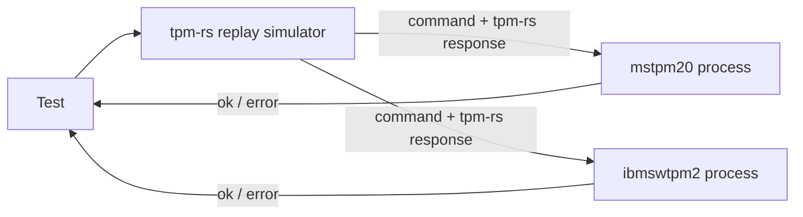

# Differential Testing (`tpm-rs` vs. C Reference TPMs `mstpm20` and `ibmswtpm2`)

This document describes how `tpm-rs` is differentially tested against two C reference TPMs, **`mstpm20`** and **`ibmswtpm2`**, and catalogs every behavioral, wire-format, validation and profile difference between the three implementations that the harness has to account for ([`testing/src/differential/mod.rs`](file:///usr/local/google/home/wenyuzhao/projects/tpm-rs/testing/src/differential/mod.rs), [`testing/src/differential/server.rs`](file:///usr/local/google/home/wenyuzhao/projects/tpm-rs/testing/src/differential/server.rs)). The [Methodology](#methodology) section explains which reference versions are used, how the three-way comparison works, what is checked and how the three implementations are made deterministic. Parts I-V describe `mstpm20`; Part VI describes what differs for `ibmswtpm2`.

Each catalogued item documents:
- **Classification**: one of
  - **Bug in `mstpm20`** / **Bug in `ibmswtpm2`**: a deviation of that reference from the specification, fixed in its patch;
  - **Implementation choice aligned with `mstpm20`**: the specification leaves the behavior open, and `tpm-rs` behaves like `mstpm20` (and, where stated, `ibmswtpm2`);
  - **Implementation-defined / profile difference**: a difference permitted by the specification (configuration, randomness, vendor-defined formats).
- **Test & Implementation Code**: links to the relevant `tpm-rs` code, tests, comparator rules and reference patch hunks.
- **TPM 2.0 Specification Quote & Explanation**: quotes from and links to the TCG TPM 2.0 Library Specification ([`part1.tcg.txt`](file:///usr/local/google/home/wenyuzhao/projects/tpm-rs/_agents/skills/tpm2-spec/resources/spec/part1.tcg.txt), [`part2.tcg.txt`](file:///usr/local/google/home/wenyuzhao/projects/tpm-rs/_agents/skills/tpm2-spec/resources/spec/part2.tcg.txt), [`part3.tcg.txt`](file:///usr/local/google/home/wenyuzhao/projects/tpm-rs/_agents/skills/tpm2-spec/resources/spec/part3.tcg.txt)) explaining what the specification requires.
- **Root Cause & Fix** (reference bugs) or **Resolution** (everything else).

Response codes are given as `NAME + position` with their numeric value. Format-1 codes are `0x080 + n`. A parameter position adds `0x040 | (N << 8)`, a handle position adds `N << 8`, and a session position adds `0x800 | (N << 8)`.

---

## Methodology

### M.1 Reference Implementations and Versions

| | `mstpm20` | `ibmswtpm2` |
|---|---|---|
| Implementation | TCG / Microsoft TPM 2.0 reference implementation | IBM software TPM (derived from the same Microsoft code, older layout) |
| Upstream | `https://github.com/TrustedComputingGroup/TPM` | `https://github.com/kgoldman/ibmswtpm2` |
| Pinned commit | `3b1f0e623f244abe2015df9e3ba86de5c9118524` | `e1df46e46fc2671e55372d65f27ecbb3c789d992` (tag `rev183-2026-08-26`) |
| Patch | [`testing/mstpm20.patch`](file:///usr/local/google/home/wenyuzhao/projects/tpm-rs/testing/mstpm20.patch) | [`testing/ibmswtpm2.patch`](file:///usr/local/google/home/wenyuzhao/projects/tpm-rs/testing/ibmswtpm2.patch) |
| Binary | [`testing/src/bin/mstpm20.rs`](file:///usr/local/google/home/wenyuzhao/projects/tpm-rs/testing/src/bin/mstpm20.rs) | [`testing/src/bin/ibmswtpm2.rs`](file:///usr/local/google/home/wenyuzhao/projects/tpm-rs/testing/src/bin/ibmswtpm2.rs) |
| Crypto library | OpenSSL (`HASH_LIB`/`SYM_LIB`/`BN_MATH_LIB = Ossl`, `MATH_LIB = TpmBigNum`) | OpenSSL (same settings) |

- **Build.** With the opt-in `differential` feature of `testing`, [`testing/build.rs`](file:///usr/local/google/home/wenyuzhao/projects/tpm-rs/testing/build.rs) clones each repository at its pinned commit, applies its patch, compiles it (`mstpm20`: the TPM library and simulator platform; `ibmswtpm2`: the `OBJFILES` of its Linux makefile without `TPMCmds.c`, the TCP server and `main()`), combines the objects with `ld -r` and localizes every symbol except the `difftest_*` entry points with `objcopy --keep-global-symbol`. The resulting `lib<name>.a` is linked into exactly one binary of the same name (`rustc-link-arg-bin`), so the two references, which share most C symbol names, never meet in one process. Both binaries share [`testing/src/bin/shared/ffi.rs`](file:///usr/local/google/home/wenyuzhao/projects/tpm-rs/testing/src/bin/shared/ffi.rs), the only `unsafe` FFI of the crate, and run [`testing::differential::server::serve`](file:///usr/local/google/home/wenyuzhao/projects/tpm-rs/testing/src/differential/server.rs).
- **Patches.** Every hunk of a patch is one of: a fix of a specification deviation of that reference (Parts II and VI, marked "spec deviation fix (not determinism)"), a profile setting (items 9 and 18), or determinism plumbing (M.4). Each hunk of `ibmswtpm2.patch` carries a `tpm-rs differential testing` comment.
- **Running.** `cargo test --release -p testing --features differential` builds both binaries and runs every E2E and Go parity test ([`testing/tests/`](file:///usr/local/google/home/wenyuzhao/projects/tpm-rs/testing/tests)) differentially. `DIFFERENTIAL_REFERENCES` (comma-separated `mstpm20`/`ibmswtpm2`, default both) selects the references; `MSTPM20_BIN`/`IBMSWTPM2_BIN` override the binary paths (default: next to the test executable, e.g. `target/release/mstpm20`). `DIFFERENTIAL_LOG_EXCEPTIONS` logs every applied exception and `TPM_RC_RETRY` re-issue on the reference processes' stderr. With both references, all 1054 E2E, 275 Go parity and 11 library tests pass.

### M.2 Three-Way Differential Comparison

- **One process per TPM and reference.** Every [`testing::tpm::Tpm`](file:///usr/local/google/home/wenyuzhao/projects/tpm-rs/testing/src/tpm.rs) is a `tpm-rs` replay simulator plus one child process per enabled reference (`testing::differential::References`). The C references keep their state in globals, so a process per `Tpm` lets tests run in parallel and a single test use several TPMs. Each reference process is initialized like a new `Tpm`: manufactured with fresh RAM-backed NV, powered on, NV on, and `TPM2_Startup(TPM_SU_CLEAR)` done.
- **`tpm-rs` is the pivot.** Every interaction is executed by `tpm-rs` first; then the interaction and, for commands, the `tpm-rs` response are sent to every reference over its stdin/stdout pipe ([`protocol.rs`](file:///usr/local/google/home/wenyuzhao/projects/tpm-rs/testing/src/differential/protocol.rs): length-prefixed `Exchange`/`AdvanceClock`/`Signal`/`HashStart`/`HashData`/`HashEnd` requests, one ok/error reply each; each reference process points fd 1 at stderr so C output cannot corrupt the channel). All references receive the request before any reply is awaited, so they work concurrently.
- **Comparison happens in the reference process.** Each reference executes the command and compares its own response with the `tpm-rs` response. Because both references are compared with the same `tpm-rs` response, agreement of both comparisons means all three implementations agree; with one reference selected, the comparison is two-way.
- **Failure.** Any undocumented difference (or an interaction the reference does not support) is an error reply, and the test panics at the diverging interaction, reporting the errors of every reference. The test itself always continues with the `tpm-rs` response, so the same test suite serves as both the `tpm-rs` E2E tests and the differential tests.

### M.3 What Is Checked

- **Commands (`Exchange`).** The command bytes the test sent to `tpm-rs` are executed by the reference at the same locality, and the reference's response must be **byte-identical** to the `tpm-rs` response. This covers the entire response: tag, `responseSize`, response code (including the handle/parameter/session position of an error), response handles, `parameterSize`, every response parameter and the authorization area (`nonceTPM`, `sessionAttributes` and the response HMAC or policy acknowledgment). The comparison therefore also verifies everything a response is derived from: cpHash/rpHash, session HMAC keys, parameter encryption, audit digests, tickets, Names, unique fields, attestation structures and signatures. Error responses are compared exactly like successful ones. Commands that `tpm-rs` rejects at the transport level (e.g. an oversized buffer) are not mirrored.
- **Command translation.** The command is sent unchanged, with two exceptions that never fabricate a result: transient handles that legitimately differ are translated from `tpm-rs` to reference handles (Rule 11), and a `TPM2_ContextLoad` blob that is byte-identical to one `tpm-rs` returned earlier is replaced by the blob the reference returned for the same `TPM2_ContextSave` (Rule 1). Tampered, truncated or foreign blobs are passed unchanged.
- **Platform signals, `_TPM_Hash_*` indications and clock advances.** These produce no response; they are delivered to every reference (power on/off, reset, NV on/off, physical presence, cancel) and their effect is checked by the responses of later commands. Transport-only signals (key cache, session end, stop, response sizes, ACT) are ignored; `Restart`, `TestFailureMode`, `SetFirmwareHash` and `SetFirmwareSvn` have no reference equivalent and fail the test.
- **Tolerated differences.** Only the narrowly keyed, implementation-defined exceptions of [Part IV](#part-iv-implementation-defined-behaviors-harness-exceptions) and the `TPM_RC_RETRY` re-issue are accepted. Every exception requires the same command code, a specific condition and response-code pair, and checks every response field it does not explicitly exempt.
- **Adopted values.** Values that are random by definition and cannot be pinned on the reference side are adopted from the `tpm-rs` response, but only after the reference has verified them (M.4.5).

### M.4 Determinism: Randomness and Time

Byte-identical comparison requires all three implementations to draw the same random values and see the same time, and `tpm-rs` to give the same response on every run. The opt-in `reproducible` cargo feature of `tpm2-crypto-bssl`, `tpm2-platform-linux` and `tpm2-simulator` (enabled by `testing`) adds the hooks for this, and [`create_replay_simulator!([seed])`](file:///usr/local/google/home/wenyuzhao/projects/tpm-rs/crates/tpm2-simulator/src/lib.rs) uses them to pin every source of nondeterminism of a simulator. The feature is purely additive: `create_simulator!()`, `LinuxRng::new`, `LinuxTimer::new` and the crypto provider outside a pinned scope still use OS entropy and the wall clock. Each `testing::tpm::Tpm` is such a simulator with seed `DEFAULT_REPLAY_SEED`.

The references share the platform RNG stream (the comparison server seeds its own `LinuxRng::seeded(DEFAULT_REPLAY_SEED)`, [`server.rs`](file:///usr/local/google/home/wenyuzhao/projects/tpm-rs/testing/src/differential/server.rs)) and the virtual clock. Values drawn from the crypto stream are adopted from `tpm-rs` and verified by the reference (M.4.5).

#### M.4.1 Platform RNG

- **Pinned by**: [`LinuxRng::seeded(seed)`](file:///usr/local/google/home/wenyuzhao/projects/tpm-rs/crates/tpm2-platforms/linux/src/lib.rs), a ChaCha20 stream seeded with the simulator seed. It is the `TpmPlatform::rng` of `tpm2-impl`. The patches route the corresponding reference draws to the same stream.
- **Values and the commands they affect**:

  | Value drawn | Where (`tpm2-impl`) | TPM commands whose responses depend on it |
  |---|---|---|
  | EPS, SPS, PPS, phProof, shProof, ehProof (64 bytes each, at manufacture) | `engine.rs` `init_storage` | `TPM2_CreatePrimary` and primary `TPM2_CreateLoaded` (keys, `unique`, `seedValue`, Name) in each hierarchy; every ticket (creation tickets of `TPM2_Create`/`TPM2_CreatePrimary`/`TPM2_CreateLoaded`, `TPM2_Hash`/`TPM2_SequenceComplete` validation tickets, `TPM2_VerifySignature` tickets, `TPM2_PolicySigned`/`TPM2_PolicySecret` timeout tickets); `TPM2_ContextSave` blobs (context integrity and encryption); obfuscated `resetCount`/`restartCount`/`firmwareVersion` in attestations (`TPM2_Quote`, `TPM2_Certify`, `TPM2_CertifyCreation`, `TPM2_GetTime`, `TPM2_GetSessionAuditDigest`, `TPM2_GetCommandAuditDigest`, `TPM2_NV_Certify`) |
  | New seeds and proofs | `change_eps.rs`, `change_pps.rs`, `clear.rs` | `TPM2_ChangeEPS`, `TPM2_ChangePPS`, `TPM2_Clear`, then everything listed in the row above for the affected hierarchy |
  | `nullSeed`, `nullProof`, `commitNonce` (at TPM Reset) | `startup.rs` | `TPM2_Startup`, then primaries under `TPM_RH_NULL`, NULL-hierarchy tickets and `TPM2_ContextSave` blobs of sessions and NULL-hierarchy objects, `TPM2_Commit` (`K`, `L`, `E`) and the `r` of later ECDAA signatures |
  | CTR_DRBG state (instantiated or reseeded at `TPM2_Startup`) | `startup.rs`, `engine.rs` `DrbgState` | No response; only the persisted NV image (`go.drbgState`) |
  | Initial `nonceTPM` of a session | `session.rs` | `TPM2_StartAuthSession`, and the HMACs and parameter encryption of every command that uses the session |
  | Random bytes | `random.rs` | `TPM2_GetRandom` (`TPM2_StirRandom` does not perturb the stream) |
  | Outer-wrap IV of `TPM2B_PRIVATE` | `create_loaded.rs` `encrypt_sensitive_area` | `outPrivate` of `TPM2_Create`, ordinary `TPM2_CreateLoaded`, `TPM2_Import`, `TPM2_ObjectChangeAuth` |

#### M.4.2 Crypto Provider RNG (BoringSSL Backend Only)

- **Pinned by**: [`Simulator::pin_crypto_rng`](file:///usr/local/google/home/wenyuzhao/projects/tpm-rs/crates/tpm2-simulator/src/lib.rs), called with `seed ^ REPLAY_CRYPTO_SEED_TWEAK`, so this stream differs from the platform RNG. It installs a per-simulator [`tpm2_crypto_bssl::replay::ReplayRng`](file:///usr/local/google/home/wenyuzhao/projects/tpm-rs/crates/tpm2-crypto/bssl/src/lib.rs) (re-exported as `tpm2_platform_linux::CryptoReplayRng`) only while that simulator executes a command or signal (`Simulator::in_tpm_scope`). Client-side crypto and other simulators on the same thread neither consume nor perturb it. Only BoringSSL routes all its output-affecting randomness through this hook, so `testing` supports only `bssl`.
- **Values drawn by `tpm2-impl` through `CryptoProvider::get_random`**:

  | Value drawn | Where (`tpm2-impl`) | TPM commands whose responses depend on it |
  |---|---|---|
  | New `nonceTPM` of every session in a response | `engine.rs` (response session processing) | Every command with an authorization, audit or encrypt session (response `nonceTPM`, response HMAC, encrypted response parameter) |
  | TPM-generated SYMCIPHER/KEYEDHASH key (`sensitiveDataOrigin` SET) of ordinary objects | `handler/mod.rs` `generate_symmetric_key`, `generate_keyed_hash_key` | `TPM2_Create`, ordinary `TPM2_CreateLoaded` (`outPrivate`, `unique`, Name) |
  | `seedValue` of ordinary objects | `create_loaded.rs` | `TPM2_Create`, ordinary `TPM2_CreateLoaded` (`outPrivate`; `unique` and Name of SYMCIPHER/KEYEDHASH objects) |
  | Inner wrapper key when `encryptionKeyIn` is empty | `duplicate.rs` | `TPM2_Duplicate` (`encryptionKeyOut`, `duplicate`) |
  | Seed for an RSA protector (`CryptSecretEncrypt`) | `duplicate.rs`, `rewrap.rs` `crypt_secret_encrypt` | `TPM2_Duplicate`, `TPM2_Rewrap` (`outSymSeed`, `duplicate`), `TPM2_MakeCredential` (`secret`, `credentialBlob`) |
  | ECDAA nonce `k` | `commit.rs` `ecdaa_sign` | `TPM2_Sign` and the attestation commands above with an ECDAA key |

- **Values drawn inside the BoringSSL backend**:

  | Value drawn | Where (`tpm2-crypto-bssl`) | TPM commands whose responses depend on it |
  |---|---|---|
  | RSA key-generation seed (32 bytes, then deterministic prime search) | `bssl.rs` `rsa_generate_key` | `TPM2_Create`, ordinary `TPM2_CreateLoaded` with RSA keys. Primary and derived keys pass their own KDF seed and are deterministic anyway. |
  | ECC private scalar | `asymmetric.rs` `ecc_generate_key` (`BsslRng`) | `TPM2_Create`, ordinary `TPM2_CreateLoaded` with ECC keys; ephemeral keys of `TPM2_ECDH_KeyGen` (`zPoint`, `pubPoint`) and of ECC protectors in `TPM2_Duplicate`, `TPM2_Rewrap`, `TPM2_MakeCredential` (`outSymSeed`/`secret`) |
  | ECDSA nonce | `bssl.rs` `ecdsa_sign` | `TPM2_Sign` and the attestation commands above with an ECDSA key |
  | RSA-PSS salt | `bssl.rs` `rsa_sign_pss` | `TPM2_Sign` and the attestation commands above with an RSAPSS key |
  | RSA-OAEP and PKCS#1 v1.5 (RSAES) encryption padding | `bssl.rs` `oaep`, `pkcs1v15_type2` | `TPM2_RSA_Encrypt`; RSA protectors in `TPM2_Duplicate`, `TPM2_Rewrap`, `TPM2_MakeCredential` |

- **Not pinned**: randomness that does not affect any output, such as RSA blinding, always comes from BoringSSL's RNG. RSASSA and HMAC signatures, derived objects and all KDF outputs are deterministic and need no pinning.

#### M.4.3 Clock

- **Pinned by**: [`LinuxTimer::new_virtual`](file:///usr/local/google/home/wenyuzhao/projects/tpm-rs/crates/tpm2-platforms/linux/src/lib.rs). The clock starts at 0 ms and moves only through `Simulator::advance_clock`. In `testing` that happens through `_common::sleep`, which advances the virtual clocks of `tpm-rs` and every reference together (`AdvanceClock`); no wall-clock time passes. The patches replace the references' clock with the same virtual clock and their entropy source with a deterministic one.
- **Commands affected**: `time`/`clock` (`TPMS_TIME_INFO`, `TPMS_CLOCK_INFO`) in `TPM2_ReadClock`, `TPM2_GetTime` and every attestation; ticket expiration in `TPM2_PolicySigned`, `TPM2_PolicySecret` and `TPM2_PolicyTicket`; `TPM2_PolicyCounterTimer`; dictionary-attack self-healing and `lockoutRecovery`.

#### M.4.4 Client-Side Randomness of the Tests

This is not TPM randomness. It keeps the *commands* a test sends identical across runs. The first `Tpm` created on a thread calls `tpm2_platform_linux::set_crypto_thread_default_seed(Some(CLIENT_SEED))` ([`tpm.rs`](file:///usr/local/google/home/wenyuzhao/projects/tpm-rs/testing/src/tpm.rs)). Outside a simulator's scope, that thread's BoringSSL randomness, and therefore `_common::CLIENT_CRYPTO`/`_common::client_rng()`, comes from this seeded stream. This pins `nonceCaller`, salts and `encryptedSalt` of `TPM2_StartAuthSession`, client-generated keys for `TPM2_LoadExternal`/`TPM2_Import`, client-side duplication blobs and signatures for `TPM2_PolicySigned`/`TPM2_VerifySignature`. Tests must not use `OsRng`/`thread_rng`.

#### M.4.5 Values Adopted from `tpm-rs` and Verified by the References

Two correct TPMs differ in their random values. Where a reference draw cannot be routed to a shared stream (the crypto RNG of M.4.2 is internal to BoringSSL), the comparison server ([`server.rs` `prepare_for_command`](file:///usr/local/google/home/wenyuzhao/projects/tpm-rs/testing/src/differential/server.rs)) hands the reference the random *input* taken from the `tpm-rs` response (only on `TPM_RC_SUCCESS`), and the patched reference verifies it before using it. The same hunks exist in both patches (item 19 lists the `ibmswtpm2` files).

| Value | Verification by the reference |
|---|---|
| Session `nonceTPM` | Random by definition. |
| RSA primes of primary/ordinary keys | `CryptRsaLoadPrivateExponent`, and `p` divides `n`. Prime generation is vendor-specific; Part 1 "Entropy for Primary Objects": "Choice of the entropy generation for Primary Objects is a vendor option". |
| ECC private scalar `d`, TPM-generated symmetric/keyed-hash key and `seedValue` of primary/ordinary objects | The reference recomputes `Q = d·G`, the unique field and the Name. Ordinary objects are unwrapped from `tpm-rs`'s `outPrivate` under the reference's own parent and re-wrapped by the reference, so `outPublic`/`outPrivate` are compared. |
| ECDSA/EC-Schnorr/RSA-PSS signatures | Adopted only if the reference verifies them with its key and digest. |
| ECDAA nonce `k` | Range-checked `0 < k < n`; the reference computes `T` and `s` itself. |
| `CryptSecretEncrypt` secrets | Adopted only if the reference decrypts them with the private key. |
| Duplicate inner symmetric key (`encryptionKeyOut`) | Random input; the reference computes the blob. |
| `ECDH_KeyGen` point pair | Only if the reference checks `Z = [d]·pub`. |
| `RSA_Encrypt` ciphertext | Only if the reference decrypts it back to the message. |

- **Always computed by the reference and compared:** derived objects, deterministic signatures (RSASSA, HMAC), `Duplicate`/`Rewrap`/`MakeCredential` blobs, names, unique fields, tickets, context integrity, and every operation on a public-only key.
- **Encrypted responses:** to adopt a value from an encrypted `tpm-rs` response, the patch's `difftest_decrypt_recorded_response_2b` uses `s_encryptSessionIndex`. Upstream resets that index (and the decrypt/audit indices) only for commands that have sessions, so a command without sessions would see a stale index (or, in a freshly started TPM, the zero-initialized global, making `SessionGet` enter failure mode). Both patches therefore also reset the three indices in `CheckAuthNoSession`.
- **Other determinism hunks:** `Manufacture.c` zeroing, the RSA prime-search skip for injected keys, and the ticket `timeEpoch` hashed as a 64-bit value (an "implementation-specific representation" per Part 2 `TPMT_TK_AUTH` and Part 3 `TPM2_PolicySigned`).

---

## Summary Table

| # | Item | Classification | Resolution |
|---|-------------|----------------|------------|
| 1 | [`ivOut` tail bytes after a partial CFB block](#1-ivout-tail-bytes-after-a-partial-cfb-block) | **Implementation choice aligned with `mstpm20`** | `encrypt_decrypt.rs` |
| 2 | [KDFe `PartyUInfo`/`PartyVInfo` for unpadded ECC coordinates](#2-kdfe-partyuinfopartyvinfo-for-unpadded-ecc-coordinates) | **Implementation choice aligned with `mstpm20`** | `session.rs`, `duplicate.rs`, `import.rs`, `rewrap.rs` |
| 3 | [Check order and response codes in `TPM2_Commit`, `TPM2_PolicySigned` and `TPM2_HMAC_Start`](#3-check-order-and-response-codes-in-tpm2_commit-tpm2_policysigned-and-tpm2_hmac_start) | **Implementation choice aligned with `mstpm20`** | `commit.rs`, `policy_signed.rs`, `sequence.rs` |
| 4 | [`lockoutAuth` use and the "DA-protected object used" flag](#4-lockoutauth-use-and-the-da-protected-object-used-flag) | **Implementation choice aligned with `mstpm20`** | `engine.rs` |
| 5 | [Command audit and `TPM2_SetCommandCodeAuditStatus`](#5-command-audit-and-tpm2_setcommandcodeauditstatus) | **Implementation choice aligned with `mstpm20`** | `command_audit.rs`, `set_command_code_audit_status.rs`, `engine.rs` |
| 6 | [Unique field of restricted symmetric parents](#6-unique-field-of-restricted-symmetric-parents) | **Bug in `mstpm20`** | Patched in `mstpm20.patch` (`CryptUtil.c`) |
| 7 | [`TPMU_NAME` struct padding accepting 67/68-byte names](#7-tpmu_name-struct-padding-accepting-6768-byte-names) | **Bug in `mstpm20`** | Patched in `mstpm20.patch` (`TpmTypes.h`) |
| 8 | [`VENDOR_PERMANENT_AUTH_HANDLE` missing `break` and missing platform function](#8-vendor_permanent_auth_handle-missing-break-and-missing-platform-function) | **Bug in `mstpm20`** | Patched in `mstpm20.patch` (`Entity.c`, `Startup.c`) |
| 9 | [Profile configuration of `mstpm20`](#9-profile-configuration-of-mstpm20) | **Profile difference** | `#define`s in `mstpm20.patch` |
| 10 | [Implementation-defined behaviors (harness exceptions)](#part-iv-implementation-defined-behaviors-harness-exceptions) | **Implementation-defined** | Rules 1-11 and RETRY in `server.rs` |
| 11 | [Open issues](#part-v-open-issues) | — | Documented |
| 12 | [`ibmswtpm2`: upstream bugs shared with `mstpm20`](#12-upstream-bugs-shared-with-mstpm20) | **Bug in `ibmswtpm2`** | Patched in `ibmswtpm2.patch` (`TpmTypes.h`, `CryptUtil.c`, `Entity.c`, `StartupCommands.c`) |
| 13 | [`ibmswtpm2`: unknown command tag reported as `TPM_RC_VALUE`](#13-unknown-command-tag-reported-as-tpm_rc_value) | **Bug in `ibmswtpm2`** | Patched in `ibmswtpm2.patch` (`Unmarshal.c`) |
| 14 | [`ibmswtpm2`: `TPMS_NV_PUBLIC.nvIndex` accepting external and permanent NV handles](#14-tpms_nv_publicnvindex-accepting-external-and-permanent-nv-handles) | **Bug in `ibmswtpm2`** | Patched in `ibmswtpm2.patch` (`Unmarshal.c`) |
| 15 | [`ibmswtpm2`: `TPMI_RSA_KEY_BITS` ignoring the profile](#15-tpmi_rsa_key_bits-ignoring-the-profile) | **Bug in `ibmswtpm2`** | Patched in `ibmswtpm2.patch` (`Unmarshal.c`) |
| 16 | [`ibmswtpm2`: wrong response-code positions](#16-wrong-response-code-positions) | **Bug in `ibmswtpm2`** | Patched in `ibmswtpm2.patch` (7 `*_fp.h`) |
| 17 | [`ibmswtpm2`: sequence objects saved with hierarchy `0`](#17-sequence-objects-saved-with-hierarchy-0) | **Bug in `ibmswtpm2`** | Patched in `ibmswtpm2.patch` (`Object.c`) |
| 18 | [`ibmswtpm2`: profile configuration](#18-profile-configuration-of-ibmswtpm2) | **Profile difference** | `#define`s and platform tables in `ibmswtpm2.patch` |
| 19 | [`ibmswtpm2`: determinism plumbing and aligned implementation choices](#19-determinism-plumbing-and-aligned-implementation-choices) | **Implementation-defined**; **aligned with `mstpm20`** | `ibmswtpm2.patch` |
| 20 | [`ibmswtpm2`: harness exceptions](#20-harness-exceptions-for-ibmswtpm2) | **Implementation-defined** | No `ibmswtpm2`-specific rule; shared rules of Part IV |

---

## Part I: Implementation Choices Aligned with `mstpm20`

The `tpm-rs` behaviors below are not dictated by the specification; `tpm-rs` follows `mstpm20`. `ibmswtpm2` derives from the same upstream code and behaves identically (it passes the same tests without an `ibmswtpm2`-specific rule, item 20), except where noted.

### 1. `ivOut` Tail Bytes After a Partial CFB Block

- **Classification**: **Implementation choice aligned with `mstpm20`** (and `ibmswtpm2`).
- **Test & Implementation Code**: [`encrypt_decrypt.rs`](file:///usr/local/google/home/wenyuzhao/projects/tpm-rs/crates/tpm2-impl/src/handler/encrypt_decrypt.rs#L223); test file `go::symmetric_encryption`.
- **TPM 2.0 Specification Quote & Explanation**: [Part 3, Table 61 (CFB)](file:///usr/local/google/home/wenyuzhao/projects/tpm-rs/_agents/skills/tpm2-spec/resources/spec/part3.tcg.txt#L4671-L4679): "*ivOut* will be the size of a cipher block". The content of the unused tail after a partial block is not specified. `mstpm20` `CryptSymmetricEncrypt/Decrypt` zero-fills it (`CryptSym.c:199-216, 348-365`), which also avoids returning unused keystream bytes.
- **Resolution**: `tpm-rs` zero-fills the tail bytes of `ivOut` after a partial CFB block.

---

### 2. KDFe `PartyUInfo`/`PartyVInfo` for Unpadded ECC Coordinates

- **Classification**: **Implementation choice aligned with `mstpm20`** (and `ibmswtpm2`; non-conforming input).
- **Test & Implementation Code**: [`session.rs`](file:///usr/local/google/home/wenyuzhao/projects/tpm-rs/crates/tpm2-impl/src/handler/session.rs#L380-L381), `duplicate.rs`, `import.rs`, `rewrap.rs`; test `e2e::activate_credential::stripped_ecc_protector_and_error_codes`.
- **TPM 2.0 Specification Quote & Explanation**: [Part 1, §33.6.3 Padding](file:///usr/local/google/home/wenyuzhao/projects/tpm-rs/_agents/skills/tpm2-spec/resources/spec/part1.tcg.txt#L17000-L17040): "An `TPMS_ECC_POINT` representing an actual ECC point … MUST be padded … when it is provided to the TPM", and a `TPM2B_PUBLIC` point "SHOULD be padded". With conforming input, padded and raw coordinates are identical. For an unpadded coordinate the KDFe input is not defined. `mstpm20` passes the `TPM2B` bytes as received (`CryptUtil.c:608-614, 753-759`).
- **Resolution**: `tpm-rs` passes the coordinate bytes as received (`Z` stays padded to the curve size), for interoperability with `mstpm20` and `ibmswtpm2`.

---

### 3. Check Order and Response Codes in `TPM2_Commit`, `TPM2_PolicySigned` and `TPM2_HMAC_Start`

- **Classification**: **Implementation choice aligned with `mstpm20`** (and `ibmswtpm2`).
- **Test & Implementation Code**: [`commit.rs`](file:///usr/local/google/home/wenyuzhao/projects/tpm-rs/crates/tpm2-impl/src/handler/commit.rs#L221), [`policy_signed.rs`](file:///usr/local/google/home/wenyuzhao/projects/tpm-rs/crates/tpm2-impl/src/handler/policy_signed.rs#L182), [`sequence.rs`](file:///usr/local/google/home/wenyuzhao/projects/tpm-rs/crates/tpm2-impl/src/handler/sequence.rs#L458); tests `e2e::commit`, `e2e::policy_signed::policy_signed_rejects_symmetric_auth_object`, `e2e::sequence_hmac::hmac_start_attributes_checked_before_hash`.
- **TPM 2.0 Specification Quote & Explanation**: [Part 3, §5.1](file:///usr/local/google/home/wenyuzhao/projects/tpm-rs/_agents/skills/tpm2-spec/resources/spec/part3.tcg.txt#L371-L375): "Unless stated otherwise, the order of the checks is not normative and different TPM may give different responses when a command has multiple errors". The `TPM2_PolicySigned` response code for a non-signing `authObject` is not specified.
- **Resolution**: `tpm-rs` follows `mstpm20`:
  - **`TPM2_Commit`** checks `(s2.size == 0) != (y2.size == 0)` first (`TPM_RC_SIZE + P3`).
  - **`TPM2_PolicySigned`** with a symmetric `authObject` returns `TPM_RC_SCHEME + P5` (`0x5D2`, `mstpm20` `CryptValidateSignature`).
  - **`TPM2_HMAC_Start`** checks key type, `restricted`, `sign`, then `hashAlg`. This TPM implements `TPM2_HMAC_Start` (no CMAC, `CC_HMAC_Start = !ALG_CMAC`), whose `mstpm20` implementation is `HMAC_Start.c`.

---

### 4. `lockoutAuth` Use and the "DA-Protected Object Used" Flag

- **Classification**: **Implementation choice aligned with `mstpm20`** (and `ibmswtpm2` with its `USE_DA_USED = YES` profile setting, item 18).
- **Test & Implementation Code**: [`engine.rs` `check_da_lockout`, `register_da_failure`](file:///usr/local/google/home/wenyuzhao/projects/tpm-rs/crates/tpm2-impl/src/engine.rs#L3416); test `e2e::dictionary_attack::unorderly_reset_counts_failure`.
- **TPM 2.0 Specification Quote & Explanation**: [Part 1, Non-orderly Shutdown](file:///usr/local/google/home/wenyuzhao/projects/tpm-rs/_agents/skills/tpm2-spec/resources/spec/part1.tcg.txt#L8063-L8083): "An alternative implementation sets an NV flag indicating that access to a DA protected object occurred during this boot cycle. After a non-orderly restart, if the flag is set, the TPM increments *failedTries*". `lockoutAuth` is governed by `lockoutRecovery`, not by `failedTries`.
- **Resolution**: as in `mstpm20` `CheckLockedOut()`/`IncrementLockout()`, only accesses to `failedTries`-governed entities set the flag. A lockout-only boot followed by an unorderly reset does not increment `failedTries`; use of a DA-protected object does.

---

### 5. Command Audit and `TPM2_SetCommandCodeAuditStatus`

- **Classification**: **Implementation choice aligned with `mstpm20`** (and `ibmswtpm2`).
- **Test & Implementation Code**: [`command_audit.rs`](file:///usr/local/google/home/wenyuzhao/projects/tpm-rs/crates/tpm2-impl/src/command_audit.rs), [`set_command_code_audit_status.rs`](file:///usr/local/google/home/wenyuzhao/projects/tpm-rs/crates/tpm2-impl/src/handler/set_command_code_audit_status.rs), [`get_command_audit_digest.rs`](file:///usr/local/google/home/wenyuzhao/projects/tpm-rs/crates/tpm2-impl/src/handler/get_command_audit_digest.rs), [`capability.rs`](file:///usr/local/google/home/wenyuzhao/projects/tpm-rs/crates/tpm2-impl/src/handler/capability.rs) (`TPM_CAP_AUDIT_COMMANDS`), [`engine.rs`](file:///usr/local/google/home/wenyuzhao/projects/tpm-rs/crates/tpm2-impl/src/engine.rs) (`execute_command`, `save_hierarchy_auths`, `save_state_data`); tests `e2e::set_command_code_audit_status`, `tpm2-impl` `command_audit::tests`, `tests/command_audit_tests.rs`.
- **TPM 2.0 Specification Quote & Explanation**:
  - [Part 1, Command Audit](file:///usr/local/google/home/wenyuzhao/projects/tpm-rs/_agents/skills/tpm2-spec/resources/spec/part1.tcg.txt#L12640-L12717): the digest is updated "when the command completes successfully and the response has been created" as `H_auditAlg(audit_old || cpHash || rpHash)`; "If the audit digest register contains all octets of zero when an audit event is recorded, then a new audit log is being created and the audit counter is incremented"; the counter "is reset to zero by TPM2_Clear()"; the register "is preserved over any orderly shutdown" and "is reset by a `TPM2_SetCommandCodeAuditStatus()` that changes the audit digest algorithm".
  - [Part 3, TPM2_SetCommandCodeAuditStatus](file:///usr/local/google/home/wenyuzhao/projects/tpm-rs/_agents/skills/tpm2-spec/resources/spec/part3.tcg.txt#L7862-L7936): the algorithm and the list cannot change together; `setList` is processed before `clearList`; unimplemented or unaudited commands are not an error; `TPM_CC_SetCommandCodeAuditStatus` in `clearList` is ignored, and changing the algorithm is not audited. `TPM2_Shutdown()` cannot be audited ([Part 3, Command Audit](file:///usr/local/google/home/wenyuzhao/projects/tpm-rs/_agents/skills/tpm2-spec/resources/spec/part3.tcg.txt#L7851-L7856)).
  - The initial list, the response code for an algorithm change with a non-empty list, and when NV must be available are not specified; `tpm-rs` follows `mstpm20` `SetCommandCodeAuditStatus.c`, `CommandAudit.c` and `SessionProcess.c`.
- **Resolution**:
  - **State.** `gp.auditCommands` (a bitmap over the implemented command codes), `gp.auditHashAlg` and `gp.auditCounter` are persistent. They are written to NV as a marked record of the hierarchy-auth NV blob (`AUDIT_EXT_MARKER`), and the `transcoder` maps them to `gp` offsets `758..792` of the `s_NV` image. At manufacture only `TPM2_SetCommandCodeAuditStatus` is audited, the algorithm is SHA-512 and the counter is zero (`CommandAuditPreInstall_Init`). `gr.commandAuditDigest` is saved with the `TPM2_Shutdown(TPM_SU_STATE)` data, kept on TPM Restart/Resume and cleared on TPM Reset (`CommandAuditStartup`).
  - **`TPM2_SetCommandCodeAuditStatus`** (`TPMI_RH_PROVISION` auth, `NV` attribute): an `auditAlg` that is not an implemented hash is `TPM_RC_HASH + P1` (`0x1C3`); `TPM_RC_NV_UNAVAILABLE` without NV; a new `auditAlg` with a non-empty `setList` or `clearList` is `TPM_RC_VALUE + P1` (`0x1C4`); otherwise a new algorithm is stored and the digest cleared without auditing this execution, or the lists are applied (unimplemented codes and `TPM2_Shutdown` are ignored, `0x140` is never removed). `TPM2_PP_Commands` is not implemented, so the physical-presence list (`TPM_CAP_PP_COMMANDS`) is empty and never required.
  - **Auditing.** For an audited command the engine computes the `cpHash` with `auditHashAlg` after authorization and before parameter decryption (`CheckCommandAudit`), failing with `TPM_RC_NV_UNAVAILABLE` if NV is unavailable while the digest is empty or the command is `TPM2_GetCommandAuditDigest`. After a successful response it hashes the response parameter area as sent into the `rpHash` and extends the digest, starting a new log (zeroed digest, counter incremented and written to NV) when the digest is empty (`CommandAudit`). `TPM2_GetCommandAuditDigest` reports `auditHashAlg`, the counter, the digest and `commandDigest`, the hash of the audited command codes in ascending order (`CommandAuditGetDigest`); a signed report then clears the digest, so its own audit (if audited) and the next audited command start a new log.
  - **Capabilities.** `TPM_CAP_AUDIT_COMMANDS` lists the audited commands from `property` on, with `moreData` as in `CommandAuditCapGetCCList`. `TPM_CAP_COMMANDS` and `TPM_PT_TOTAL_COMMANDS`/`TPM_PT_LIBRARY_COMMANDS` include `TPM2_SetCommandCodeAuditStatus` (`TPMA_CC` `0x02400140`).

---

## Part II: Bugs in `mstpm20` (Fixed in `testing/mstpm20.patch`)

These are the only specification-deviation hunks in the patch. Items 6 and 7 are marked "C-ref spec deviation fix (not determinism)". `tpm-rs` follows the specification in each case.

### 6. Unique Field of Restricted Symmetric Parents

- **Classification**: **Bug in `mstpm20`**.
- **Test & Implementation Code**: [`mstpm20.patch`](file:///usr/local/google/home/wenyuzhao/projects/tpm-rs/testing/mstpm20.patch) (`CryptUtil.c` `CryptComputeSymmetricUnique`).
- **TPM 2.0 Specification Quote & Explanation**: [Part 1, Public Area Creation](file:///usr/local/google/home/wenyuzhao/projects/tpm-rs/_agents/skills/tpm2-spec/resources/spec/part1.tcg.txt#L10662-L10686): for `TPM_ALG_KEYEDHASH` and `TPM_ALG_SYMCIPHER`, *unique* := **H**$_{nameAlg}$(*obfuscate* ∥ *key*).
- **Root Cause**: `mstpm20` uses an HMAC keyed with `seedValue` when `restricted && decrypt` (`CryptUtil.c:1040-1051`).
- **Fix**: the patch applies the spec formula.

---

### 7. `TPMU_NAME` Struct Padding Accepting 67/68-Byte Names

- **Classification**: **Bug in `mstpm20`**.
- **Test & Implementation Code**: [`mstpm20.patch`](file:///usr/local/google/home/wenyuzhao/projects/tpm-rs/testing/mstpm20.patch) (`TpmTypes.h`); tests `oversized_name_rejected`, `policy_duplication_select_rejects_oversized_name`.
- **TPM 2.0 Specification Quote & Explanation**: Part 2 `TPM2B_NAME`: `name[size]{:sizeof(TPMU_NAME)}` with `TPMU_NAME = {TPMT_HA digest; TPM_HANDLE handle}`, so the maximum is 2 + 64 = 66 octets with SHA-512.
- **Root Cause**: the 4-byte alignment of the `TPM_HANDLE` member pads the C union to 68 bytes, so `TPM2B_NAME_Unmarshal` (`Marshal.c:1802`) accepts 67- and 68-byte names. `tpm-rs` returns `TPM_RC_SIZE + P1` (`0x1D5`).
- **Fix**: the member is declared as `BYTE[sizeof(TPM_HANDLE)]`.

---

### 8. `VENDOR_PERMANENT_AUTH_HANDLE` Missing `break` and Missing Platform Function

- **Classification**: **Bug in `mstpm20`** (only in the `VENDOR_PERMANENT_AUTH_ENABLED` profile used here, because `tpm-rs` implements `TPM_RH_AUTH_00`).
- **Test & Implementation Code**: [`mstpm20.patch`](file:///usr/local/google/home/wenyuzhao/projects/tpm-rs/testing/mstpm20.patch) (`Entity.c`, `Startup.c`); test `e2e::startup::platform_unique_and_auth_00_handle`.
- **TPM 2.0 Specification Quote & Explanation**: [Part 1, Permanent Resource Handles](file:///usr/local/google/home/wenyuzhao/projects/tpm-rs/_agents/skills/tpm2-spec/resources/spec/part1.tcg.txt#L3995-L4003): a vendor-specific authorization value "can be used as a bind value within an authorization session or to authorize a policy".
- **Root Cause**: in `EntityGetAuthValue` (`Entity.c:210-218`), the `VENDOR_PERMANENT_AUTH_HANDLE` case falls through into `FAIL(FATAL_ERROR_INTERNAL)`, and `Startup.c` calls a non-existent `_plat__GetUniqueAuth`.
- **Fix**: add the `break` and use `_plat__GetUnique`.

---

## Part III: Profile Configuration of `mstpm20`

### 9. Profile Configuration of `mstpm20`

- **Classification**: **Profile difference** (`#define` only).
- **Test & Implementation Code**: [`mstpm20.patch`](file:///usr/local/google/home/wenyuzhao/projects/tpm-rs/testing/mstpm20.patch) (`TpmProfile_*.h`, `TpmBuildSwitches.h`, `PlatformPcr.c`).
- **Settings**:

  | Setting | Value | Reason |
  |---|---|---|
  | `MAX_LOADED_OBJECTS` | 16 | `tpm-rs` `TPM2_MAX_LOADED_OBJECTS` (also determines `TRANSIENT_LAST`). |
  | Algorithms | +SHA-512; no Camellia, CMAC, SM2, SM4, EC-Schnorr, ECMQV, RSA-3072/4096, P-192, BN-P638, SM2-P256 | The set `tpm-rs` implements (so the context-integrity hash is SHA-512, and `0x15B` is `TPM2_HMAC_Start`). |
  | Commands | `CC_NO` for the 14 commands `tpm-rs` lacks (`ECC_Decrypt`, `ECC_Encrypt`, `EC_Ephemeral`, `ZGen_2Phase`, `PolicyCapability`, `PolicyParameters`, `PolicyPhysicalPresence`, `Policy_AC_SendSelect`, `PolicyTransportSPDM` with `SEC_CHANNEL_SUPPORT NO`, `SetAlgorithmSet`, `NV_DefineSpace2`, `NV_ReadPublic2`, `ReadOnlyControl`, `PP_Commands`), the vendor test command, and ACT | `tpm-rs`'s command set. |
  | PCR banks | SHA-1 + SHA-256 | `tpm-rs` default allocation. |
  | `RSA_PRIVATE_PRIME_ONLY` | YES | RSA private storage is vendor-specific (Part 2, `RSA_PRIVATE_SIZE`). |
  | `VENDOR_PERMANENT_AUTH` | on | `tpm-rs` implements `TPM_RH_AUTH_00`. |
  | `ENABLE_SELF_TESTS` | NO | The `toDoList` is implementation-defined (Rule 4). |
  | Other | `FILE_BACKED_NV NO`, debug print off, production context-slot size | |

- The ticket `timeEpoch` is hashed as a 64-bit value (M.4.5).

---

## Part IV: Implementation-Defined Behaviors (Harness Exceptions)

Each rule in [`server.rs`](file:///usr/local/google/home/wenyuzhao/projects/tpm-rs/testing/src/differential/server.rs) (`compare_differential_response`, `capability_difference_is_documented`) is keyed to a specific command, condition and response-code pair. Any other difference fails the step. The rules apply to both references; in the table, "C" means the reference under comparison (`mstpm20` or `ibmswtpm2`, see item 20 for which rules `ibmswtpm2` hits).

| Rule | Difference | Specification basis |
|---|---|---|
| 1 | `TPM2_ContextSave` `contextBlob` content. `sequence`, `savedHandle`, `hierarchy`, sessions and tag are compared exactly. A saved blob is translated to the other TPM's blob only on an exact match. | The saved-context structure "may be defined by the vendor" (Part 1 §26.1). |
| 2 | `TPM2_GetCapability` (tag, capability, `moreData` and order exact): `TPM_CAP_PCRS` lists `tpm-rs`-only empty SM3/SHA3 banks; `TPM_CAP_AUTH_POLICIES` has C `moreData = YES` when the list is full; `TPM_CAP_TPM_PROPERTIES` has implementation-specific values `{0x10E, 0x10F, 0x116, 0x118, 0x119, 0x11C, 0x11E, 0x11F, 0x121, 0x122, 0x12D}`, C-only `0x12F`/`0x130`, and `tpm-rs` `PT_VAR` entries when a query starts in `PT_FIXED`; `TPM_CAP_HANDLES` has C-only FW/SVN permanent handles. | Capability contents are TPM-specific (Part 3 §30.2). |
| 3 | `TPM2_ECC_Parameters` fields are equal up to leading zero bytes. | "may not be the same size" (Part 1 §33.6.3, Part 3 §14.6). |
| 4 | `TPM2_IncrementalSelfTest` `toDoList` (both sides must return a well-formed `TPML_ALG`, tag `0x8001`). | Which algorithms are listed is TPM-dependent (Part 3 §10.3). |
| 5 | `TPM2_NV_Read`: `0x00` (`tpm-rs`) vs. `0xFF` (C) only at offsets never written since the index was defined; header, size and sessions exact. | The content of unwritten NV bytes is not specified. |
| 6 | `TPM2_LoadExternal` of a public-only RSA-3072 key: `tpm-rs` success vs. C `TPM_RC_VALUE + P2`. | Profile: `RSA_3072 = NO` in both references (items 9 and 18), because `tpm-rs` cannot generate RSA-3072 keys. |
| 7 | `TPM2_Rewrap` with an `inDuplicate` size in (1350, 1618]: `tpm-rs` `TPM_RC_VALUE + P1` vs. C `TPM_RC_SIZE + P1`. | The maximum `TPM2B_PRIVATE` size is a profile constant. |
| 8 | `TPM2_PCR_Reset` of PCR 16 at locality 5-31: `tpm-rs` `TPM_RC_LOCALITY` vs. C success. | The C simulator platform maps localities 5-31 to 0. |
| 9 | `TPM2_ContextLoad` of a blob that was never saved (tampered or truncated): both reject, with `SIZE` vs. `INTEGRITY + P1` depending on the blob layout. | Vendor-defined blob layout (Rule 1). |
| 10 | `TPM2_HashSequenceStart`/`TPM2_HMAC_Start` while `tpm-rs` already holds 3 sequence objects: `tpm-rs` `TPM_RC_OBJECT_MEMORY` vs. C success. The harness flushes the C-only sequence, and the flush must succeed. | Object-slot capacity is implementation-specific. |
| 11 | Transient handle numbering when a persistent object is referenced (C uses a temporary object slot). Only the returned handle may differ, and later commands are translated from `tpm-rs` handles to C handles. | Handle assignment is implementation-specific. |
| RETRY | C (both references, `USE_DA_USED = YES`) returns `TPM_RC_RETRY` from `CheckLockedOut` on the first DA-protected access of a boot: the identical command is re-issued to C once and compared, and a second `RETRY` fails. | `TPM_RC_RETRY` is a warning; both behaviors meet Part 1 "Non-orderly Shutdown". |

---

## Part V: Open Issues

- **KEYEDHASH keys generated by the TPM for primary and ordinary objects** are 32 bytes in `tpm-rs`; `mstpm20` uses one digest of the scheme hash. The size is not specified. Derived objects follow the KDFa stream specified in Part 1 "Entropy for Derived Objects".
- **`tpm2::crypto::ecc::EccCurve::ecdaa_sign`** (in `crates/tpm2`) cannot express the ECDAA scheme hash and is not called: `tpm2-impl` computes ECDAA signatures itself ([`commit.rs` `ecdaa_sign`](file:///usr/local/google/home/wenyuzhao/projects/tpm-rs/crates/tpm2-impl/src/handler/commit.rs#L422)), and the backends report the provider primitive as `UnsupportedAlgorithm`.

---

## Part VI: The IBM Software TPM (`ibmswtpm2`)

`ibmswtpm2` ([M.1](#m1-reference-implementations-and-versions)) derives from the same Microsoft code as `mstpm20`, in an older layout (one flat `src/` directory, commands grouped into files such as `ObjectCommands.c`, `HierarchyCommands.c`, `StartupCommands.c`, and a hand-written `Unmarshal.c`). [`testing/ibmswtpm2.patch`](file:///usr/local/google/home/wenyuzhao/projects/tpm-rs/testing/ibmswtpm2.patch) has the same structure as `mstpm20.patch`; every hunk carries a `tpm-rs differential testing` comment, and the behavioral ones are marked "spec deviation fix (NOT determinism)". `ibmswtpm2` needs no harness rule of its own (item 20).

### 12. Upstream Bugs Shared with `mstpm20`

- **Classification**: **Bug in `ibmswtpm2`**.
- **Test & Implementation Code**: [`ibmswtpm2.patch`](file:///usr/local/google/home/wenyuzhao/projects/tpm-rs/testing/ibmswtpm2.patch) (`TpmTypes.h`, `CryptUtil.c` `CryptComputeSymmetricUnique`, `Entity.c` `EntityGetAuthValue`, `StartupCommands.c`).
- **Explanation & Fix**: the IBM code has the same defects as `mstpm20` and gets the same fixes: the `TPMU_NAME` padding (item 7), the HMAC-based unique field of restricted symmetric parents (item 6), and the `VENDOR_PERMANENT_AUTH_HANDLE` case that falls through into `FAIL(FATAL_ERROR_INTERNAL)` (item 8). `TPM2_Startup` calls `_plat__GetUniqueAuth((g_platformUniqueAuth.t.buffer), g_platformUniqueAuth.t.buffer)`, an undeclared function called with a buffer as its size; the patch calls `_plat__GetUnique(1, sizeof(buffer), buffer)` as in `mstpm20.patch`.

---

### 13. Unknown Command Tag Reported as `TPM_RC_VALUE`

- **Classification**: **Bug in `ibmswtpm2`**.
- **Test & Implementation Code**: [`ibmswtpm2.patch`](file:///usr/local/google/home/wenyuzhao/projects/tpm-rs/testing/ibmswtpm2.patch) (`Unmarshal.c` `TPMI_ST_COMMAND_TAG_Unmarshal`); test `e2e::authorization_area::command_header_and_auth_area_sizes`.
- **TPM 2.0 Specification Quote & Explanation**: [Part 3, Command Header Validation](file:///usr/local/google/home/wenyuzhao/projects/tpm-rs/_agents/skills/tpm2-spec/resources/spec/part3.tcg.txt#L383-L390): "The TPM shall successfully unmarshal a `TPMI_ST_COMMAND_TAG` and verify that it is either `TPM_ST_SESSIONS` or `TPM_ST_NO_SESSIONS` (`TPM_RC_BAD_TAG`)", and [Part 2 `TPMI_ST_COMMAND_TAG`](file:///usr/local/google/home/wenyuzhao/projects/tpm-rs/_agents/skills/tpm2-spec/resources/spec/part2.tcg.txt#L6627-L6650) has `#TPM_RC_BAD_TAG`.
- **Root Cause**: `TPMI_ST_COMMAND_TAG_Unmarshal` first calls `TPM_ST_Unmarshal`, which rejects any value that is not a `TPM_ST` constant with `TPM_RC_VALUE`, so a command starting with `0x1234` got `TPM_RC_VALUE` (`0x084`) instead of `TPM_RC_BAD_TAG` (`0x01E`).
- **Fix**: the tag is read as a plain `UINT16` and every value other than the two command tags is `TPM_RC_BAD_TAG`.

---

### 14. `TPMS_NV_PUBLIC.nvIndex` Accepting External and Permanent NV Handles

- **Classification**: **Bug in `ibmswtpm2`**.
- **Test & Implementation Code**: [`ibmswtpm2.patch`](file:///usr/local/google/home/wenyuzhao/projects/tpm-rs/testing/ibmswtpm2.patch) (`Unmarshal.c` `TPMS_NV_PUBLIC_Unmarshal`); test `e2e::nv_define_space::non_nv_index_handle_rejected`.
- **TPM 2.0 Specification Quote & Explanation**: [Part 2 `TPMS_NV_PUBLIC`](file:///usr/local/google/home/wenyuzhao/projects/tpm-rs/_agents/skills/tpm2-spec/resources/spec/part2.tcg.txt#L11745-L11760): *nvIndex* is a [`TPMI_RH_NV_LEGACY_INDEX`](file:///usr/local/google/home/wenyuzhao/projects/tpm-rs/_agents/skills/tpm2-spec/resources/spec/part2.tcg.txt#L6301-L6316), whose only values are `{NV_INDEX_FIRST:NV_INDEX_LAST}` "range of NV Indexes with 32-bit attributes", with `#TPM_RC_VALUE`.
- **Root Cause**: the field is unmarshaled as `TPMI_RH_NV_INDEX`, which also admits the external (`0x11xxxxxx`) and permanent NV ranges, so `TPM2_NV_DefineSpace` defined an index `0x11500000` that `tpm-rs` and `mstpm20` reject with `TPM_RC_VALUE + P2` (`0x2C4`).
- **Fix**: `TPMS_NV_PUBLIC_Unmarshal` returns `TPM_RC_VALUE` for an *nvIndex* outside `{NV_INDEX_FIRST:NV_INDEX_LAST}`.

---

### 15. `TPMI_RSA_KEY_BITS` Ignoring the Profile

- **Classification**: **Bug in `ibmswtpm2`**.
- **Test & Implementation Code**: [`ibmswtpm2.patch`](file:///usr/local/google/home/wenyuzhao/projects/tpm-rs/testing/ibmswtpm2.patch) (`Unmarshal.c` `TPMI_RSA_KEY_BITS_Unmarshal`); tests `e2e::test_parms::test_test_parms_rsa3072_unsupported`, `e2e::load_external_public_validation::scheme_seed_unique_and_key_size_checks`.
- **TPM 2.0 Specification Quote & Explanation**: [Part 2 `TPMI_RSA_KEY_BITS`](file:///usr/local/google/home/wenyuzhao/projects/tpm-rs/_agents/skills/tpm2-spec/resources/spec/part2.tcg.txt#L9746-L9770): `$RSA_KEY_SIZES_BITS` "the number of bits in the supported key", `#TPM_RC_VALUE` "error when key size is not supported".
- **Root Cause**: the hand-written unmarshaler hard-codes 1024, 2048 and 3072 regardless of the `RSA_*` profile switches. With `RSA_3072 = NO` (item 18), `TPM2_TestParms` accepted RSA-3072, and `TPM2_LoadExternal` of a 3072-bit public key failed only later at the oversized modulus (`TPM_RC_SIZE + P2`) instead of at *keyBits*, which made shared rule 6 inapplicable.
- **Fix**: the accepted sizes follow `RSA_1024`/`RSA_2048`/`RSA_3072`/`RSA_4096`, as in `mstpm20`'s generated unmarshaler.

---

### 16. Wrong Response-Code Positions

- **Classification**: **Bug in `ibmswtpm2`**.
- **Test & Implementation Code**: [`ibmswtpm2.patch`](file:///usr/local/google/home/wenyuzhao/projects/tpm-rs/testing/ibmswtpm2.patch) (`ChangePPS_fp.h`, `ContextSave_fp.h`, `HierarchyChangeAuth_fp.h`, `NV_ReadPublic_fp.h`, `PolicyGetDigest_fp.h`, `SequenceUpdate_fp.h`); test `e2e::sequence_hmac::sequence_auth_and_read_public_rejected`.
- **TPM 2.0 Specification Quote & Explanation**: [Part 2, response code constants](file:///usr/local/google/home/wenyuzhao/projects/tpm-rs/_agents/skills/tpm2-spec/resources/spec/part2.tcg.txt#L2632-L2640): `TPM_RC_H` "add to a handle-related error", `TPM_RC_P` "add to a parameter-related error", plus `TPM_RC_n` for the position. Positions count handles and parameters separately in the Part 3 command layout.
- **Root Cause**: seven `RC_<command>_<field>` constants have the wrong kind or number: the handles `TPM2_SequenceUpdate.sequenceHandle`, `TPM2_ContextSave.saveHandle`, `TPM2_NV_ReadPublic.nvIndex`, `TPM2_PolicyGetDigest.policySession` and `TPM2_ChangePPS.authHandle` are `TPM_RC_P + TPM_RC_1` instead of `TPM_RC_H + TPM_RC_1`, and the first parameters `TPM2_SequenceUpdate.buffer` and `TPM2_HierarchyChangeAuth.newAuth` are `TPM_RC_P + TPM_RC_2` instead of `+ TPM_RC_1`. `TPM2_SequenceUpdate` of a key handle therefore returned `TPM_RC_MODE + P1` (`0x1C9`) instead of `TPM_RC_MODE + H1` (`0x189`). Every constant was compared with `mstpm20`; the other two differences (`CertifyX509`, `ACT_SetTimeout`) are in commands configured out (item 18).
- **Fix**: the seven constants are corrected.

---

### 17. Sequence Objects Saved with Hierarchy `0`

- **Classification**: **Bug in `ibmswtpm2`**.
- **Test & Implementation Code**: [`ibmswtpm2.patch`](file:///usr/local/google/home/wenyuzhao/projects/tpm-rs/testing/ibmswtpm2.patch) (`Object.c` `FindEmptyObjectSlot`); test `e2e::hash_sequence_digest::context_save_load_preserves_state`.
- **TPM 2.0 Specification Quote & Explanation**: [Part 1, Context Management, Hierarchy](file:///usr/local/google/home/wenyuzhao/projects/tpm-rs/_agents/skills/tpm2-spec/resources/spec/part1.tcg.txt#L11592-L11597): "For objects, this value is determined by the hierarchy of the object and may be `TPM_RH_NULL` for a Temporary Object. Sequence objects and sessions are in the NULL hierarchy." [Part 2 `TPMS_CONTEXT`](file:///usr/local/google/home/wenyuzhao/projects/tpm-rs/_agents/skills/tpm2-spec/resources/spec/part2.tcg.txt#L12094) types *hierarchy* as `TPMI_RH_HIERARCHY`, which does not include `0`.
- **Root Cause**: IBM's `FindEmptyObjectSlot` (a libtpms change) zeroes the whole `OBJECT` and, unlike `mstpm20`, does not set `hierarchy = TPM_RH_NULL`; sequence objects never get a hierarchy, so `TPM2_ContextSave` reported `hierarchy = 0x00000000`.
- **Fix**: the slot's hierarchy is initialized to `TPM_RH_NULL`.

---

### 18. Profile Configuration of `ibmswtpm2`

- **Classification**: **Profile difference** (`#define`s and platform tables only).
- **Test & Implementation Code**: [`ibmswtpm2.patch`](file:///usr/local/google/home/wenyuzhao/projects/tpm-rs/testing/ibmswtpm2.patch) (`TpmProfile_Common.h`, `TpmProfile_Misc.h`, `TpmProfile_CommandList.h`, `TpmBuildSwitches.h`, `PlatformPCR.c`, `VendorInfo.c`, `VendorInfo.h`, `Unique.c`, `PlatformData.h`).
- **Settings**: the same profile as `mstpm20` (item 9), plus the IBM-specific values below.

  | Setting | Value | Reason |
  |---|---|---|
  | Algorithms, `MAX_LOADED_OBJECTS`, PCR banks, `RSA_PRIVATE_PRIME_ONLY`, `VENDOR_PERMANENT_AUTH`, `ENABLE_SELF_TESTS`, production context slot, RAM-backed NV | as item 9 | IBM already has SHA-512 on and SM4 off. |
  | Commands | `CC_NO` for the `mstpm20` list that exists in this older code (no `ReadOnlyControl`/`PolicyTransportSPDM`) plus `CertifyX509` (on in IBM, off in the `mstpm20` profile), `ACT_SetTimeout` (with `ACT_SUPPORT NO`), `Vendor_TCG_Test` and the Nuvoton `NTC2_PreConfig`/`NTC2_LockPreConfig`/`NTC2_GetConfig` vendor commands | `tpm-rs`'s command set. With these off, `X509_ECC.c`/`X509_RSA.c` are compiled out (their ASN.1 helpers exist only with `CertifyX509`), and the unconditional `ActStartup`/`ActShutdown`/`ActGetCapabilityData` calls are guarded; `TPM_CAP_ACT` is `TPM_RC_VALUE + P2` as in `mstpm20` without ACT support. |
  | `MAX_CONTEXT_SIZE` | 2264 (IBM: 2680 for RSA-3072) | As `mstpm20`; the harness assumes this blob capacity (`ffi.rs` `C_CONTEXT_BLOB_CAPACITY`). The informational "can be reduced" and "Size of OBJECT" output of `TpmSizeChecks` is silenced. |
  | `MIN_EVICT_OBJECTS`, `NV_MEMORY_SIZE` | 2, 16384 (IBM: 7, 32768) | `mstpm20` values. |
  | `USE_DA_USED` | YES (IBM: NO) | IBM counted a DA failure after every non-orderly shutdown; with the flag, only if a DA-protected object was used, as `tpm-rs` and `mstpm20` do (item 4). The RETRY rule then applies to both references. |
  | PCR attributes 16-23 | `mstpm20` table | IBM's PC-Client-like table puts PCR 16 and 21-23 in the do-not-increment group and gives PCRs 20-22 no policy/auth-value group and other reset localities; `tpm-rs` follows `mstpm20` (`pcrUpdateCounter`, `TPM2_PCR_SetAuthPolicy`/`SetAuthValue` of PCR 20). |
  | Spec / platform capability values | `TPM_PT_REVISION` 185, year/day 0, `TPM_PT_PS_*` 0 | As item 9 (IBM: 183, 2024/25, PC Client family 1, revision 0x106). |
  | Vendor strings, firmware version, `_plat__GetUnique` | `GOOG`/`TPM-`/`RUST`, `0x00000001`/`0`, reversed unique string | As `mstpm20.patch`. |

---

### 19. Determinism Plumbing and Aligned Implementation Choices

- **Classification**: **Implementation-defined randomness** and **implementation choice aligned with `mstpm20`**.
- **Test & Implementation Code**: [`ibmswtpm2.patch`](file:///usr/local/google/home/wenyuzhao/projects/tpm-rs/testing/ibmswtpm2.patch).
- **Explanation**: every determinism hunk of `mstpm20.patch` ([M.4](#m4-determinism-randomness-and-time)) is ported to the IBM file layout: virtual clock (`Clock.c`), deterministic entropy (`Entropy.c`), the shared platform RNG stream for the manufacture seeds and proofs (`Hierarchy.c`), `ChangeEPS`/`ChangePPS`/`Clear` (`HierarchyCommands.c`), `GetRandom` (`RandomCommands.c`), nonces (`Session.c`, `SessionProcess.c`), the outer-wrap IV (`Object_spt.c`) and `difftest_startup_rng` at `TPM2_Startup` (`StartupCommands.c`, replacing the `nullSeed`/`nullProof`/`commitNonce` draws of `Hierarchy.c`/`CryptUtil.c`); the adopted-and-verified values (primary and ordinary objects in `HierarchyCommands.c`/`ObjectCommands.c` with the `difftest_*` helpers appended to `Object_spt.c`, signatures and secrets in `CryptUtil.c`, ECDAA nonce, duplicate inner key, `ECDH_KeyGen`/`RSA_Encrypt` in `AsymmetricCommands.c`, context-blob translation in `ContextCommands.c`, `difftest_decrypt_recorded_response_2b` and the `CheckAuthNoSession` index reset in `SessionProcess.c`, the RSA prime-search skip in `CryptRsa.c`); the `Manufacture.c` zeroing; and the 64-bit ticket `timeEpoch` (`Ticket.c`). The `difftest_*` entry points live in `TPMCmdp.c`, which also defines the `verbose` tracing switch of the unlinked `TPMCmds.c` (tracing stays off). The IBM RSA key cache is off already (`USE_RSA_KEY_CACHE = NO * DEBUG` with `SIMULATION`; the prime search is skipped anyway for injected keys).
- **Empty encrypted parameter (aligned with `mstpm20`, not an exception)**: an encrypted first parameter that is an empty `TPM2B` ending the command (e.g. `TPM2_HierarchyChangeAuth` with an empty `newAuth` under a `decrypt` session) is rejected by `tpm-rs` and `mstpm20` (`CryptParameterDecryption`, `bufferSize <= 0`) with `TPM_RC_SIZE + S1` (`0x995`), while the IBM code decrypts zero octets and executes the command. The specification defines no error for this case, so it is implementation-defined; but a harness exception cannot be used, because `ibmswtpm2` would then have executed the command and rolled the session's `nonceTPM`, and every later command of the session would diverge (`e2e::parameter_encryption_decryption::decrypt_and_encrypt_across_session_hashes`). The patch adds the same `bufferSize <= 0` check to IBM's `CryptParameterDecryption`.

---

### 20. Harness Exceptions for `ibmswtpm2`

No rule of [`server.rs`](file:///usr/local/google/home/wenyuzhao/projects/tpm-rs/testing/src/differential/server.rs) is specific to `ibmswtpm2`; every `ibmswtpm2`-specific divergence is resolved by items 12-19. The shared rules of [Part IV](#part-iv-implementation-defined-behaviors-harness-exceptions) apply unchanged, and those hit by the current tests with `DIFFERENTIAL_REFERENCES=ibmswtpm2 DIFFERENTIAL_LOG_EXCEPTIONS=1` are:

| Rule | Hit with `ibmswtpm2` | Note |
|---|---|---|
| 1 (`ContextSave` blob) | yes | IBM's blob layout differs from both other implementations. |
| 2 (`GetCapability`) | yes | `TPM_CAP_PCRS` (the `tpm-rs`-only empty SM3/SHA3 banks). |
| 4 (`IncrementalSelfTest`) | yes | |
| 8 (`PCR_Reset` at locality 5-31) | yes | Same simulator platform locality mapping. |
| 10 (fourth sequence object) | yes | |
| 11 (transient handle numbering) | yes | |
| RETRY | yes | With `USE_DA_USED = YES` (item 18). |
| 3, 5, 6, 7, 9 | not hit | IBM's ECC parameter constants, NV erase value, `TPM2B_PRIVATE` size and context-blob checks happen to match `tpm-rs` for the tested inputs; the rules stay available because the same implementation-defined freedom applies. |
