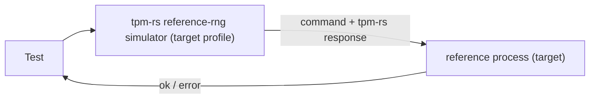

# Differential Testing (`tpm-rs` vs. C Reference TPMs `mstpm20` and `ibmswtpm2`)

This document describes how `tpm-rs` is differentially tested against two C reference TPMs, **`mstpm20`** and **`ibmswtpm2`**, and catalogs every behavioral, wire-format, validation and profile difference between the three implementations that the harness has to account for ([`testing/src/differential/mod.rs`](file:///usr/local/google/home/wenyuzhao/projects/tpm-rs/testing/src/differential/mod.rs), [`testing/src/differential/server.rs`](file:///usr/local/google/home/wenyuzhao/projects/tpm-rs/testing/src/differential/server.rs)). The [Methodology](#methodology) section explains which reference versions are used, how the three-way comparison works, what is checked and how the three implementations are made deterministic. Parts I-V describe `mstpm20`; Part VI describes what differs for `ibmswtpm2`.

Each catalogued item documents:
- **Classification**: one of
  - **Bug in `mstpm20`** / **Bug in `ibmswtpm2`**: a deviation of that reference from the specification, fixed in its patch;
  - **Implementation choice aligned with `mstpm20`**: the specification leaves the behavior open, and `tpm-rs` behaves like `mstpm20` (and, where stated, `ibmswtpm2`);
  - **Implementation-defined / profile difference**: a difference permitted by the specification (configuration, randomness, vendor-defined formats).
- **Test & Implementation Code**: links to the relevant `tpm-rs` code, tests, comparator rules and reference patch hunks.
- **TPM 2.0 Specification Quote & Explanation**: quotes from and links to the TCG TPM 2.0 Library Specification ([`part1.tcg.txt`](file:///usr/local/google/home/wenyuzhao/projects/tpm-rs/_agents/skills/tpm2-spec/resources/spec/part1.tcg.txt), [`part2.tcg.txt`](file:///usr/local/google/home/wenyuzhao/projects/tpm-rs/_agents/skills/tpm2-spec/resources/spec/part2.tcg.txt), [`part3.tcg.txt`](file:///usr/local/google/home/wenyuzhao/projects/tpm-rs/_agents/skills/tpm2-spec/resources/spec/part3.tcg.txt)) explaining what the specification requires.
- **Root Cause & Fix** (reference bugs) or **Resolution** (everything else).

Response codes are given as `NAME + position` with their numeric value. Format-1 codes are `0x080 + n`. A parameter position adds `0x040 | (N << 8)`, a handle position adds `N << 8`, and a session position adds `0x800 | (N << 8)`.

---

## Methodology

### M.1 Reference Implementations and Versions

| | `mstpm20` | `ibmswtpm2` |
|---|---|---|
| Implementation | TCG / Microsoft TPM 2.0 reference implementation | IBM software TPM (derived from the same Microsoft code, older layout) |
| Upstream | `v185`: `https://github.com/TrustedComputingGroup/TPM-Internal` (TCG members only); `public`: `https://github.com/TrustedComputingGroup/TPM` | `https://github.com/kgoldman/ibmswtpm2` |
| Pinned commit | `v185`: `5b5e8df4142885bbd7a947dd064c3dc1b812a979` (branch `185-feature`, after tag `v185.0.0`); `public`: `3b1f0e623f244abe2015df9e3ba86de5c9118524` | `e1df46e46fc2671e55372d65f27ecbb3c789d992` (tag `rev183-2026-08-26`) |
| Patches | `v185`: [`testing/patches/mstpm20-185-feature/`](file:///usr/local/google/home/wenyuzhao/projects/tpm-rs/testing/patches/mstpm20-185-feature); `public`: [`testing/patches/mstpm20/`](file:///usr/local/google/home/wenyuzhao/projects/tpm-rs/testing/patches/mstpm20) (one file per fix) | [`testing/patches/ibmswtpm2/`](file:///usr/local/google/home/wenyuzhao/projects/tpm-rs/testing/patches/ibmswtpm2) (one file per fix) |
| `testing` feature | `v185`: `target-mstpm20-v185`; `public`: `target-mstpm20` | `target-ibmswtpm2` |
| Binary | [`testing/src/bin/reference.rs`](file:///usr/local/google/home/wenyuzhao/projects/tpm-rs/testing/src/bin/reference.rs) (the target of the build) | same |
| Crypto library | OpenSSL (`HASH_LIB`/`SYM_LIB`/`BN_MATH_LIB = Ossl`, `MATH_LIB = TpmBigNum`; `v185` additionally `RAND_LIB = RandRef`, `KDF_LIB = KdfRef`, `RSA_LIB = RsaRef`, `ECC_LIB = EccRef`, `MLKEM_LIB`/`MLDSA_LIB = Ossl`, its CMake defaults) | OpenSSL (same settings) |

- **Targets.** A differential build compares `tpm-rs` with **one** C reference TPM, the *target*, selected by exactly one feature of `testing` ([`testing/Cargo.toml`](file:///usr/local/google/home/wenyuzhao/projects/tpm-rs/testing/Cargo.toml)): **`target-mstpm20`** (the public TCG reference code, `public`), **`target-mstpm20-v185`** (the TCG-internal repository on its `185-feature` branch, specification version 185, the version `tpm-rs` reports; only TCG members can clone it) or **`target-ibmswtpm2`**. Each target enables the internal `differential` feature and the profile features of `tpm2` and `tpm2-impl` that give `tpm-rs` the profile of that reference (table below), so the reference needs no patch for those settings; the features unify with the whole build, so every test of a target run sees that profile. `make test-differential` (or `make test`) runs the three targets one after the other ([`Makefile`](file:///usr/local/google/home/wenyuzhao/projects/tpm-rs/Makefile); `DIFFERENTIAL_TARGETS` selects them). The version label of the target is the compile-time environment variable `DIFFERENTIAL_<NAME>_VERSION` of `testing`. Each version has its own patch directory and its own checkout (`OUT_DIR/mstpm20-185-feature`, `OUT_DIR/mstpm20`, `OUT_DIR/ibmswtpm2`). The `reference-rng` feature of `tpm2-impl` always links the `public` version's random-number code, which draws the same values as `v185` and `ibmswtpm2` (all tests pass against every target). Item 22 lists what the `v185` patches change.

  | Target | `tpm2` features | `tpm2-impl` features | Replaces the reference patches |
  |---|---|---|---|
  | `target-mstpm20` | `tpma-object-fixed-firmware` (`TPMA_OBJECT` bit 3 is `fixedFirmware`, not reserved) | `max-context-size-2168` (`MAX_CONTEXT_SIZE`), `act-a` (`TPM_RH_ACT_A` in addition to `TPM_RH_ACT_0`, `RH_ACT_A`) | `profile-tpma-object-fixed-firmware-reserved`, `profile-max-context-size`, `profile-no-act` |
  | `target-mstpm20-v185` | `tpma-object-fixed-firmware`, `max-cap-buffer-3072` (`MAX_CAP_BUFFER`), `max-nv-index-size-8500` (`MAX_NV_INDEX_SIZE`) | `max-command-size-8192` (`MAX_COMMAND_SIZE`, `MAX_RESPONSE_SIZE`), `max-context-size-4344`, `min-evict-objects-9` (`MIN_EVICT_OBJECTS`), `nv-memory-size-128k` (`NV_MEMORY_SIZE`), `ecc-parameters-null-kdf` (`TPM2_ECC_Parameters` reports a NULL KDF) | `profile-tpma-object-fixed-firmware-reserved`, `profile-max-cap-buffer`, `profile-max-command-size`, `profile-max-nv-index-size`, `profile-min-evict-objects`, `profile-nv-memory-size`, `profile-ecc-curve-kdf`, `profile-no-act` (only `TPM_RH_ACT_0`, the default of `tpm-rs`) |
  | `target-ibmswtpm2` | — | `max-context-size-2680`, `min-evict-objects-7`, `nv-memory-size-32k`, `ntc2-vendor-commands` (the Nuvoton `NTC2_*` vendor commands of `ibmswtpm2`, compiled with `TPM_NUVOTON` as in its makefile), `act-a` | `profile-max-context-size`, `profile-min-evict-objects`, `profile-nv-memory-size`, `profile-no-vendor-commands`, `profile-no-act` |

  The algorithms, curves and key sizes of `tpm-rs` are the default features of `tpm2` (its TPM profile: SHA-1/256/384/512, AES-128/256, CTR/OFB/CBC/CFB/ECB, NIST P-224 to P-521 and BN P-256, RSA-1024/2048, RSASSA/RSAPSS/RSAES/OAEP, ECDSA/ECDH/ECDAA); the types of `tpm2` accept exactly the enabled values and size the profile-dependent buffers from them (e.g. `TPM2B_PRIVATE` 910, `TPM2B_TEMPLATE` 350 octets). What `tpm-rs` does not implement (e.g. Camellia, CMAC, RSA-3072/4096, SM2, ML-KEM) is still disabled in every reference by its `profile-algorithms` and `profile-command-list` patches.

- **Build.** With a `target-*` feature of `testing`, [`testing/build.rs`](file:///usr/local/google/home/wenyuzhao/projects/tpm-rs/testing/build.rs) clones the target's repository at its pinned commit, applies every `*.patch` of `testing/patches/<name>/` in file-name order (one `git apply` per file; each file name starts with its classification: `bug-fix-`, `build-fix-`, `harness-`, `platform-` or `profile-`), compiles it (`mstpm20`: the TPM library and simulator platform; `ibmswtpm2`: the `OBJFILES` of its Linux makefile without `TPMCmds.c`, the TCP server and `main()`), combines the objects with `ld -r`, renames the entry points to `difftest_<name>_*` and redirects `getpid` to `difftest_getpid` and `rand`/`srand` to `difftest_<name>_rand`/`srand` (`objcopy --redefine-sym`), localizes every other symbol (`objcopy --keep-global-symbol`), and checks the resulting symbol interface with `nm`. Only the prefixed entry points are global, so the target's `lib<name>.a` is linked into the `testing` library (`rustc-link-lib`, and through it into every binary using it) without conflicts, also next to `tpm2-impl`'s localized `libtpmrs_refrng.a` (which exports only `tpmrs_refrng_*`). [`testing/src/differential/inproc.rs`](file:///usr/local/google/home/wenyuzhao/projects/tpm-rs/testing/src/differential/inproc.rs) holds all FFI, the only `unsafe` code of the crate: the entry points behind the safe `CReference`, the shared callbacks, and one port of glibc's `rand()` per reference (`GlibcRand`). The binary `reference` only calls `inproc::serve_process` for the target, which runs [`testing::differential::server::serve`](file:///usr/local/google/home/wenyuzhao/projects/tpm-rs/testing/src/differential/server.rs).
- **Patches.** Each patch file fixes one thing and starts with a header explaining it and its classification, which is also the prefix of its file name: a fix of a specification deviation of that reference (`bug-fix-*.patch`, Parts II and VI), a profile or platform setting (`profile-*.patch`, `platform-*.patch`; items 9 and 18), a build fix (`build-fix-*.patch`), or harness plumbing (`harness-*.patch`: `harness-difftest-entry-points.patch`, the `difftest_*` entry points; `harness-virtual-clock.patch`, `_plat__RealTime()` returns the harness's virtual clock). **No patch changes how a reference draws or uses random numbers**: `tpm-rs` reproduces the references' random-number generation instead, by linking the original code (M.4).
- **Running.** `cargo test --release -p testing --features target-<name>` (or `make test-<name>`) builds the `reference` binary and runs every E2E and Go parity test ([`testing/tests/`](file:///usr/local/google/home/wenyuzhao/projects/tpm-rs/testing/tests)) differentially against the target; `make test-differential` runs all three targets. `REFERENCE_BIN` overrides the binary path (default: next to the test executable, e.g. `target/release/reference`). `DIFFERENTIAL_LOG_EXCEPTIONS` logs every applied exception and `TPM_RC_RETRY` re-issue on the reference processes' stderr. Against every target, all 1204 E2E, 275 Go parity and 30 library tests pass. `cargo test --release -p testing --features target-<name>,fuzz-inproc` also runs the in-process tests (M.5).

### M.2 Differential Comparison

- **One process per reference and TPM.** Every [`testing::tpm::Tpm`](file:///usr/local/google/home/wenyuzhao/projects/tpm-rs/testing/src/tpm.rs) is a `tpm-rs` simulator plus one child process of the target reference (`testing::differential::References`), all seeded with the same seed (M.4). The C references keep their state in globals, so a process per reference and `Tpm` lets tests run in parallel and a single test use several TPMs. Each reference process first confirms the seed it adopted (handshake, `protocol.rs`), and is then initialized like a new `Tpm`: manufactured with fresh RAM-backed NV, powered on, NV on, and `TPM2_Startup(TPM_SU_CLEAR)` done.
- **`tpm-rs` is the pivot.** Every interaction is executed by `tpm-rs` first; then the interaction and, for commands, the `tpm-rs` response are sent to the reference over its stdin/stdout pipe ([`protocol.rs`](file:///usr/local/google/home/wenyuzhao/projects/tpm-rs/testing/src/differential/protocol.rs): length-prefixed `Exchange`/`AdvanceClock`/`Signal`/`HashStart`/`HashData`/`HashEnd` requests, one ok/error reply each; each reference process points fd 1 at stderr so C output cannot corrupt the channel). 
- **Comparison happens in the reference process.** The reference executes the command and compares its own response with the `tpm-rs` response. Each target is a separate run (a separate build with the target's profile), so the references are no longer compared with each other in one run; each must match `tpm-rs` built with its profile.
- **Failure.** Any undocumented difference (or an interaction the reference does not support) is an error reply, and the test panics at the diverging interaction, reporting the error. The test itself always continues with the `tpm-rs` response, so the same test suite serves as both the `tpm-rs` E2E tests and the differential tests.

### M.3 What Is Checked

- **Commands (`Exchange`).** The command bytes the test sent to `tpm-rs` are executed by the reference at the same locality, and the reference's response must be **byte-identical** to the `tpm-rs` response. This covers the entire response: tag, `responseSize`, response code (including the handle/parameter/session position of an error), response handles, `parameterSize`, every response parameter and the authorization area (`nonceTPM`, `sessionAttributes` and the response HMAC or policy acknowledgment). The comparison therefore also verifies everything a response is derived from: cpHash/rpHash, session HMAC keys, parameter encryption, audit digests, tickets, Names, unique fields, attestation structures and signatures. Error responses are compared exactly like successful ones. Commands that `tpm-rs` rejects at the transport level (e.g. an oversized buffer) are not mirrored.
- **Command translation.** The command is sent unchanged, with one exception that never fabricates a result: a `TPM2_ContextLoad` blob that is byte-identical to one `tpm-rs` returned earlier is replaced, in the command bytes, by the blob the reference returned for the same `TPM2_ContextSave` (Rule 1, `DiffState::translate_context_load`); any other blob (tampered, truncated or from another run) reaches the reference with a zeroed integrity value (Rule 9, `DiffState::untranslated_context_load`).
- **Platform signals, `_TPM_Hash_*` indications and clock advances.** These produce no response; they are delivered to every reference (power on/off, reset, NV on/off, physical presence, cancel) and their effect is checked by the responses of later commands. Transport-only signals (key cache, session end, stop, response sizes, the `ACT_GET_SIGNALED` query) are ignored; `Restart`, `TestFailureMode`, `SetFirmwareHash` and `SetFirmwareSvn` have no reference equivalent and fail the test.
- **Tolerated differences.** Only the narrowly keyed, implementation-defined exceptions of [Part IV](#part-iv-implementation-defined-behaviors-harness-exceptions) and the `TPM_RC_RETRY` re-issue are accepted. Every exception requires the same command code, a specific condition and response-code pair, and checks every response field it does not explicitly exempt.
- **No adopted values.** Every random value (keys, seeds, nonces, signatures, ciphertexts, IVs, `TPM2_GetRandom` output) is generated by the reference itself and must be byte-identical to the one `tpm-rs` generated.

### M.4 Determinism: Randomness and Time

Byte-identical comparison requires `tpm-rs` to draw exactly the random values the reference draws and to see the same time. The references are not modified for this: they run their own random-number generator. Instead, the opt-in `reference-rng` cargo feature of `tpm2-impl`, `tpm2-platform-linux` and `tpm2-simulator` (enabled by `testing`) makes `tpm-rs` reproduce it, and [`create_reference_simulator!(pid, realtime_ms)`](file:///usr/local/google/home/wenyuzhao/projects/tpm-rs/crates/tpm2-simulator/src/lib.rs) builds a simulator that matches the reference process with that process ID and initial clock. No seed or clock value is a constant of the harness: both come from the reference process.

#### M.4.1 The References' Random-Number Generation

`mstpm20` and `ibmswtpm2` share the same random-number code (it differs only in formatting):

- **Platform entropy** (`Entropy.c`): `_plat__GetEntropy(NULL, 0)`, called by `CryptInit()` at manufacture and on every `_TPM_Init`, seeds the C library's `rand()` with `(unsigned)_plat__RealTime() ^ getpid()`. Every other call returns 32 bits, `(rand() << 1) ^ rand()` XORed with the current real time, after a FIPS 140-2 continuous test against the previous value. (The harness redirects the references' `rand()`/`srand()` to a port of glibc's generator with one state per reference, so each draws the same values as the C library's generator in a process of its own, also when both run in one process, M.5.)
- **DRBG** (`CryptRand.c`): the TPM's random values come from an SP 800-90A CTR_DRBG with AES-256 and a derivation function (`drbgDefault`, kept in `go.drbgState` and persisted in NV with `ORDERLY_DATA` at manufacture, `TPM2_Shutdown`, `TPM2_Clear` and Clock updates, and reloaded at `_TPM_Init`). It is instantiated from 48 bytes of platform entropy at manufacture, reseeded with 48 bytes at every `TPM2_Startup`, and reseeded with entropy plus the derivation of `inData` by `TPM2_StirRandom`. Primary Objects use a separate DRBG instantiated from `DRBG_InstantiateSeeded(primarySeed, "Primary Object Creation", templateName, inSensitive.data)`; Derived Objects use a KDFa stream.
- **Consumers**: RSA keys (`CryptRsaGenerateKey()`: random candidates, a 2048-byte prime sieve, Miller-Rabin with random bases, and the pairwise test of signing keys), ECC private scalars (`TpmEcc_GenPrivateScalar()`: `orderBytes + 8` random bytes reduced mod `n - 1`, plus 1), the FIPS pairwise test of signing ECC keys, ECDSA and ECDAA nonces, OAEP seeds, RSAES-PKCS1-v1_5 padding (zero bytes replaced by `0x55`), PSS salts (the largest FIPS 186-4 size), TPM-generated symmetric/keyed-hash keys and `seedValue`s, `CryptSecretEncrypt()` seeds and ephemeral keys, the outer-wrap IV, session `nonceTPM`s, the hierarchy seeds and proofs, `nullSeed`/`nullProof`/`commitNonce`, and `TPM2_GetRandom`.

#### M.4.2 The `reference-rng` Feature of `tpm-rs`

- **Platform** ([`tpm2-platforms/linux/src/reference.rs`](file:///usr/local/google/home/wenyuzhao/projects/tpm-rs/crates/tpm2-platforms/linux/src/reference.rs)): `GlibcRand` is a port of glibc's `rand()`/`srand()` (`random_r.c`, `TYPE_3`); `ReferenceEntropy` reproduces `_plat__GetEntropy()` for a given process ID and `VirtualClock`; `LinuxRng::reference` uses it as the platform RNG. The new `Rng::init` hook is the `_plat__GetEntropy(NULL, 0)` call.
- **Engine** ([`tpm2-impl/src/reference_rng/`](file:///usr/local/google/home/wenyuzhao/projects/tpm-rs/crates/tpm2-impl/src/reference_rng/mod.rs)): the references' random-number code is linked, not ported, and no C is written for it. With the feature, [`tpm2-impl/build.rs`](file:///usr/local/google/home/wenyuzhao/projects/tpm-rs/crates/tpm2-impl/build.rs) clones `mstpm20` at the pinned commit, applies the same `testing/patches/mstpm20/` patches (none touches the random-number code), and compiles only unmodified files: `CryptRand.c`, `CryptPrime.c`/`CryptPrimeSieve.c`/`PrimeData.c`, `CryptRsa.c`, `CryptEccMain.c`/`CryptEccSignature.c`/`TpmEcc_Signature_ECDSA.c`, `CryptHash.c` and the TpmBigNum/OpenSSL math library. The three mutable globals involved are redirected by command-line macros to accessors implemented in Rust (`-Dgo=(*tpmrs_refrng_go())`, so that `drbgDefault`, `go.drbgState`, is the calling TPM's DRBG; likewise the DRBG self-test flags `g_cryptoSelfTestState` and the sieve's `primeLimit`), and `CryptRsa.c`'s `static` encoders are kept (`-fkeep-static-functions`) and made global with `objcopy`. The objects are partially linked with `libcrypto.a`; the entry points Rust calls (`DRBG_Instantiate()`/`DRBG_Reseed()`/`DRBG_Generate()`/`CryptRandStartup()`/`CryptRandomStir()`/`DRBG_InstantiateSeeded()`/`DRBG_AdditionalData()`, `CryptRsaGenerateKey()`, `OaepEncode()`/`RSAES_PKCS1v1_5Encode()`/`PssEncode()`, `CryptEccGenerateKey()` (with its FIPS pairwise test)/`CryptEccNewKeyPair()`/`CryptEccSign()`/`CryptEccValidateSignature()`/`CryptEccPointMultiply()`) and the platform functions the C code calls (`_plat__GetEntropy()` etc., implemented in Rust; `CryptTestAlgorithm()`, which the linked code's `TPM_DO_SELF_TEST()` would call, is a never-reached stub because `tpm-rs` runs the algorithm self tests itself, item 49) are prefixed with `tpmrs_refrng_`, and every other symbol is localized, as for the reference binaries. `bindgen` generates the Rust types and prototypes from the reference headers. All glue is Rust in `reference_rng/ffi.rs` (the only `unsafe` code): the per-call state (the TPM's DRBG loaded from its `DrbgState`, the self-test flags, the failure mode, the entropy source) lives on the calling Rust function's stack and is published in POSIX thread-local storage, so TPMs in parallel threads do not interfere. `reference_rng/vectors.rs` checks the results against outputs of the C reference, as do the glibc/entropy tests of `reference.rs`.
- **Integration** ([`rng.rs`](file:///usr/local/google/home/wenyuzhao/projects/tpm-rs/crates/tpm2-impl/src/rng.rs), [`handler/reference_ops.rs`](file:///usr/local/google/home/wenyuzhao/projects/tpm-rs/crates/tpm2-impl/src/handler/reference_ops.rs)): every random value of the engine goes through `TpmEngine::random_platform`/`random_crypto`, which draw from the DRBG with the feature (and from the platform RNG and the crypto provider's CSPRNG without it); object creation (`reference_create_object`, the counterpart of `CryptCreateObject()`), ECDSA and PSS signatures, RSA encryption and ephemeral ECC keys use the linked C code, with only the raw RSA operations on the encoded blocks left to the crypto provider (which holds the private keys). The call sites draw in the reference's order: e.g. the DRBG lifecycle at manufacture, `_TPM_Init` and `TPM2_Startup` (reseed, then `commitNonce`, `nullProof`, `nullSeed`), `TPM2_Clear` (SPS, shProof, ehProof), the `nonceTPM` of `TPM2_StartAuthSession` drawn only after the salt is decrypted and a slot is free, the `TPM2_Duplicate` seed before the inner key, and no IV for Primary and Derived Objects.
- Without the feature, `tpm-rs` behaves as before and builds no C code; with it, the linked big-number arithmetic is not constant time (the feature is for testing).

#### M.4.3 Clock

- `harness-virtual-clock.patch` makes the references' `_plat__RealTime()` return the harness's virtual clock (`difftest_virtual_ms()`). The reference process starts that clock at the real time of the seed the `Tpm` chose (a `CLOCK_MONOTONIC`-like millisecond value, like what the unpatched `_plat__RealTime()` would return; started by hand without a seed, at its own `CLOCK_MONOTONIC` milliseconds) and confirms the value with its process ID in the handshake.
- `tpm-rs` gets a [`VirtualClock`](file:///usr/local/google/home/wenyuzhao/projects/tpm-rs/crates/tpm2-platforms/linux/src/reference.rs) with that real time; its TPM timer (`LinuxTimer::new_virtual`) counts from 0. Both clocks move only through `_common::sleep`, which advances `tpm-rs` and the reference together (`AdvanceClock`); no wall-clock time passes.
- **ACT ticks.** The references' Authenticated Countdown Timers count down on `_plat__ACT_Tick()`, which their TCP simulator calls from a timer thread that the harness does not run. `harness-difftest-entry-points.patch` makes `difftest_advance_clock(ms)` deliver the ticks instead: one per whole second of the virtual clock since the last power on (`difftest_init()` or a power-on signal while the power is off) that the advance crossed. `tpm-rs` counts the same ticks, the whole seconds of its platform timer since the last power on (`_plat__TimerReset()`), applied lazily before each command (`tpm2_impl::act`); both drop them from `_TPM_Init` (and power off) until `TPM2_Startup`. The ACT of a reference therefore holds exactly the `tpm-rs` value at every command (item 44).
- **Commands affected**: `time`/`clock` in `TPM2_ReadClock`, `TPM2_GetTime` and every attestation; ticket expiration; `TPM2_PolicyCounterTimer`; dictionary-attack self-healing; the ACT timeouts and `signaled` attributes (`TPM_CAP_ACT`, `TPM2_ACT_SetTimeout`'s `TPM_RC_RETRY`); and, through the entropy source, every random value.

#### M.4.4 Consequences

- **Seed.** The references seed `rand()` from their process ID and real time, so the `Tpm` chooses both ([`testing/src/seed.rs`](file:///usr/local/google/home/wenyuzhao/projects/tpm-rs/testing/src/seed.rs), `ReferenceSeed::choose`: the test process's ID and its current monotonic milliseconds), builds the `tpm-rs` simulator from them and hands them to every reference process as `TPM_REFERENCE_SEED=<pid>:<realtime_ms>` in its environment. The process adopts them without any C change: `build.rs` redirects the reference's `getpid()` to `difftest_getpid` (`objcopy --redefine-sym`), which returns the seed's process ID, and the virtual clock starts at the seed's real time; the handshake confirms both. All references of a `Tpm` therefore draw the same random values as `tpm-rs`, and every command is compared with all of them in one run. Without the `differential` feature, a `Tpm` uses the same seed choice.
- **Reproducing a run.** Every `Tpm` prints `tpm-rs: TPM_REFERENCE_SEED=<pid>:<realtime_ms>` on stderr. By default runs differ (the process ID and time change), and client-side randomness comes from the OS. With `TPM_REFERENCE_SEED` set, every `Tpm` uses that seed, and client-side randomness (`_common::client_random`) is derived from the seed and the test name, so the TPM's random values and the test's commands repeat exactly (except randomness drawn inside BoringSSL on the client side, e.g. client signatures). The variable holds one seed, so all `Tpm`s of a reproduced test share it.
- The ticket `timeEpoch` is hashed as the reference's 32-bit `CLOCK_NONCE` (`TicketComputeAuth()`), unconditionally.

### M.5 In-Process References (`fuzz-inproc`)

Every `Tpm` normally mirrors to reference processes, which lets tests run in parallel. For fuzzing, where every input is a short conversation, the opt-in `fuzz-inproc` feature of `testing` hosts the target reference in the calling process instead: `InProcReferences` runs a `server::Server` directly over the linked C code (the same comparison and exceptions as the processes), and `Tpm::with_seed_in_process` mirrors to it. Cheap requests run on the calling thread, one reference after the other; expensive commands (key generation, private-key operations, attestations) run on both references concurrently, which is safe because the references share no C state (every global but the entry points is local to its archive, including its copy of OpenSSL) and the shared callbacks are thread-safe. The references share the process's virtual clock and `difftest_getpid()` (the seed's process ID); `InProcReferences` sets the clock to the same value before each reference handles a request. `Tpm::reset()` re-initializes them in place (`Server::reinit`: clock back to the seed's real time, `difftest_init()`, `TPM2_Startup(CLEAR)`, comparison state cleared). `difftest_init()` re-manufactures the reference and re-seeds its own `rand()` (`_plat__GetEntropy(NULL, 0)`), so no state survives a re-initialization: `reset_determinism::in_process_mirror_repeats_the_responses_of_reference_processes` checks that an in-process `Tpm` gives the responses of a process-based one, before and after resets, and the `inproc` unit tests check the same for repeated re-initialization and re-hosting. The C references keep their state in globals, so a process hosts at most one `InProcReferences` at a time. `FUZZ_C_COVERAGE=1` additionally builds the C code with `-fsanitize=fuzzer-no-link` (with `clang`), so that libFuzzer also sees the references' coverage.

### M.6 Differential Fuzzing

`testing/fuzz` (crate `tpm2-fuzz`, see its `README.md`) fuzzes `tpm-rs` against both references with multi-round conversations: every input is a sequence of TPM commands sent to a fresh, started `Tpm` with the fixed seed `4242:1000000`, whose later commands may reuse handles, names, blobs, nonces and tickets of earlier responses, and whose sessions (password, HMAC, policy) are computed by the fuzz driver. Every round is compared like an E2E test command (M.2, Part IV), and an undocumented difference at any round, a malformed or unparseable `tpm-rs` response, or a bad response HMAC is a finding. Findings are triaged like E2E differences: a `tpm-rs` fix with an E2E regression test, a `bug-fix` patch of the reference, or a narrow documented exception. The recommended build mirrors in-process without sanitizer (`cargo fuzz build --fuzz-dir testing/fuzz -O -s none --features inproc diff_conversation`).

---

## Summary Table

| # | Item | Classification | Resolution |
|---|-------------|----------------|------------|
| 1 | [`ivOut` tail bytes after a partial CFB block](#1-ivout-tail-bytes-after-a-partial-cfb-block) | **Implementation choice aligned with `mstpm20`** | `encrypt_decrypt.rs` |
| 2 | [KDFe `PartyUInfo`/`PartyVInfo` for unpadded ECC coordinates](#2-kdfe-partyuinfopartyvinfo-for-unpadded-ecc-coordinates) | **Implementation choice aligned with `mstpm20`** | `session.rs`, `duplicate.rs`, `import.rs`, `rewrap.rs` |
| 3 | [Check order and response codes in `TPM2_Commit`, `TPM2_PolicySigned` and `TPM2_HMAC_Start`](#3-check-order-and-response-codes-in-tpm2_commit-tpm2_policysigned-and-tpm2_hmac_start) | **Implementation choice aligned with `mstpm20`** | `commit.rs`, `policy_signed.rs`, `sequence.rs` |
| 4 | [`lockoutAuth` use and the "DA-protected object used" flag](#4-lockoutauth-use-and-the-da-protected-object-used-flag) | **Implementation choice aligned with `mstpm20`** | `engine.rs` |
| 5 | [Command audit and `TPM2_SetCommandCodeAuditStatus`](#5-command-audit-and-tpm2_setcommandcodeauditstatus) | **Implementation choice aligned with `mstpm20`** | `command_audit.rs`, `set_command_code_audit_status.rs`, `engine.rs` |
| 6 | [Unique field of restricted symmetric parents](#6-unique-field-of-restricted-symmetric-parents) | **Bug in `mstpm20`** | `bug-fix-symmetric-unique.patch` |
| 7 | [`TPMU_NAME` struct padding accepting 67/68-byte names](#7-tpmu_name-struct-padding-accepting-6768-byte-names) | **Bug in `mstpm20`** | `bug-fix-tpmu-name-size.patch` |
| 8 | [`VENDOR_PERMANENT_AUTH_HANDLE` missing `break` and missing platform function](#8-vendor_permanent_auth_handle-missing-break-and-missing-platform-function) | **Bug in `mstpm20`** | `bug-fix-vendor-auth-entity-break.patch`, `build-fix-startup-get-unique-auth.patch` |
| 9 | [Profile configuration of `mstpm20`](#9-profile-configuration-of-mstpm20) | **Profile difference** | profile/platform patches in `testing/patches/mstpm20/` |
| 10 | [Implementation-defined behaviors (harness exceptions)](#part-iv-implementation-defined-behaviors-harness-exceptions) | **Implementation-defined** | Rules 1-3, 9 (4-8, 10, 11 retired) and RETRY in `server.rs` |
| 11 | [Open issues](#part-v-open-issues) | — | Documented |
| 12 | [`ibmswtpm2`: upstream bugs shared with `mstpm20`](#12-upstream-bugs-shared-with-mstpm20) | **Bug in `ibmswtpm2`** | the same `bug-fix-*.patch` files as items 6-8 |
| 13 | [`ibmswtpm2`: unknown command tag reported as `TPM_RC_VALUE`](#13-unknown-command-tag-reported-as-tpm_rc_value) | **Bug in `ibmswtpm2`** | `bug-fix-command-tag-unmarshal.patch` |
| 14 | [`ibmswtpm2`: `TPMS_NV_PUBLIC.nvIndex` accepting external and permanent NV handles](#14-tpms_nv_publicnvindex-accepting-external-and-permanent-nv-handles) | **Bug in `ibmswtpm2`** | `bug-fix-nv-public-index-unmarshal.patch` |
| 15 | [`ibmswtpm2`: `TPMI_RSA_KEY_BITS` ignoring the profile](#15-tpmi_rsa_key_bits-ignoring-the-profile) | **Bug in `ibmswtpm2`** | `bug-fix-rsa-key-bits-unmarshal.patch` |
| 16 | [`ibmswtpm2`: wrong response-code positions](#16-wrong-response-code-positions) | **Bug in `ibmswtpm2`** | `bug-fix-response-code-positions.patch` (7 `*_fp.h`) |
| 17 | [`ibmswtpm2`: sequence objects saved with hierarchy `0`](#17-sequence-objects-saved-with-hierarchy-0) | **Bug in `ibmswtpm2`** | `bug-fix-sequence-object-hierarchy.patch` |
| 18 | [`ibmswtpm2`: profile configuration](#18-profile-configuration-of-ibmswtpm2) | **Profile difference** | profile/platform patches in `testing/patches/ibmswtpm2/` |
| 19 | [`ibmswtpm2`: harness plumbing and aligned implementation choices](#19-harness-plumbing-and-aligned-implementation-choices) | **Aligned with `mstpm20`** | `profile-align-empty-encrypted-parameter.patch` |
| 20 | [`ibmswtpm2`: harness exceptions](#20-harness-exceptions-for-ibmswtpm2) | **Implementation-defined** | No `ibmswtpm2`-specific rule; shared rules of Part IV |
| 21 | [Unsigned `TPM2_NV_Certify` digest attestations](#21-unsigned-tpm2_nv_certify-digest-attestations) | **Bug in `mstpm20`/`ibmswtpm2`** (pre-185 behavior) | `bug-fix-nv-certify-null-sign-handle-digest.patch` (all three patch directories), `nv_storage.rs` |
| 22 | [`mstpm20` version 185](#22-mstpm20-version-185) | **Bugs, build fixes and profile of `v185`** | `testing/patches/mstpm20-185-feature/` |
| 23 | [`ibmswtpm2`: `TPM_ST` values that are not constants reported as `TPM_RC_VALUE`](#23-tpm_st-values-that-are-not-constants-reported-as-tpm_rc_value) | **Bug in `ibmswtpm2`** | `bug-fix-tpm-st-unmarshal.patch` |
| 24 | [`auditExclusive`/`auditReset` accepted without `audit`](#24-auditexclusiveauditreset-accepted-without-audit) | **Bug in `mstpm20`/`ibmswtpm2`** | `bug-fix-session-audit-attribute-dependency.patch` (all three patch directories) |
| 25 | [Signed overflow of `expiration = INT32_MIN`](#25-signed-overflow-of-expiration--int32_min) | **Bug in `mstpm20`/`ibmswtpm2`** | `bug-fix-expiration-absolute-value.patch` (all three patch directories) |
| 26 | [`TPM2_Create` scratch object slot](#26-tpm2_create-scratch-object-slot) | **Implementation choice aligned with `mstpm20`** | `create.rs` |
| 27 | [`TPM2B_TEMPLATE` bounded by the padded C `sizeof(TPMT_PUBLIC)`](#27-tpm2b_template-bounded-by-the-padded-c-sizeoftpmt_public) | **Bug in `mstpm20`/`ibmswtpm2`** | `bug-fix-template-size.patch` (all three patch directories), `capability.rs` |
| 28 | [NV space accounting](#28-nv-space-accounting) | **Implementation choice aligned with `mstpm20`** | `storage/nv_capacity.rs`, `evict_control.rs`, `nv_storage.rs` |
| 29 | [`ibmswtpm2`: firmware-limited and SVN-limited hierarchy handles](#29-firmware-limited-and-svn-limited-hierarchy-handles) | **Bug in `ibmswtpm2`** | `bug-fix-fw-svn-limited-hierarchy-handles.patch`, `engine.rs`, `hierarchy.rs` |
| 30 | [Transient handle resolving to a persistent object's per-command copy](#30-transient-handle-resolving-to-a-persistent-objects-per-command-copy) | **Bug in `mstpm20`/`ibmswtpm2`** | `bug-fix-persistent-copy-handle-alias.patch` (all three patch directories) |
| 31 | [`TPM2_Certify` of a sequence object](#31-tpm2_certify-of-a-sequence-object) | **Bug in `mstpm20`/`ibmswtpm2`** | `bug-fix-certify-sequence-object.patch` (`mstpm20/`, `ibmswtpm2/`; fixed upstream in `v185`), `certify.rs` |
| 32 | [`ibmswtpm2`: permanent NV handles accepted by `TPM2_NV_UndefineSpace(Special)`](#32-permanent-nv-handles-accepted-by-tpm2_nv_undefinespacespecial) | **Bug in `ibmswtpm2`** | `bug-fix-nv-undefine-defined-index.patch` |
| 33 | [Persistent public-only objects](#33-persistent-public-only-objects) | **Bug in `mstpm20`/`ibmswtpm2`** (pre-185 behavior) | `bug-fix-persist-public-only-objects.patch` (`mstpm20`, `ibmswtpm2`), `evict_control.rs` |
| 34 | [Failed `TPM2_SequenceComplete` consuming the sequence](#34-failed-tpm2_sequencecomplete-consuming-the-sequence) | **Bug in `mstpm20`/`ibmswtpm2`** | `bug-fix-sequence-complete-ticket-error-state.patch` (all three patch directories) |
| 35 | [Transient handle numbering with persistent handles](#35-transient-handle-numbering-with-persistent-handles) | **Implementation choice aligned with `mstpm20`** | `engine.rs` (`find_next_transient_handle`) |
| 36 | [Unwritten bytes of an ordinary NV index](#36-unwritten-bytes-of-an-ordinary-nv-index) | **Implementation choice aligned with `mstpm20`** | `nv_storage.rs` (`nv_write_index_data`) |
| 37 | [`TPM2_HierarchyControl` `authHandle` unmarshaled as `TPMI_RH_HIERARCHY`](#37-tpm2_hierarchycontrol-authhandle-unmarshaled-as-tpmi_rh_hierarchy) | **Bug in `mstpm20` (`public`)** | `bug-fix-hierarchy-control-base-hierarchy.patch` |
| 38 | [`TPM2_CertifyCreation` and `TPM2_ActivateCredential` of a sequence object](#38-tpm2_certifycreation-and-tpm2_activatecredential-of-a-sequence-object) | **Bug in `mstpm20` (`public`)/`ibmswtpm2`** (fixed upstream in `v185`) | `bug-fix-certify-creation-sequence-object.patch`, `bug-fix-activate-credential-sequence-object.patch` (`mstpm20/`, `ibmswtpm2/`), `certify.rs`, `activate_credential.rs` |
| 39 | [`TPMT_TK_VERIFIED` tags of version 185](#39-tpmt_tk_verified-tags-of-version-185) | **Bug in `mstpm20` (`public`)/`ibmswtpm2`** (pre-185 behavior) | `bug-fix-tk-verified-tags.patch` (`mstpm20/`, `ibmswtpm2/`), `policy_authorize.rs` |
| 40 | [Extended localities aliased to localities 0-4 in PCR checks](#40-extended-localities-aliased-to-localities-0-4-in-pcr-checks) | **Bug in `mstpm20`/`ibmswtpm2`** | `bug-fix-pcr-extended-locality.patch` (all three patch directories) |
| 41 | [Bound HMAC session authorizing a public-only object](#41-bound-hmac-session-authorizing-a-public-only-object) | **Bug in `mstpm20`/`ibmswtpm2`** | `bug-fix-bind-entity-public-only.patch` (all three patch directories) |
| 42 | [Platform signals and localities 5-31](#42-platform-signals-and-localities-5-31) | **Implementation choice aligned with `mstpm20`** | `tpm2-simulator` (`platform_signal`), `engine.rs` (`set_locality`) |
| 43 | [`TPM2_ObjectChangeAuth` of a Derived Object](#43-tpm2_objectchangeauth-of-a-derived-object) | **Bug in `mstpm20`/`ibmswtpm2`** | `bug-fix-object-change-auth-derived-object.patch` (all three patch directories), `object_change_auth.rs` |
| 44 | [ACT `preserveSignaled` on TPM Reset, Restart and Resume](#44-act-preservesignaled-on-tpm-reset-restart-and-resume) | **Bug in `mstpm20`/`ibmswtpm2`** | `bug-fix-act-preserve-signaled.patch` (all three patch directories), `act.rs` |
| 45 | [RSA primes outside the acceptable range](#45-rsa-primes-outside-the-acceptable-range) | **Bug in `mstpm20`/`ibmswtpm2`** | `bug-fix-rsa-prime-range.patch` (all three patch directories), `rsa_sensitive.rs`, `load_external.rs` |
| 46 | [`TPM2_EvictControl` of an object in a limited hierarchy](#46-tpm2_evictcontrol-of-an-object-in-a-limited-hierarchy) | **Bug in `mstpm20`/`ibmswtpm2`** | `bug-fix-svn-fw-limited-evict-control.patch` (all three patch directories), `evict_control.rs` |
| 47 | [`TPM2_LoadExternal` of a public-only object with `firmwareLimited`/`svnLimited`](#47-tpm2_loadexternal-of-a-public-only-object-with-firmwarelimitedsvnlimited) | **Bug in `mstpm20`/`ibmswtpm2`** | `bug-fix-svn-fw-limited-load-external.patch` (all three patch directories), `load_external.rs` |
| 48 | [Firmware-limited and SVN-limited hierarchies](#48-firmware-limited-and-svn-limited-hierarchies) | **Implementation choices aligned with `mstpm20`**; ticket hierarchy of limited objects: **Bug in `mstpm20`/`ibmswtpm2`** | `hierarchy.rs`, `tpm2::platform::firmware`, `harness-difftest-firmware.patch`, `bug-fix-svn-fw-limited-entity-hierarchy.patch` (all three patch directories) |
| 49 | [Algorithm self tests and `TPM2_GetTestResult`](#49-algorithm-self-tests-and-tpm2_gettestresult) | **Bug in `mstpm20`/`ibmswtpm2`** | `bug-fix-get-test-result-needs-test.patch` (all three patch directories), `bug-fix-self-test-clear-untestable.patch` (`ibmswtpm2/`), `build-fix-self-test-ecschnorr.patch` (`mstpm20/`, `ibmswtpm2/`), `self_test/` |

---

## Part I: Implementation Choices Aligned with `mstpm20`

The `tpm-rs` behaviors below are not dictated by the specification; `tpm-rs` follows `mstpm20`. `ibmswtpm2` derives from the same upstream code and behaves identically (it passes the same tests without an `ibmswtpm2`-specific rule, item 20), except where noted.

### 1. `ivOut` Tail Bytes After a Partial CFB Block

- **Classification**: **Implementation choice aligned with `mstpm20`** (and `ibmswtpm2`).
- **Test & Implementation Code**: [`encrypt_decrypt.rs`](file:///usr/local/google/home/wenyuzhao/projects/tpm-rs/crates/tpm2-impl/src/handler/encrypt_decrypt.rs#L223); test file `go::symmetric_encryption`.
- **TPM 2.0 Specification Quote & Explanation**: [Part 3, Table 61 (CFB)](file:///usr/local/google/home/wenyuzhao/projects/tpm-rs/_agents/skills/tpm2-spec/resources/spec/part3.tcg.txt#L4671-L4679): "*ivOut* will be the size of a cipher block". The content of the unused tail after a partial block is not specified. `mstpm20` `CryptSymmetricEncrypt/Decrypt` zero-fills it (`CryptSym.c:199-216, 348-365`), which also avoids returning unused keystream bytes.
- **Resolution**: `tpm-rs` zero-fills the tail bytes of `ivOut` after a partial CFB block.

---

### 2. KDFe `PartyUInfo`/`PartyVInfo` for Unpadded ECC Coordinates

- **Classification**: **Implementation choice aligned with `mstpm20`** (and `ibmswtpm2`; non-conforming input).
- **Test & Implementation Code**: [`session.rs`](file:///usr/local/google/home/wenyuzhao/projects/tpm-rs/crates/tpm2-impl/src/handler/session.rs#L380-L381), `duplicate.rs`, `import.rs`, `rewrap.rs`; test `e2e::activate_credential::stripped_ecc_protector_and_error_codes`.
- **TPM 2.0 Specification Quote & Explanation**: [Part 1, §33.6.3 Padding](file:///usr/local/google/home/wenyuzhao/projects/tpm-rs/_agents/skills/tpm2-spec/resources/spec/part1.tcg.txt#L17000-L17040): "An `TPMS_ECC_POINT` representing an actual ECC point … MUST be padded … when it is provided to the TPM", and a `TPM2B_PUBLIC` point "SHOULD be padded". With conforming input, padded and raw coordinates are identical. For an unpadded coordinate the KDFe input is not defined. `mstpm20` passes the `TPM2B` bytes as received (`CryptUtil.c:608-614, 753-759`).
- **Resolution**: `tpm-rs` passes the coordinate bytes as received (`Z` stays padded to the curve size), for interoperability with `mstpm20` and `ibmswtpm2`.

---

### 3. Check Order and Response Codes in `TPM2_Commit`, `TPM2_PolicySigned` and `TPM2_HMAC_Start`

- **Classification**: **Implementation choice aligned with `mstpm20`** (and `ibmswtpm2`).
- **Test & Implementation Code**: [`commit.rs`](file:///usr/local/google/home/wenyuzhao/projects/tpm-rs/crates/tpm2-impl/src/handler/commit.rs#L221), [`policy_signed.rs`](file:///usr/local/google/home/wenyuzhao/projects/tpm-rs/crates/tpm2-impl/src/handler/policy_signed.rs#L182), [`sequence.rs`](file:///usr/local/google/home/wenyuzhao/projects/tpm-rs/crates/tpm2-impl/src/handler/sequence.rs#L458); tests `e2e::commit`, `e2e::policy_signed::policy_signed_rejects_symmetric_auth_object`, `e2e::sequence_hmac::hmac_start_attributes_checked_before_hash`.
- **TPM 2.0 Specification Quote & Explanation**: [Part 3, §5.1](file:///usr/local/google/home/wenyuzhao/projects/tpm-rs/_agents/skills/tpm2-spec/resources/spec/part3.tcg.txt#L371-L375): "Unless stated otherwise, the order of the checks is not normative and different TPM may give different responses when a command has multiple errors". The `TPM2_PolicySigned` response code for a non-signing `authObject` is not specified.
- **Resolution**: `tpm-rs` follows `mstpm20`:
  - **`TPM2_Commit`** checks `(s2.size == 0) != (y2.size == 0)` first (`TPM_RC_SIZE + P3`).
  - **`TPM2_PolicySigned`** with a symmetric `authObject` returns `TPM_RC_SCHEME + P5` (`0x5D2`, `mstpm20` `CryptValidateSignature`).
  - **`TPM2_HMAC_Start`** checks key type, `restricted`, `sign`, then `hashAlg`. This TPM implements `TPM2_HMAC_Start` (no CMAC, `CC_HMAC_Start = !ALG_CMAC`), whose `mstpm20` implementation is `HMAC_Start.c`.

---

### 4. `lockoutAuth` Use and the "DA-Protected Object Used" Flag

- **Classification**: **Implementation choice aligned with `mstpm20`** (and `ibmswtpm2` with its `USE_DA_USED = YES` profile setting, item 18).
- **Test & Implementation Code**: [`engine.rs` `check_da_lockout`, `register_da_failure`](file:///usr/local/google/home/wenyuzhao/projects/tpm-rs/crates/tpm2-impl/src/engine.rs#L3416); test `e2e::dictionary_attack::unorderly_reset_counts_failure`.
- **TPM 2.0 Specification Quote & Explanation**: [Part 1, Non-orderly Shutdown](file:///usr/local/google/home/wenyuzhao/projects/tpm-rs/_agents/skills/tpm2-spec/resources/spec/part1.tcg.txt#L8063-L8083): "An alternative implementation sets an NV flag indicating that access to a DA protected object occurred during this boot cycle. After a non-orderly restart, if the flag is set, the TPM increments *failedTries*". `lockoutAuth` is governed by `lockoutRecovery`, not by `failedTries`.
- **Resolution**: as in `mstpm20` `CheckLockedOut()`/`IncrementLockout()`, only accesses to `failedTries`-governed entities set the flag. A lockout-only boot followed by an unorderly reset does not increment `failedTries`; use of a DA-protected object does.

---

### 5. Command Audit and `TPM2_SetCommandCodeAuditStatus`

- **Classification**: **Implementation choice aligned with `mstpm20`** (and `ibmswtpm2`).
- **Test & Implementation Code**: [`command_audit.rs`](file:///usr/local/google/home/wenyuzhao/projects/tpm-rs/crates/tpm2-impl/src/command_audit.rs), [`set_command_code_audit_status.rs`](file:///usr/local/google/home/wenyuzhao/projects/tpm-rs/crates/tpm2-impl/src/handler/set_command_code_audit_status.rs), [`get_command_audit_digest.rs`](file:///usr/local/google/home/wenyuzhao/projects/tpm-rs/crates/tpm2-impl/src/handler/get_command_audit_digest.rs), [`capability.rs`](file:///usr/local/google/home/wenyuzhao/projects/tpm-rs/crates/tpm2-impl/src/handler/capability.rs) (`TPM_CAP_AUDIT_COMMANDS`), [`engine.rs`](file:///usr/local/google/home/wenyuzhao/projects/tpm-rs/crates/tpm2-impl/src/engine.rs) (`execute_command`, `save_hierarchy_auths`, `save_state_data`); tests `e2e::set_command_code_audit_status`, `tpm2-impl` `command_audit::tests`, `tests/command_audit_tests.rs`.
- **TPM 2.0 Specification Quote & Explanation**:
  - [Part 1, Command Audit](file:///usr/local/google/home/wenyuzhao/projects/tpm-rs/_agents/skills/tpm2-spec/resources/spec/part1.tcg.txt#L12640-L12717): the digest is updated "when the command completes successfully and the response has been created" as `H_auditAlg(audit_old || cpHash || rpHash)`; "If the audit digest register contains all octets of zero when an audit event is recorded, then a new audit log is being created and the audit counter is incremented"; the counter "is reset to zero by TPM2_Clear()"; the register "is preserved over any orderly shutdown" and "is reset by a `TPM2_SetCommandCodeAuditStatus()` that changes the audit digest algorithm".
  - [Part 3, TPM2_SetCommandCodeAuditStatus](file:///usr/local/google/home/wenyuzhao/projects/tpm-rs/_agents/skills/tpm2-spec/resources/spec/part3.tcg.txt#L7862-L7936): the algorithm and the list cannot change together; `setList` is processed before `clearList`; unimplemented or unaudited commands are not an error; `TPM_CC_SetCommandCodeAuditStatus` in `clearList` is ignored, and changing the algorithm is not audited. `TPM2_Shutdown()` cannot be audited ([Part 3, Command Audit](file:///usr/local/google/home/wenyuzhao/projects/tpm-rs/_agents/skills/tpm2-spec/resources/spec/part3.tcg.txt#L7851-L7856)).
  - The initial list, the response code for an algorithm change with a non-empty list, and when NV must be available are not specified; `tpm-rs` follows `mstpm20` `SetCommandCodeAuditStatus.c`, `CommandAudit.c` and `SessionProcess.c`.
- **Resolution**:
  - **State.** `gp.auditCommands` (a bitmap over the implemented command codes), `gp.auditHashAlg` and `gp.auditCounter` are persistent. They are written to NV as a marked record of the hierarchy-auth NV blob (`AUDIT_EXT_MARKER`), and the `transcoder` maps them to `gp` offsets `758..792` of the `s_NV` image. At manufacture only `TPM2_SetCommandCodeAuditStatus` is audited, the algorithm is SHA-512 and the counter is zero (`CommandAuditPreInstall_Init`). `gr.commandAuditDigest` is saved with the `TPM2_Shutdown(TPM_SU_STATE)` data, kept on TPM Restart/Resume and cleared on TPM Reset (`CommandAuditStartup`).
  - **`TPM2_SetCommandCodeAuditStatus`** (`TPMI_RH_PROVISION` auth, `NV` attribute): an `auditAlg` that is not an implemented hash is `TPM_RC_HASH + P1` (`0x1C3`); `TPM_RC_NV_UNAVAILABLE` without NV; a new `auditAlg` with a non-empty `setList` or `clearList` is `TPM_RC_VALUE + P1` (`0x1C4`); otherwise a new algorithm is stored and the digest cleared without auditing this execution, or the lists are applied (unimplemented codes and `TPM2_Shutdown` are ignored, `0x140` is never removed). `TPM2_PP_Commands` is not implemented, so the physical-presence list (`TPM_CAP_PP_COMMANDS`) is empty and never required.
  - **Auditing.** For an audited command the engine computes the `cpHash` with `auditHashAlg` after authorization and before parameter decryption (`CheckCommandAudit`), failing with `TPM_RC_NV_UNAVAILABLE` if NV is unavailable while the digest is empty or the command is `TPM2_GetCommandAuditDigest`. After a successful response it hashes the response parameter area as sent into the `rpHash` and extends the digest, starting a new log (zeroed digest, counter incremented and written to NV) when the digest is empty (`CommandAudit`). `TPM2_GetCommandAuditDigest` reports `auditHashAlg`, the counter, the digest and `commandDigest`, the hash of the audited command codes in ascending order (`CommandAuditGetDigest`); a signed report then clears the digest, so its own audit (if audited) and the next audited command start a new log.
  - **Capabilities.** `TPM_CAP_AUDIT_COMMANDS` lists the audited commands from `property` on, with `moreData` as in `CommandAuditCapGetCCList`. `TPM_CAP_COMMANDS` and `TPM_PT_TOTAL_COMMANDS`/`TPM_PT_LIBRARY_COMMANDS` include `TPM2_SetCommandCodeAuditStatus` (`TPMA_CC` `0x02400140`).

---

### 26. `TPM2_Create` Scratch Object Slot

- **Classification**: **Implementation choice aligned with `mstpm20`** (found by differential fuzzing).
- **Test & Implementation Code**: `handler/create.rs` (the free-slot check after the parent check); tests `e2e::create_object_slots::{create_without_a_free_slot_returns_object_memory, create_under_persistent_parent_needs_two_free_slots}`.
- **TPM 2.0 Specification Quote & Explanation**: Part 3, "Response Code Details", `TPM_RC_OBJECT_MEMORY`: "This response code can be returned by any command that causes the TPM to need an object 'slot'. [...] However, the TPM implementation is allowed to use object slots for other reasons. In the Reference Code, the TPM copies a referenced persistent object into RAM for the duration of the command. If all the slots are previously occupied, the TPM may return this value. A TPM is allowed to use object slots for other purposes and return this value." The specification leaves the slot use of `TPM2_Create` to the implementation.
- **Root Cause**: `mstpm20`'s `TPM2_Create()` takes a free object slot as scratch memory right after the parent check (`FindEmptyObjectSlot(NULL)`, else `TPM_RC_OBJECT_MEMORY`); with every slot occupied (counting a persistent parent's RAM copy) it fails where `tpm-rs` succeeded.
- **Fix**: `tpm-rs` requires a free slot at the same point (nothing is allocated).

---

### 28. NV Space Accounting

- **Classification**: **Implementation choice aligned with `mstpm20`** (found by differential fuzzing: TPM2_EvictControl and TPM2_NV_DefineSpace `TPM_RC_NV_SPACE` vs success).
- **Test & Implementation Code**: [`storage/nv_capacity.rs`](file:///usr/local/google/home/wenyuzhao/projects/tpm-rs/crates/tpm2-impl/src/storage/nv_capacity.rs) (the reference's `NvTestSpace()`/`NvRamTestSpaceIndex()` ledger), used by `handler/evict_control.rs` and `handler/nv_storage.rs` (`TPM2_NV_DefineSpace`); the simulator's NV backing store is `tpm2_simulator::NV_STORAGE_SIZE` (32 KiB) so it never binds first; tests `e2e::nv_capacity`.
- **TPM 2.0 Specification Quote & Explanation**: Part 2, `TPM_PT_HR_PERSISTENT_AVAIL` / `TPM_PT_NV_COUNTERS_AVAIL`: "This value is an estimate"; Part 3, TPM2_EvictControl: "`TPM_RC_NV_SPACE` | no space in NV memory", TPM2_NV_DefineSpace: "`TPM_RC_NV_SPACE` | insufficient space for the Index". The capacity is implementation-specific.
- **Root Cause**: `tpm-rs` charged its own (marshaled, key-type-dependent) record sizes against a 4 KiB store, while the references charge fixed C struct sizes in a 16 KiB NV image: a dynamic area of `NV_MEMORY_SIZE - NV_USER_DYNAMIC` = 11364 bytes; a persistent object takes `NV_EVICT_OBJECT_SIZE` = 1288 bytes, an Index `4 + sizeof(NV_INDEX)` (148) plus its data (orderly data in the 512-byte `s_indexOrderlyRam` with a 12-byte header); a new entry must leave room for the forward pointer and list terminator, for `MIN_EVICT_OBJECTS` (2) persistent objects when it is an Index, and for `MIN_COUNTER_INDICES` (8) counters unless it is a counter. So `tpm-rs` stored more ECC and fewer RSA persistent objects than the references.
- **Fix**: `tpm-rs` evaluates the same ledger (constants named after the reference macros, values of the compiled reference builds, identical for `mstpm20` `public`/`v185` and `ibmswtpm2`) at the reference's point in each command: after `TPM_RC_NV_DEFINED`, before the NV-availability check. `TPM_PT_HR_PERSISTENT_AVAIL`, `TPM_PT_NV_COUNTERS` and `TPM_PT_NV_COUNTERS_AVAIL` (`capability.rs`) come from the same ledger (`NvCapGetPersistentAvail()`, `NvCapGetCounterNumber()`, `NvCapGetCounterAvail()`), so no capability exception is needed (test `e2e::nv_capacity::nv_availability_properties_follow_the_accounting`).

---

### 35. Transient Handle Numbering with Persistent Handles

- **Classification**: **Implementation choice aligned with `mstpm20`** (found by differential fuzzing).
- **Test & Implementation Code**: [`engine.rs`](file:///usr/local/google/home/wenyuzhao/projects/tpm-rs/crates/tpm2-impl/src/engine.rs#L1183-L1211) (`find_next_transient_handle`); tests `e2e::transient_handle_numbering`.
- **TPM 2.0 Specification Quote & Explanation**: Part 1, "Transient Object Handles": "The TPM assigns Object handles when an Object is loaded [...] Transient Objects in TPM RAM have handles with an MSO of $80_{16}$." The values of the three LSOs are not specified, so the numbering is implementation-specific.
- **Root Cause**: the references copy every persistent object of the handle area into the lowest free object slot for the duration of the command (`ObjectLoadEvict` → `ObjectAllocateSlot`), so an object created by that command (`TPM2_HMAC_Start`/`TPM2_MAC_Start` with a persistent key, `TPM2_Load`/`TPM2_CreateLoaded` under a persistent parent) gets the next free slot. `tpm-rs` counted the copies against `MAX_LOADED_OBJECTS` but gave the new object the lowest free handle. Exception 11 mapped the returned handle, but not the handles listed by a later `TPM2_GetCapability(TPM_CAP_HANDLES)`.
- **Fix**: the new object gets the first free slot after the `command_persistent_objects` copies, as in the references, so exception 11 no longer applies.

---

### 36. Unwritten Bytes of an Ordinary NV Index

- **Classification**: **Implementation choice aligned with `mstpm20`** (found by differential fuzzing).
- **Test & Implementation Code**: [`nv_storage.rs`](file:///usr/local/google/home/wenyuzhao/projects/tpm-rs/crates/tpm2-impl/src/handler/nv_storage.rs#L333-L387) (`nv_write_index_data`) and [`allocate_nv_space`](file:///usr/local/google/home/wenyuzhao/projects/tpm-rs/crates/tpm2-impl/src/handler/nv_storage.rs#L864-L919); tests `e2e::nv_read_write::{first_partial_write_clears_rest, first_partial_write_of_orderly_index_clears_rest_to_zero, unwritten_bytes_of_non_orderly_index_read_as_erased, zero_length_first_write_of_pin_index_leaves_data_erased}`.
- **TPM 2.0 Specification Quote & Explanation**: Part 3, TPM2_NV_Write: "If all checks succeed, the TPM will merge the *data.size* octets of *data.buffer* value into the *nvIndex→data* starting at *nvIndex→data\[offset\].*" The contents of bytes never written are not specified.
- **Root Cause**: the references' `NvAdd()` writes only the header of a new index into NV memory whose free space is kept at the erase value, so a non-orderly index's data starts as `0xFF` (an orderly index's RAM copy as `0x00`, `NvAddRAM`), and on the first partial write of an ordinary index they clear its data area again: a non-orderly index to the NV erase value (`_plat__NvMemoryClear`: "In this implementation, assume that the erase value for NV is all 1s"), an orderly index's RAM copy to `0x00`. `tpm-rs` cleared both to `0x00`. Exception 5 masked the difference in plain `TPM2_NV_Read`/unsigned `TPM2_NV_Certify` responses, but not behind an `encrypt` session (the ciphertext and the response HMAC differ) or in a signed attestation.
- **Fix**: `tpm-rs` initializes the data area of a new non-orderly index to `0xFF` (`allocate_nv_space`, which also covers a zero-length first `TPM2_NV_Write`, e.g. of a PIN index) and clears like the references on the first partial write, so the retired exception 5 is not needed.

---

## Part II: Bugs in `mstpm20` (Fixed in `testing/patches/mstpm20/`)

These are the only specification-deviation fixes (`bug-fix-*.patch`). `tpm-rs` follows the specification in each case.

### 6. Unique Field of Restricted Symmetric Parents

- **Classification**: **Bug in `mstpm20`**.
- **Test & Implementation Code**: [`bug-fix-symmetric-unique.patch`](file:///usr/local/google/home/wenyuzhao/projects/tpm-rs/testing/patches/mstpm20/bug-fix-symmetric-unique.patch) (`CryptUtil.c` `CryptComputeSymmetricUnique`).
- **TPM 2.0 Specification Quote & Explanation**: [Part 1, Public Area Creation](file:///usr/local/google/home/wenyuzhao/projects/tpm-rs/_agents/skills/tpm2-spec/resources/spec/part1.tcg.txt#L10662-L10686): for `TPM_ALG_KEYEDHASH` and `TPM_ALG_SYMCIPHER`, *unique* := **H**$_{nameAlg}$(*obfuscate* ∥ *key*).
- **Root Cause**: `mstpm20` uses an HMAC keyed with `seedValue` when `restricted && decrypt` (`CryptUtil.c:1040-1051`).
- **Fix**: the patch applies the spec formula.

---

### 7. `TPMU_NAME` Struct Padding Accepting 67/68-Byte Names

- **Classification**: **Bug in `mstpm20`**.
- **Test & Implementation Code**: [`bug-fix-tpmu-name-size.patch`](file:///usr/local/google/home/wenyuzhao/projects/tpm-rs/testing/patches/mstpm20/bug-fix-tpmu-name-size.patch) (`TpmTypes.h`); tests `oversized_name_rejected`, `policy_duplication_select_rejects_oversized_name`.
- **TPM 2.0 Specification Quote & Explanation**: Part 2 `TPM2B_NAME`: `name[size]{:sizeof(TPMU_NAME)}` with `TPMU_NAME = {TPMT_HA digest; TPM_HANDLE handle}`, so the maximum is 2 + 64 = 66 octets with SHA-512.
- **Root Cause**: the 4-byte alignment of the `TPM_HANDLE` member pads the C union to 68 bytes, so `TPM2B_NAME_Unmarshal` (`Marshal.c:1802`) accepts 67- and 68-byte names. `tpm-rs` returns `TPM_RC_SIZE + P1` (`0x1D5`).
- **Fix**: the member is declared as `BYTE[sizeof(TPM_HANDLE)]`.

---

### 8. `VENDOR_PERMANENT_AUTH_HANDLE` Missing `break` and Missing Platform Function

- **Classification**: **Bug in `mstpm20`** (only in the `VENDOR_PERMANENT_AUTH_ENABLED` profile used here, because `tpm-rs` implements `TPM_RH_AUTH_00`).
- **Test & Implementation Code**: [`bug-fix-vendor-auth-entity-break.patch`](file:///usr/local/google/home/wenyuzhao/projects/tpm-rs/testing/patches/mstpm20/bug-fix-vendor-auth-entity-break.patch), [`build-fix-startup-get-unique-auth.patch`](file:///usr/local/google/home/wenyuzhao/projects/tpm-rs/testing/patches/mstpm20/build-fix-startup-get-unique-auth.patch); test `e2e::startup::platform_unique_and_auth_00_handle`.
- **TPM 2.0 Specification Quote & Explanation**: [Part 1, Permanent Resource Handles](file:///usr/local/google/home/wenyuzhao/projects/tpm-rs/_agents/skills/tpm2-spec/resources/spec/part1.tcg.txt#L3995-L4003): a vendor-specific authorization value "can be used as a bind value within an authorization session or to authorize a policy".
- **Root Cause**: in `EntityGetAuthValue` (`Entity.c:210-218`), the `VENDOR_PERMANENT_AUTH_HANDLE` case falls through into `FAIL(FATAL_ERROR_INTERNAL)`, and `Startup.c` calls a non-existent `_plat__GetUniqueAuth`.
- **Fix**: add the `break` and use `_plat__GetUnique`.

---

### 24. `auditExclusive`/`auditReset` Accepted Without `audit`

- **Classification**: **Bug in `mstpm20` (`public` and `v185`) and `ibmswtpm2`** (found by differential fuzzing).
- **Test & Implementation Code**: `bug-fix-session-audit-attribute-dependency.patch` in [`mstpm20/`](file:///usr/local/google/home/wenyuzhao/projects/tpm-rs/testing/patches/mstpm20/bug-fix-session-audit-attribute-dependency.patch), [`mstpm20-185-feature/`](file:///usr/local/google/home/wenyuzhao/projects/tpm-rs/testing/patches/mstpm20-185-feature/bug-fix-session-audit-attribute-dependency.patch) and [`ibmswtpm2/`](file:///usr/local/google/home/wenyuzhao/projects/tpm-rs/testing/patches/ibmswtpm2/bug-fix-session-audit-attribute-dependency.patch) (`SessionProcess.c` `RetrieveSessionData`); test `e2e::authorization_area::audit_reset_without_audit_rejected`.
- **TPM 2.0 Specification Quote & Explanation**: Part 2, Table "Definition of (UINT8) TPMA_SESSION Bits": "1 | auditExclusive | ... This setting is only allowed if the *audit* attribute is SET (TPM_RC_ATTRIBUTES)." and "2 | auditReset | ... This setting is only allowed if the *audit* attribute is SET (TPM_RC_ATTRIBUTES)."
- **Root Cause**: the references check the rule only for password sessions; for an HMAC or policy session with `audit` CLEAR they ignore `auditExclusive`/`auditReset` and fail later with another response code (e.g. a later session's unmarshaling error, `TPM_RC_SYMMETRIC` or `TPM_RC_BAD_AUTH`). `tpm-rs` returns `TPM_RC_ATTRIBUTES` for the session.
- **Fix**: `RetrieveSessionData` returns `TPM_RC_ATTRIBUTES` for the session right after the duplicate-handle check, before the `decrypt`/`encrypt`/`audit` checks, as `tpm-rs` does.

---

### 25. Signed Overflow of `expiration = INT32_MIN`

- **Classification**: **Bug in `mstpm20` (`public` and `v185`) and `ibmswtpm2`** (found by differential fuzzing).
- **Test & Implementation Code**: `bug-fix-expiration-absolute-value.patch` in [`mstpm20/`](file:///usr/local/google/home/wenyuzhao/projects/tpm-rs/testing/patches/mstpm20/bug-fix-expiration-absolute-value.patch), [`mstpm20-185-feature/`](file:///usr/local/google/home/wenyuzhao/projects/tpm-rs/testing/patches/mstpm20-185-feature/bug-fix-expiration-absolute-value.patch) and [`ibmswtpm2/`](file:///usr/local/google/home/wenyuzhao/projects/tpm-rs/testing/patches/ibmswtpm2/bug-fix-expiration-absolute-value.patch) (`Policy_spt.c` `ComputeAuthTimeout`); test `e2e::policy_secret::most_negative_expiration_uses_its_absolute_value`.
- **TPM 2.0 Specification Quote & Explanation**: Part 3, "Policy Parameter Checks": "*expiration* - If this parameter is not zero, then: [...] if *nonceTPM* is not an Empty Buffer, then the absolute value of *expiration* is converted to milliseconds and added to *policySession→startTime* to create the *timeout* value [...] If *nonceTPM* is an Empty Buffer, then the absolute value of *expiration* is converted to milliseconds and used as the *timeout* value".
- **Root Cause**: `ComputeAuthTimeout()` negates the `INT32` (`expiration = -expiration`), which overflows for `-2147483648` (undefined behavior; in practice the value stays negative), so the sign-extended `(UINT64)expiration * 1000` gives a timeout near 2^64 instead of 2^31 s; the `timeout` output of `TPM2_PolicySecret`/`TPM2_PolicySigned` and the HMAC of their policy ticket differ from `tpm-rs`, which uses the absolute value 2^31.
- **Fix**: take the absolute value in `UINT64` arithmetic (`(UINT64)0 - (UINT64)expiration` for a negative value).

---

### 27. `TPM2B_TEMPLATE` Bounded by the Padded C `sizeof(TPMT_PUBLIC)`

- **Classification**: **Bug in `mstpm20` (`public` and `v185`) and `ibmswtpm2`** (found by differential fuzzing).
- **Test & Implementation Code**: `bug-fix-template-size.patch` in [`mstpm20/`](file:///usr/local/google/home/wenyuzhao/projects/tpm-rs/testing/patches/mstpm20/bug-fix-template-size.patch), [`mstpm20-185-feature/`](file:///usr/local/google/home/wenyuzhao/projects/tpm-rs/testing/patches/mstpm20-185-feature/bug-fix-template-size.patch) and [`ibmswtpm2/`](file:///usr/local/google/home/wenyuzhao/projects/tpm-rs/testing/patches/ibmswtpm2/bug-fix-template-size.patch) (`TPM2B_TEMPLATE_Unmarshal`); [`capability.rs`](file:///usr/local/google/home/wenyuzhao/projects/tpm-rs/crates/tpm2-impl/src/handler/capability.rs) (`SIZEOF_TPMT_PUBLIC`); test `e2e::profile_limits::template_larger_than_unpadded_tpmt_public_rejected`.
- **TPM 2.0 Specification Quote & Explanation**: Part 2, Table "Definition of TPM2B_TEMPLATE Structure": "buffer\[size\]{:sizeof(TPMT_PUBLIC)}", and Part 2, "Data Alignment": "When used in a table to indicate a maximum size, the sizeof() function returns the octet-aligned size of the structure, with no padding." With RSA-2048 and ECDAA this is 2 + 2 + 4 + 66 (`authPolicy`) + 18 (`TPMS_RSA_PARMS`/`TPMS_ECC_PARMS`) + 258 (`TPM2B_PUBLIC_KEY_RSA`) = 350 bytes.
- **Root Cause**: the C code uses the C `sizeof(TPMT_PUBLIC)`, which includes the alignment padding of the `UINT32` members (`TPMA_OBJECT`, the RSA `exponent`): 356 bytes, so templates of 351 to 356 bytes were accepted instead of `TPM_RC_SIZE` (the same kind of padding issue as item 7).
- **Fix**: the bound is the unpadded size (`TPMT_PUBLIC_PACKED_SIZE`). `tpm-rs` derives the same 350 bytes from the Part 2 definitions; it previously accepted templates up to its compile-time `TpmtPublic::MAX_SIZE` (all algorithms enabled), which now follows from the algorithms enabled by the `tpm2` features of the TPM (`limits::Template` is `sizeof(TPMT_PUBLIC)`, the sum of its members' largest sizes; likewise `TPM2B_ECC_PARAMETER` (`MAX_ECC_KEY_BYTES` = 66) and the `HASH_COUNT` lists).

---

### 30. Transient Handle Resolving to a Persistent Object's Per-Command Copy

- **Classification**: **Bug in `mstpm20` (`public` and `v185`) and `ibmswtpm2`** (found by differential fuzzing).
- **Test & Implementation Code**: `bug-fix-persistent-copy-handle-alias.patch` in [`mstpm20/`](file:///usr/local/google/home/wenyuzhao/projects/tpm-rs/testing/patches/mstpm20/bug-fix-persistent-copy-handle-alias.patch), [`mstpm20-185-feature/`](file:///usr/local/google/home/wenyuzhao/projects/tpm-rs/testing/patches/mstpm20-185-feature/bug-fix-persistent-copy-handle-alias.patch) and [`ibmswtpm2/`](file:///usr/local/google/home/wenyuzhao/projects/tpm-rs/testing/patches/ibmswtpm2/bug-fix-persistent-copy-handle-alias.patch) (`Entity.c` `EntityGetLoadStatus`); tests `e2e::persistent_object_handles`.
- **TPM 2.0 Specification Quote & Explanation**: Part 3, "Handle Area Validation": "2. For all handles in the handle area of the command, the TPM will validate that the referenced entity is present in the TPM. 1. If the handle references a transient object, the handle shall reference a loaded object (`TPM_RC_REFERENCE_H0` + N where N is the number of the handle in the command)."
- **Root Cause**: `EntityGetLoadStatus()` checks the handles in order; for a persistent handle `ObjectLoadEvict()` copies the object into the lowest free object slot for the command and replaces the handle with that slot's transient handle. A later transient handle naming that slot (e.g. `TPM2_Duplicate(0x81000200, 0x80000000)` with nothing loaded at `0x80000000`) then passes `IsObjectPresent()` and silently refers to the persistent object (the command proceeds to authorization), instead of `TPM_RC_REFERENCE_H1` as in `tpm-rs`.
- **Fix**: the transient-handle check also rejects a slot that only holds such a per-command copy (`attributes.evict` SET). The numbering of objects created under a persistent parent (exception 11, `handle_map`) is unaffected: the copy still occupies its slot during the command.

---

### 31. `TPM2_Certify` of a Sequence Object

- **Classification**: **Bug in `mstpm20` (`public`) and `ibmswtpm2`** (found by differential fuzzing; `v185` rejects it since its `185-feature` branch).
- **Test & Implementation Code**: `bug-fix-certify-sequence-object.patch` in [`mstpm20/`](file:///usr/local/google/home/wenyuzhao/projects/tpm-rs/testing/patches/mstpm20/bug-fix-certify-sequence-object.patch) and [`ibmswtpm2/`](file:///usr/local/google/home/wenyuzhao/projects/tpm-rs/testing/patches/ibmswtpm2/bug-fix-certify-sequence-object.patch) (`Certify.c` `TPM2_Certify`); [`certify.rs`](file:///usr/local/google/home/wenyuzhao/projects/tpm-rs/crates/tpm2-impl/src/handler/certify.rs#L77-L89); test `e2e::sequence_object_as_key::certify_of_sequence_object_is_type_error`.
- **TPM 2.0 Specification Quote & Explanation**: Part 3, "TPM2_Certify", "General Description": "The object may be any object that is loaded with `TPM2_Load()` or `TPM2_CreatePrimary()`. An object that only has its public area loaded cannot be certified." A hash, HMAC or event sequence object is neither. The specification gives no response code for this case.
- **Root Cause**: after the `signHandle` and `inScheme` checks the references certify a sequence object. Its Name and Qualified Name are whatever an earlier object left in the slot (`FindEmptyObjectSlot()` clears only the slot's attributes, and `AllocateSequenceSlot()` sets neither), so the attestation contains stale data.
- **Fix**: after the scheme check, `ObjectIsSequence(certifiedObject)` returns `TPM_RC_TYPE + RC_Certify_objectHandle` (`0x18A`), the response code `v185` uses ("Cannot certify a sequence object"), as does `tpm-rs` (which previously returned `TPM_RC_KEY + H1`). The `signHandle` and scheme checks keep their order.

---

### 34. Failed `TPM2_SequenceComplete` Consuming the Sequence

- **Classification**: **Bug in `mstpm20` (`public` and `v185`) and `ibmswtpm2`** (found by differential fuzzing; `v185` entered failure mode).
- **Test & Implementation Code**: `bug-fix-sequence-complete-ticket-error-state.patch` in [`mstpm20/`](file:///usr/local/google/home/wenyuzhao/projects/tpm-rs/testing/patches/mstpm20/bug-fix-sequence-complete-ticket-error-state.patch), [`mstpm20-185-feature/`](file:///usr/local/google/home/wenyuzhao/projects/tpm-rs/testing/patches/mstpm20-185-feature/bug-fix-sequence-complete-ticket-error-state.patch) and [`ibmswtpm2/`](file:///usr/local/google/home/wenyuzhao/projects/tpm-rs/testing/patches/ibmswtpm2/bug-fix-sequence-complete-ticket-error-state.patch) (`TPM2_SequenceComplete`); test `e2e::limited_hierarchies::limited_hierarchy_parameters_fail_at_use`.
- **TPM 2.0 Specification Quote & Explanation**: Part 3, "Response Codes": "The normal response for any command is TPM_RC_SUCCESS. Any other value indicates that the command did not complete and the state of the TPM is unchanged."
- **Root Cause**: for a hash sequence the references add the last data and end the hash before computing the hash-check ticket; when the ticket fails (`TPM_RC_FW_LIMITED`/`TPM_RC_SVN_LIMITED`, item 29) the sequence object stays loaded with a consumed hash state, so the next `TPM2_SequenceComplete` returned a wrong digest or put `v185` into failure mode. `tpm-rs` works on a copy of the hash state and leaves the sequence unchanged.
- **Fix**: the hierarchy's proof is obtained before the sequence is changed, so the error leaves it intact.

---

### 37. `TPM2_HierarchyControl` `authHandle` Unmarshaled as `TPMI_RH_HIERARCHY`

- **Classification**: **Bug in `mstpm20` (`public`)** (found by differential fuzzing; `v185` and `ibmswtpm2` unmarshal the handle as a base hierarchy).
- **Test & Implementation Code**: [`bug-fix-hierarchy-control-base-hierarchy.patch`](file:///usr/local/google/home/wenyuzhao/projects/tpm-rs/testing/patches/mstpm20/bug-fix-hierarchy-control-base-hierarchy.patch) (`CommandDispatchData.h`, the command descriptor); test `e2e::limited_hierarchies::hierarchy_control_rejects_limited_hierarchies`.
- **TPM 2.0 Specification Quote & Explanation**: Part 3, Table "TPM2_HierarchyControl Command": "TPMI_RH_BASE_HIERARCHY | @authHandle | TPM_RH_ENDORSEMENT, TPM_RH_OWNER or TPM_RH_PLATFORM+{PP}"; Part 2, Table "Definition of (TPM_HANDLE) TPMI_RH_BASE_HIERARCHY Type": "TPM_RH_OWNER", "TPM_RH_PLATFORM", "TPM_RH_ENDORSEMENT", "#TPM_RC_VALUE | response code returned when the unmarshaling of this type fails".
- **Root Cause**: the command descriptor unmarshals `authHandle` as a `TPMI_RH_HIERARCHY`, which also admits `TPM_RH_NULL` and the firmware-limited and SVN-limited hierarchies, so such a handle reached its load status (`TPM_RC_FW_LIMITED + H1`) instead of `TPM_RC_VALUE + H1`.
- **Fix**: the descriptor uses the existing `TPMI_RH_BASE_HIERARCHY` handle type.

---

### 38. `TPM2_CertifyCreation` and `TPM2_ActivateCredential` of a Sequence Object

- **Classification**: **Bug in `mstpm20` (`public`) and `ibmswtpm2`**; `v185` rejects both since its `185-feature` branch (upstream "Vrt10 patch").
- **Test & Implementation Code**: `bug-fix-certify-creation-sequence-object.patch` and `bug-fix-activate-credential-sequence-object.patch` in [`mstpm20/`](file:///usr/local/google/home/wenyuzhao/projects/tpm-rs/testing/patches/mstpm20/bug-fix-certify-creation-sequence-object.patch) and [`ibmswtpm2/`](file:///usr/local/google/home/wenyuzhao/projects/tpm-rs/testing/patches/ibmswtpm2/bug-fix-certify-creation-sequence-object.patch); [`certify.rs`](file:///usr/local/google/home/wenyuzhao/projects/tpm-rs/crates/tpm2-impl/src/handler/certify.rs) (`certify_creation`), [`activate_credential.rs`](file:///usr/local/google/home/wenyuzhao/projects/tpm-rs/crates/tpm2-impl/src/handler/activate_credential.rs); tests `e2e::sequence_object_as_key::certify_creation_*` and `e2e::activate_credential_secret::sequence_object_activated_is_type_error`.
- **TPM 2.0 Specification Quote & Explanation**: Part 3, "TPM2_CertifyCreation": "This command is used to prove the association between an object and its creation data."; Part 3, "TPM2_ActivateCredential": "This command enables the association of a credential with an object in a way that ensures that the TPM has validated the parameters of the credentialed object." A sequence object has neither creation data nor validated parameters. The specification gives no response code for these cases.
- **Root Cause**: the pre-185 code uses whatever Name an earlier object left in the sequence object's slot: `TPM2_CertifyCreation` recomputes the ticket over it (`TPM_RC_TICKET`, after the `signHandle` and scheme checks) and `TPM2_ActivateCredential` derives the credential keys from it.
- **Fix**: as in `v185`, `TPM2_CertifyCreation` returns `TPM_RC_TYPE + RC_CertifyCreation_objectHandle` (`0x28A`) before the `signHandle` check, and `TPM2_ActivateCredential` returns `TPM_RC_TYPE + RC_ActivateCredential_activateHandle` (`0x18A`) after the `keyHandle` checks. `tpm-rs` follows (it previously returned `TPM_RC_TICKET + P4` and activated the credential).

---

### 40. Extended Localities Aliased to Localities 0-4 in PCR Checks

- **Classification**: **Bug in `mstpm20` (`public` and `v185`) and `ibmswtpm2`** (found by differential fuzzing).
- **Test & Implementation Code**: `bug-fix-pcr-extended-locality.patch` in [`mstpm20/`](file:///usr/local/google/home/wenyuzhao/projects/tpm-rs/testing/patches/mstpm20/bug-fix-pcr-extended-locality.patch), [`mstpm20-185-feature/`](file:///usr/local/google/home/wenyuzhao/projects/tpm-rs/testing/patches/mstpm20-185-feature/bug-fix-pcr-extended-locality.patch) and [`ibmswtpm2/`](file:///usr/local/google/home/wenyuzhao/projects/tpm-rs/testing/patches/ibmswtpm2/bug-fix-pcr-extended-locality.patch) (`PCR.c` `PCRIsResetAllowed`, `PCRIsExtendAllowed`); test `e2e::platform_signals::extended_locality_cannot_extend_or_reset_pcrs`.
- **TPM 2.0 Specification Quote & Explanation**: Part 1, "Locality": "Localities 0 through 4 are represented as bits in the byte [...] A second representation is for localities above 4. These are called *extended localities*. For extended localities, the locality byte is an integer value representing the locality." The PCR reset and extend attributes are bitmaps of localities 0-4.
- **Root Cause**: both functions test `1 << locality` against the bitmap; for an extended locality the shift is undefined (on x86 by `locality % 32`), so locality 67 acted as locality 3 and 68 as locality 4.
- **Fix**: an extended locality is rejected (`TPM_RC_LOCALITY`), as in `tpm-rs`.

---

### 41. Bound HMAC Session Authorizing a Public-Only Object

- **Classification**: **Bug in `mstpm20` (`public` and `v185`) and `ibmswtpm2`** (found by differential fuzzing: the references entered failure mode).
- **Test & Implementation Code**: `bug-fix-bind-entity-public-only.patch` in [`mstpm20/`](file:///usr/local/google/home/wenyuzhao/projects/tpm-rs/testing/patches/mstpm20/bug-fix-bind-entity-public-only.patch), [`mstpm20-185-feature/`](file:///usr/local/google/home/wenyuzhao/projects/tpm-rs/testing/patches/mstpm20-185-feature/bug-fix-bind-entity-public-only.patch) and [`ibmswtpm2/`](file:///usr/local/google/home/wenyuzhao/projects/tpm-rs/testing/patches/ibmswtpm2/bug-fix-bind-entity-public-only.patch) (`SessionProcess.c` `IsSessionBindEntity`); test `e2e::public_only_object_auth::bound_hmac_session_cannot_authorize_public_only_object`.
- **TPM 2.0 Specification Quote & Explanation**: Part 3, "Authorization Checks": "Authorization checks must be performed in this order. 1. The public and sensitive portions of the object shall be present on the TPM (`TPM_RC_AUTH_UNAVAILABLE`)."
- **Root Cause**: for a bound HMAC session, `CheckAuthSession()` first computes whether the authorized entity is the bind entity, which reads its authValue with `EntityGetAuthValue()`; for a public-only object (e.g. from `TPM2_LoadExternal`) that function asserts, and the TPM enters failure mode instead of returning `TPM_RC_AUTH_UNAVAILABLE`.
- **Fix**: a public-only object is never the bind entity, so the command fails with `TPM_RC_AUTH_UNAVAILABLE`, as in `tpm-rs`.

---

### 42. Platform Signals and Localities 5-31

- **Classification**: **Implementation choice aligned with `mstpm20`** (found by differential fuzzing once the fuzzer could send platform signals and change the locality).
- **Test & Implementation Code**: [`tpm2-simulator/src/lib.rs`](file:///usr/local/google/home/wenyuzhao/projects/tpm-rs/crates/tpm2-simulator/src/lib.rs) (`platform_signal`), [`engine.rs`](file:///usr/local/google/home/wenyuzhao/projects/tpm-rs/crates/tpm2-impl/src/engine.rs) (`set_locality`); tests `e2e::platform_signals`.
- **TPM 2.0 Specification Quote & Explanation**: Part 1, "_TPM_Init": "The method of signaling _TPM_Init is platform specific."; Part 1, "Locality": "Locality 5 through 31 cannot be selected." The specification leaves both to the platform.
- **Behavior**: as the reference simulator's platform port (`_rpc__Signal_PowerOn(isReset)`, `_rpc__Signal_NvOff()`, `_plat__LocalitySet()`): `PowerOn` while powered on, and `Reset` or `NvOff` while powered off, are ignored; a power cycle makes NV available again (`NvPowerOn()`), and so does a `Reset` until a `TPM2_Startup` has completed after the power loss (`g_powerWasLost`), while a later `Reset` keeps NV availability; a command at locality 5-31 runs at locality 0. `tpm-rs` previously re-initialized the TPM on every `PowerOn`/`Reset` and kept localities 5-31.

---

### 43. `TPM2_ObjectChangeAuth` of a Derived Object

- **Classification**: **Bug in `mstpm20` (`public` and `v185`) and `ibmswtpm2`** (found by differential fuzzing: `v185` crashed).
- **Test & Implementation Code**: `bug-fix-object-change-auth-derived-object.patch` in [`mstpm20/`](file:///usr/local/google/home/wenyuzhao/projects/tpm-rs/testing/patches/mstpm20/bug-fix-object-change-auth-derived-object.patch), [`mstpm20-185-feature/`](file:///usr/local/google/home/wenyuzhao/projects/tpm-rs/testing/patches/mstpm20-185-feature/bug-fix-object-change-auth-derived-object.patch) and [`ibmswtpm2/`](file:///usr/local/google/home/wenyuzhao/projects/tpm-rs/testing/patches/ibmswtpm2/bug-fix-object-change-auth-derived-object.patch); [`object_change_auth.rs`](file:///usr/local/google/home/wenyuzhao/projects/tpm-rs/crates/tpm2-impl/src/handler/object_change_auth.rs); test `e2e::object_change_auth::derived_object_auth_cannot_be_changed`.
- **TPM 2.0 Specification Quote & Explanation**: Part 3, TPM2_CreateLoaded: "If *parentHandle* references a Derivation Parent or a Primary Seed, then *outPrivate* will be an Empty Buffer." with the note "Returning *outPrivate* would imply that the returned primary or derived object can be loaded, and it cannot." TPM2_ObjectChangeAuth gives no response code for a Derived Object.
- **Root Cause**: the new private area is protected with the parent, here a Derivation Parent (a KEYEDHASH object without a symmetric definition): `mstpm20` reads an uninitialized `TPMT_SYM_DEF_OBJECT` (`CryptoCommon_SelectSymDefObject()` fails for it) and crashed, `ibmswtpm2` reinterprets the KEYEDHASH scheme as a symmetric definition, `tpm-rs` used AES-128.
- **Fix**: all three return `TPM_RC_TYPE + RC_ObjectChangeAuth_parentHandle` (the code for a parent that cannot be used; the specification is silent, so this is a choice).

### 44. ACT `preserveSignaled` on TPM Reset, Restart and Resume

- **Classification**: **Bug in `mstpm20` (`public` and `v185`) and `ibmswtpm2`**.
- **Test & Implementation Code**: `bug-fix-act-preserve-signaled.patch` in [`mstpm20/`](file:///usr/local/google/home/wenyuzhao/projects/tpm-rs/testing/patches/mstpm20/bug-fix-act-preserve-signaled.patch), [`mstpm20-185-feature/`](file:///usr/local/google/home/wenyuzhao/projects/tpm-rs/testing/patches/mstpm20-185-feature/bug-fix-act-preserve-signaled.patch) and [`ibmswtpm2/`](file:///usr/local/google/home/wenyuzhao/projects/tpm-rs/testing/patches/ibmswtpm2/bug-fix-act-preserve-signaled.patch); [`act.rs`](file:///usr/local/google/home/wenyuzhao/projects/tpm-rs/crates/tpm2-impl/src/act.rs) (`ActState::startup`); tests `e2e::act_countdown::reset_without_power_loss_clears_preserve_signaled`, `resume_after_power_loss_preserves_signaled`, `resume_copies_signaled_to_preserve_signaled`.
- **TPM 2.0 Specification Quote & Explanation**: Part 2, `TPMA_ACT`: "On a TPM Reset or Restart, preservedSignaled is CLEAR for all ACT. On a TPM Resume, the state of each ACT signaled is copied to the corresponding preservedSignaled."
- **Root Cause**: `ActStartup()` clears `go.preservedSignaled` only after a power loss and otherwise ORs `go.signaledACT` (saved by `TPM2_Shutdown(TPM_SU_STATE)`) into it, for every startup type: TPM Reset and TPM Restart after a `_TPM_Init` without power loss keep (or, after `TPM2_Shutdown(TPM_SU_STATE)`, set) `preserveSignaled`, and TPM Resume after a power loss loses it.
- **Fix**: on TPM Resume `go.preservedSignaled = go.signaledACT`, otherwise 0, as in `tpm-rs`.
- **Other ACT choices** (the specification is silent; `tpm-rs` follows the references): `startTimeout` `0xFFFFFFFF` for an ACT that has not signaled is `TPM_RC_VALUE + RC_P1`; `TPM2_Shutdown(TPM_SU_STATE)` saves a timeout of 1 and the stopped `0xFFFFFFFF` unhalved and rounds other halves down; an update is applied and counted down by the same tick (a pending update from a non-zero timeout to 0 becomes 1, so that it signals); `TPM_CAP_ACT` reports a pending timeout; a second update while one is pending is `TPM_RC_RETRY`. Which ACTs exist is a profile setting (M.1: `ACT_0` in `v185` and by default, also `ACT_A` in `public` and `ibmswtpm2`), and the ACT state of `go` and the unused ACT policy slots of `gc` move the reference's NV layout (`NV_INDEX_RAM_DATA` 4644 or 4784 instead of 4508, item 28).

### 45. RSA Primes Outside the Acceptable Range

- **Classification**: **Bug in `mstpm20` (`public` and `v185`) and `ibmswtpm2`** (made observable by the CRT form of RSA keys under fixedTPM parents, item 9).
- **Test & Implementation Code**: `bug-fix-rsa-prime-range.patch` in [`mstpm20/`](file:///usr/local/google/home/wenyuzhao/projects/tpm-rs/testing/patches/mstpm20/bug-fix-rsa-prime-range.patch), [`mstpm20-185-feature/`](file:///usr/local/google/home/wenyuzhao/projects/tpm-rs/testing/patches/mstpm20-185-feature/bug-fix-rsa-prime-range.patch) and [`ibmswtpm2/`](file:///usr/local/google/home/wenyuzhao/projects/tpm-rs/testing/patches/ibmswtpm2/bug-fix-rsa-prime-range.patch); [`rsa_sensitive.rs`](file:///usr/local/google/home/wenyuzhao/projects/tpm-rs/crates/tpm2-impl/src/handler/rsa_sensitive.rs) (`rsa_primes_in_range`), [`load_external.rs`](file:///usr/local/google/home/wenyuzhao/projects/tpm-rs/crates/tpm2-impl/src/handler/load_external.rs); tests `e2e::rsa_prime_range`.
- **TPM 2.0 Specification Quote & Explanation**: Part 1, "RSA", "Introduction": "The TPM will also validate that the provided and computed prime factors are in an acceptable range. To be acceptable, the square of the prime is required to have the same number of significant bits as the public modulus." (also Part 2, `TPM2B_PRIVATE_KEY_RSA`).
- **Root Cause**: `CryptoCommon_ValidateKeys()` only checks that the provided prime has half the size of the modulus with its most significant bit SET, and `CryptRsaLoadPrivateExponent()` does not check the computed prime `Q = N / P` at all. A key whose `P²` is one bit short, or whose `Q` has one bit more than half the modulus, is accepted; under a fixedTPM parent, `PackExponent()` then sizes the CRT form by the larger prime (RSA-1024: a 325-byte sensitive value that `TPM2_Load` rejects; RSA-2048: more than `RSA_MAX_PRIME`, failure mode).
- **Fix**: after the division, both primes are checked; out of range is `TPM_RC_BINDING` (the code `CryptRsaLoadPrivateExponent()` returns for parts that do not fit together; the specification gives none), in `tpm-rs` and the references alike: `TPM2_Load`, `TPM2_LoadExternal` and `TPM2_Import` under a fixedTPM parent. `TPM2_Import` under another parent still passes the duplicate through unvalidated.

### 46. `TPM2_EvictControl` of an Object in a Limited Hierarchy

- **Classification**: **Bug in `mstpm20` (`public` and `v185`) and `ibmswtpm2`**.
- **Test & Implementation Code**: `bug-fix-svn-fw-limited-evict-control.patch` in [`mstpm20/`](file:///usr/local/google/home/wenyuzhao/projects/tpm-rs/testing/patches/mstpm20/bug-fix-svn-fw-limited-evict-control.patch), [`mstpm20-185-feature/`](file:///usr/local/google/home/wenyuzhao/projects/tpm-rs/testing/patches/mstpm20-185-feature/bug-fix-svn-fw-limited-evict-control.patch) and [`ibmswtpm2/`](file:///usr/local/google/home/wenyuzhao/projects/tpm-rs/testing/patches/ibmswtpm2/bug-fix-svn-fw-limited-evict-control.patch); [`evict_control.rs`](file:///usr/local/google/home/wenyuzhao/projects/tpm-rs/crates/tpm2-impl/src/handler/evict_control.rs) (`validate_transient_object_hierarchy_attributes`); test `e2e::limited_hierarchies::evict_control_rejects_limited_objects`.
- **TPM 2.0 Specification Quote & Explanation**: Part 3, TPM2_EvictControl: "The TPM shall return `TPM_RC_ATTRIBUTES` if 1. it is in the hierarchy of `TPM_RH_NULL` or a firmware-limited or SVN-limited hierarchy, or 2. the *stClear* is SET in the object or in an ancestor key"; Part 1, "EvictControl of objects in firmware-limited and SVN-limited hierarchies": "Objects in a firmware-limited or SVN-limited hierarchy (including objects without *firmwareLimited/svnLimited* SET), cannot be made persistent".
- **Root Cause**: the references return `TPM_RC_HIERARCHY + RC_EvictControl_objectHandle` (the code the specification reserves for an object outside the hierarchy of *auth*).
- **Fix**: all three return `TPM_RC_ATTRIBUTES + RC_EvictControl_objectHandle` for any object of a limited hierarchy (its descendants included).

---

### 47. `TPM2_LoadExternal` of a Public-Only Object with `firmwareLimited`/`svnLimited`

- **Classification**: **Bug in `mstpm20` (`public` and `v185`) and `ibmswtpm2`**.
- **Test & Implementation Code**: `bug-fix-svn-fw-limited-load-external.patch` in [`mstpm20/`](file:///usr/local/google/home/wenyuzhao/projects/tpm-rs/testing/patches/mstpm20/bug-fix-svn-fw-limited-load-external.patch), [`mstpm20-185-feature/`](file:///usr/local/google/home/wenyuzhao/projects/tpm-rs/testing/patches/mstpm20-185-feature/bug-fix-svn-fw-limited-load-external.patch) and [`ibmswtpm2/`](file:///usr/local/google/home/wenyuzhao/projects/tpm-rs/testing/patches/ibmswtpm2/bug-fix-svn-fw-limited-load-external.patch); [`load_external.rs`](file:///usr/local/google/home/wenyuzhao/projects/tpm-rs/crates/tpm2-impl/src/handler/load_external.rs) (`validate_load_external_hierarchy`); test `e2e::limited_hierarchies::load_external_in_limited_hierarchies`.
- **TPM 2.0 Specification Quote & Explanation**: Part 2, TPMA_OBJECT, "Bit[8] - *firmwareLimited*" and "Bit[9] - *svnLimited*": "**External** | shall be CLEAR", unconditionally (unlike *fixedTPM*: "if both public and sensitive portions are loaded, shall be CLEAR").
- **Root Cause**: the references validate the attributes of an external object only with a sensitive area (`ObjectLoad()` runs `PublicAttributesValidation()` only then), so a public-only object with either attribute SET is loaded.
- **Fix**: all three reject either attribute with `TPM_RC_ATTRIBUTES + RC_LoadExternal_inPublic` after the hierarchy and sensitive-area checks of `TPM2_LoadExternal`.

---

### 48. Firmware-Limited and SVN-Limited Hierarchies

- **Classification**: **Implementation choices aligned with `mstpm20`** where the specification is silent; the references are built with `FW_LIMITED_SUPPORT` and `SVN_LIMITED_SUPPORT` (their default).
- **Test & Implementation Code**: [`hierarchy.rs`](file:///usr/local/google/home/wenyuzhao/projects/tpm-rs/crates/tpm2-impl/src/hierarchy.rs) (decomposition, availability, seed and proof derivation), `tpm2::platform::firmware` (`TpmFirmware`, `SimulatedFirmware`), [`harness-difftest-firmware.patch`](file:///usr/local/google/home/wenyuzhao/projects/tpm-rs/testing/patches/mstpm20/harness-difftest-firmware.patch) (all three patch directories); tests `e2e::limited_hierarchies`, `tpm2-impl` `tests/limited_hierarchies.rs`.
- **TPM 2.0 Specification Quote & Explanation**: Part 1, "TPM Firmware-Limited and SVN-Limited Objects": seeds and proofs are `KDFa(hashAlg, bSecret, bSecretLabel, aSecret, aSecretLabel, bits)` with "a hash algorithm chosen by the vendor" (both use the context integrity hash) and the reference's labels `"H_SEED_SECRET"`, `"H_PROOF_SECRET"`, `"H_FW_SECRET"`, `"H_SVN_SECRET"` (with their terminating NUL); "Creation or loading of such objects shall fail if the given SVN is greater than the TPM firmware's current SVN"; "For Primary Objects created in firmware-limited or SVN-limited hierarchies, the required authorization is that of the associated base hierarchy". How the secrets are obtained "is outside the scope of this specification": the simulator's `SimulatedFirmware` gives the reference platform's (insecure) dummy secrets, the firmware hash (`FIRMWARE_V2`, 0 after `platform-vendor-info.patch`) and the SVN repeated in little-endian byte order, SVN 10, maximum SVN 255.
- **Choices**: as `mstpm20` `v185`: a handle's load status is that of its base hierarchy (`TPM_RC_HIERARCHY`) after the SVN check (`TPM_RC_SVN_LIMITED`); auth values, policies, DA and session binding use the base hierarchy (`s_associatedHandles` normalized); objects keep the limited handle as their hierarchy (contexts and every ticket of the object: `TPM2_VerifySignature`, `TPM2_Create`'s creation ticket and the `TPM2_PolicySigned`/`TPM2_PolicySecret` auth tickets, per Part 2 TPMT_TK_CREATION "the hierarchy containing *name*" / TPMT_TK_AUTH "hierarchy of the object used to produce the ticket"; the references' `EntityGetHierarchy()` used the base hierarchy for the latter three, fixed by `bug-fix-svn-fw-limited-entity-hierarchy.patch`, all three patch directories), and attestation obfuscation and hierarchy flushes follow the base hierarchy; `TPM_CAP_HANDLES` lists `TPM_RH_FW_*` and the SVN-0 handles (Part 3), `TPM_CAP_AUTH_POLICIES` those with a base policy (not those of `TPM_RH_NULL`). The MSSIM signals `TPM_SET_FW_HASH`/`TPM_SET_FW_SVN` reach the references through the entry points `difftest_set_firmware_hash`/`difftest_set_firmware_svn` (`Tpm::set_firmware_hash`/`set_firmware_svn`, protocol request `SetFirmware`); a re-initialized reference gets the default firmware again.

### 49. Algorithm Self Tests and `TPM2_GetTestResult`

- **Classification**: **Bug in `mstpm20` (`public` and `v185`) and `ibmswtpm2`** (`TPM2_GetTestResult`), **bug in `ibmswtpm2`** (algorithms without a test).
- **Test & Implementation Code**: `bug-fix-get-test-result-needs-test.patch` in [`mstpm20/`](file:///usr/local/google/home/wenyuzhao/projects/tpm-rs/testing/patches/mstpm20/bug-fix-get-test-result-needs-test.patch), [`mstpm20-185-feature/`](file:///usr/local/google/home/wenyuzhao/projects/tpm-rs/testing/patches/mstpm20-185-feature/bug-fix-get-test-result-needs-test.patch) and [`ibmswtpm2/`](file:///usr/local/google/home/wenyuzhao/projects/tpm-rs/testing/patches/ibmswtpm2/bug-fix-get-test-result-needs-test.patch); [`ibmswtpm2/bug-fix-self-test-clear-untestable.patch`](file:///usr/local/google/home/wenyuzhao/projects/tpm-rs/testing/patches/ibmswtpm2/bug-fix-self-test-clear-untestable.patch); `build-fix-self-test-ecschnorr.patch` (`mstpm20/`, `ibmswtpm2/`: `AlgorithmTests.c` does not compile without EC-Schnorr; `v185` has the guard); [`self_test/`](file:///usr/local/google/home/wenyuzhao/projects/tpm-rs/crates/tpm2-impl/src/self_test/mod.rs), [`testing.rs`](file:///usr/local/google/home/wenyuzhao/projects/tpm-rs/crates/tpm2-impl/src/handler/testing.rs); tests `e2e::algorithm_self_tests`, `e2e::self_test_commands`, `tpm2-impl` `self_test::unit_tests`.
- **TPM 2.0 Specification Quote & Explanation**: Part 3, TPM2_GetTestResult: "If TPM2_SelfTest() has not been executed and a testable function has not been tested, *testResult* will be `TPM_RC_NEEDS_TEST`. If TPM2_SelfTest() has been received and the tests are not complete, *testResult* will be `TPM_RC_TESTING`. If testing of all functions is complete without functional failures, *testResult* will be `TPM_RC_SUCCESS`." Part 3, TPM2_IncrementalSelfTest: "The TPM will return in *toDoList* a list of algorithms that are yet to be tested. [...] Only the algorithms on the *toTest* list are scheduled to be tested by this command." and "If *toDoList* is empty, then no additional tests are required".
- **Root Cause**: `CryptGetTestResult()`/`CryptoCommon_GetTestResult()` always return `TPM_RC_SUCCESS` (its comment: "NOT the correct behavior for a real TPM implementation"). `ibmswtpm2`'s `TestAlgorithm()` clears the bit of an algorithm without a test only in the caller's vector, not in `g_toTest`: after `TPM2_SelfTest(fullTest = YES)` (which sets `g_toTest` to every implemented algorithm) KEYEDHASH, XOR, MGF1, ECDAA, SYMCIPHER and the KDFs stay on the `toDoList` forever, although nothing tests them (after `_TPM_Init` they are not listed).
- **Fix**: the tests run synchronously (`TPM2_SelfTest` completes every test before it returns, an untested algorithm is tested on its first use), so testing is never "in progress": `testResult` is `TPM_RC_NEEDS_TEST` while a bit of `g_toTest` is SET and `TPM_RC_SUCCESS` otherwise, in `tpm-rs` and the references; `ibmswtpm2` clears both vectors (`CLEAR_BOTH`) like `mstpm20`.
- **The self tests** (`ENABLE_SELF_TESTS = YES`, unpatched): `tpm-rs` ports `AlgorithmTests.c`/`CryptSelfTest.c` ([`algorithm_tests.rs`](file:///usr/local/google/home/wenyuzhao/projects/tpm-rs/crates/tpm2-impl/src/self_test/algorithm_tests.rs), with the reference's known-answer vectors in `vectors.rs`), including the bookkeeping that the `toDoList` shows (`g_toTest` after `_TPM_Init`: the implemented hashes, AES, CFB, RSASSA, RSAES, RSAPSS, OAEP, ECDSA, ECDH and KDF1_SP800_108; the RSA and ECC tests clear `TPM_ALG_NULL`/`TPM_ALG_ECDH`, the ECDSA, OAEP, PSS and KDFa tests test the default test hash, a mode alone marks AES, ...), and runs a test where the reference's `TPM_DO_SELF_TEST()` does: the engine's crypto provider is wrapped (`self_test::Tested`) so that every hash/HMAC start, symmetric operation, KDFa and ECC point multiplication tests its algorithm, and the RSA encryption/decryption/signature/verification, ECC key generation, ECDSA signing, `CryptEccNewKeyPair()`, the sequence starts (the engine's own streaming hashes) and the hashes inside the RSA encodings call `TpmEngine::do_self_test` at the reference's position (e.g. `CryptRsaDecrypt()` after the size check and before `RSADP()`; `CryptSecretEncrypt()` after the seed is drawn). The RSAES, OAEP and RSASSA-PSS tests and the ECDSA test draw from the TPM's DRBG; with `reference-rng` they run the reference's own encodings and `TpmEcc_SignEcdsa()` on it, so every later random value matches. The linked reference code's own `TPM_DO_SELF_TEST()` never fires (its `g_toTest` stays zero; `CryptTestAlgorithm()` is a Rust stub). A failed test is Failure mode (with `TpmFailureMode()`'s responses; unreachable with a correct provider). The BoringSSL provider implements only CFB, so the known-answer tests of the other modes (run only by `TPM2_SelfTest(fullTest = YES)`) are skipped with it (Part 3, "Testing": no value that depends on an untested function can be returned); test doubles with fake algorithms set `CryptoProvider::KNOWN_ANSWER_TESTS = false`.

---

---

## Part III: Profile Configuration of `mstpm20`

### 9. Profile Configuration of `mstpm20`

- **Classification**: **Profile difference** (`#define` only).
- **Test & Implementation Code**: [`testing/patches/mstpm20/`](file:///usr/local/google/home/wenyuzhao/projects/tpm-rs/testing/patches/mstpm20) (`profile-algorithms`, `profile-command-list`, `profile-no-sec-channel`, `profile-production-context-slot`, `platform-no-debug-print`, `profile-enable-vendor-permanent-auth`, `platform-vendor-info`, `platform-vendor-unique-value`, `platform-ram-backed-nv`, `platform-manufacture-zero-state`, `build-fix-openssl-version-check`, `build-fix-self-test-ecschnorr`).
- **Settings**:

  | Setting | Value | Reason |
  |---|---|---|
  | Algorithms | +SHA-512; no Camellia, CMAC, SM2, SM4, EC-Schnorr, ECMQV, RSA-3072/4096, P-192, BN-P638, SM2-P256 | The set `tpm-rs` implements (so the context-integrity hash is SHA-512, and `0x15B` is `TPM2_HMAC_Start`). |
  | Commands | `CC_NO` for the 14 commands `tpm-rs` lacks (`ECC_Decrypt`, `ECC_Encrypt`, `EC_Ephemeral`, `ZGen_2Phase`, `PolicyCapability`, `PolicyParameters`, `PolicyPhysicalPresence`, `Policy_AC_SendSelect`, `PolicyTransportSPDM` with `SEC_CHANNEL_SUPPORT NO`, `SetAlgorithmSet`, `NV_DefineSpace2`, `NV_ReadPublic2`, `ReadOnlyControl`, `PP_Commands`) | `tpm-rs`'s command set. The vendor command `TPM2_Vendor_TCG_Test` stays enabled: `tpm-rs` implements it (`handler/vendor.rs`; tests `e2e::vendor_tcg_test`, `e2e::vendor_command_capabilities`). |
  | PCR banks | SHA-256 + SHA-384 (unpatched) | The reference platform's default allocation (`DefaultActivePcrBanks`), which `tpm-rs` uses too (`tpm2::platform::pcr::DEFAULT_PCR_BANKS`). |
  | `CRT_FORMAT_RSA` | unpatched: YES | The RSA sensitive value under a fixedTPM parent is the CRT form (P, Q, dP, dQ, qInv, `MarshalSensitive()`), everywhere else the prime (Part 2, `TPM2B_PRIVATE_KEY_RSA`: `RSA_PRIVATE_SIZE` "can be (`MAX_RSA_KEY_BYTES` / 2) or ((`MAX_RSA_KEY_BYTES` \* 5) / 2). The larger size would only apply to keys that have *fixedTPM* parents"). `tpm-rs` stores the same bytes (`tpm2-impl/src/handler/rsa_sensitive.rs`); unlike the references, it checks on `TPM2_Load` that stored CRT values belong to the key rebuilt from the prime (`TPM_RC_BINDING`; unobservable, since only the TPM can produce such a blob). |
  | `VENDOR_PERMANENT_AUTH` | on | `tpm-rs` implements `TPM_RH_AUTH_00`. |
  | `ENABLE_SELF_TESTS` | YES (unpatched) | `tpm-rs` runs the same algorithm self tests (item 49). |
  | `TPMA_OBJECT` bit 3 | unpatched: `fixedFirmware` (mask `0xfff0f001`) | This version defines bit 3 as the draft attribute `fixedFirmware`, which none of its code evaluates (Part 2, Table "Definition of (UINT32) TPMA_OBJECT Bits", in the specification version `tpm-rs` implements by default: "3 \| Reserved \| shall be zero"). The `target-mstpm20` and `target-mstpm20-v185` builds give `tpm-rs` the same attribute (`tpm2` feature `tpma-object-fixed-firmware`), so a public area with bit 3 SET is accepted by both; `ibmswtpm2` and the default `tpm-rs` reject it with `TPM_RC_RESERVED_BITS`. |
  | ACTs | unpatched: `RH_ACT_0`, `RH_ACT_A` (`v185`: `RH_ACT_0`) | `tpm-rs` implements the same ACTs (`tpm2-impl` feature `act-a` with `target-mstpm20`, M.1). |
  | Other | `FILE_BACKED_NV NO`, debug print off, production context-slot size, the manufactured state zeroed (`platform-manufacture-zero-state.patch`) | |

---

## Part IV: Implementation-Defined Behaviors (Harness Exceptions)

Each rule in [`server.rs`](file:///usr/local/google/home/wenyuzhao/projects/tpm-rs/testing/src/differential/server.rs) (`compare_differential_response`, `capability_difference_is_documented`) is keyed to a specific command, condition and response-code pair. Any other difference fails the step. The rules apply to both references; in the table, "C" means the reference under comparison (`mstpm20` or `ibmswtpm2`, see item 20 for which rules `ibmswtpm2` hits).

| Rule | Difference | Specification basis |
|---|---|---|
| 1 | `TPM2_ContextSave` `contextBlob` content. `sequence`, `savedHandle`, `hierarchy`, sessions and tag are compared exactly. A saved blob is translated to the other TPM's blob only on an exact match. | The saved-context structure "may be defined by the vendor" (Part 1 §26.1). |
| 2 | `TPM2_GetCapability` (tag, capability, `moreData` and order exact): `TPM_CAP_TPM_PROPERTIES` has implementation-specific values `{0x10F, 0x116, 0x118, 0x119, 0x11C, 0x11F, 0x121, 0x122, 0x12D}` (`0x121`/`0x122`, `TPM_PT_MAX_OBJECT_CONTEXT`/`TPM_PT_MAX_SESSION_CONTEXT`, are the bounds of each implementation's own context format, rule 1: the references report `SIZE_OF_CONTEXT_OVERHEAD + sizeof(OBJECT)`/`sizeof(SESSION)` = 1372/404, `tpm-rs` the bounds of its serialization in `context_save.rs`, checked by `e2e::get_capability::max_context_sizes_bound_saved_contexts`), C-only (`mstpm20` `v185`) `0x131` `TPM_PT_ML_PARAMETER_SETS` with value 0, and `tpm-rs`-only (against `ibmswtpm2`, whose older code base does not report them) `0x12F`/`0x130` `TPM_PT_FIRMWARE_SVN`/`TPM_PT_FIRMWARE_MAX_SVN`. When C's list is cut by `propertyCount` before or within that C-only tail (all other entries equal), C's `moreData = YES` against `tpm-rs`'s `NO` is accepted; against `ibmswtpm2`, `tpm-rs`'s `moreData = YES` against C's `NO` is accepted when `tpm-rs`'s list ends at `0x12E` or `0x12F` (cut before or within its own tail). Every other capability must be identical (including the firmware-limited and SVN-limited hierarchies of `TPM_CAP_HANDLES`/`TPM_CAP_AUTH_POLICIES`, item 48). | Capability contents are TPM-specific (Part 3 §30.2). |
| 3 | `TPM2_ECC_Parameters` fields are equal up to leading zero bytes. | "may not be the same size" (Part 1 §33.6.3, Part 3 §14.6). |
| 4 | Retired: `tpm-rs` runs the references' algorithm self tests (item 49), so the `toDoList` of `TPM2_IncrementalSelfTest` is equal. | — |
| 5 | Retired: `tpm-rs` clears an ordinary index on its first partial write like the references (non-orderly: the NV erase value `0xFF`; orderly: `0x00`; item 36), so unwritten bytes are equal. | — |
| 6 | Retired: `tpm-rs` unmarshals commands per its TPM profile (the default features of `tpm2`), whose RSA key sizes are 1024 and 2048 bits, so a 3072-bit `keyBits` is `TPM_RC_VALUE + P2` in `tpm-rs` too (Part 2, `TPMI_RSA_KEY_BITS`: "#TPM_RC_VALUE \| error when key size is not supported"). | — |
| 7 | Retired: the profile also bounds `TPM2B_PRIVATE` to the profile's `sizeof(_PRIVATE)` (910 bytes, like both references), so an oversized `inDuplicate` is `TPM_RC_SIZE + P1` in `tpm-rs` too. | — |
| 8 | Retired: `tpm-rs` selects locality 0 for a command at locality 5-31, like the C simulator platform (`_plat__LocalitySet()`; item 42), so `TPM2_PCR_Reset` of PCR 16 at locality 5 succeeds in `tpm-rs` too. | — |
| 9 | `TPM2_ContextLoad` of a blob that was never saved on this TPM (tampered, truncated, or from another run): it reaches C with its integrity value zeroed (`DiffState::untranslated_context_load`; this deliberately masks how C would treat the blob; all implementations share the proofs and Part 1's integrity HMAC, so C would otherwise authenticate a `tpm-rs` blob and interpret its implementation-defined contents), and both reject it, with `SIZE` vs. `INTEGRITY + P1` depending on the blob layout. `tpm-rs` answers an authentic blob whose contents are not its layout (e.g. from an earlier build) with `TPM_RC_INTEGRITY + P1` (`context_load.rs` `malformed_context`), and one whose decrypted fingerprint does not match with `TPM_RC_FAILURE` (Part 3, TPM2_ContextLoad: "enter failure mode if the check fails"); C then answers `SIZE`/`INTEGRITY + P1`. | Vendor-defined blob layout (Rule 1). |
| 10 | Retired: `tpm-rs` and both references now share the TCG reference profile value `MAX_LOADED_OBJECTS = 3` (object slots shared by transient and sequence objects), so a fourth sequence object fails with `TPM_RC_OBJECT_MEMORY` in all of them. | — |
| 11 | Retired: a new object gets the first free slot after the per-command copies of persistent objects, as in the references (item 35), so transient handles are equal and no command translation is needed. | — |
| RETRY | C (both references, `USE_DA_USED = YES`) returns `TPM_RC_RETRY` from `CheckLockedOut` on the first DA-protected access of a boot: the identical command is re-issued to C once and compared, and a second `RETRY` fails. | `TPM_RC_RETRY` is a warning; both behaviors meet Part 1 "Non-orderly Shutdown". |

---

## Part V: Open Issues

- **KEYEDHASH keys generated by the TPM for primary and ordinary objects** are 32 bytes in `tpm-rs`; `mstpm20` uses one digest of the scheme hash. The size is not specified. Derived objects follow the KDFa stream specified in Part 1 "Entropy for Derived Objects".
- **`tpm2::crypto::ecc::EccCurve::ecdaa_sign`** (in `crates/tpm2`) cannot express the ECDAA scheme hash and is not called: `tpm2-impl` computes ECDAA signatures itself ([`commit.rs` `ecdaa_sign`](file:///usr/local/google/home/wenyuzhao/projects/tpm-rs/crates/tpm2-impl/src/handler/commit.rs#L422)), and the backends report the provider primitive as `UnsupportedAlgorithm`.

---

## Part VI: The IBM Software TPM (`ibmswtpm2`)

`ibmswtpm2` ([M.1](#m1-reference-implementations-and-versions)) derives from the same Microsoft code as `mstpm20`, in an older layout (one flat `src/` directory, commands grouped into files such as `ObjectCommands.c`, `HierarchyCommands.c`, `StartupCommands.c`, and a hand-written `Unmarshal.c`). [`testing/patches/ibmswtpm2/`](file:///usr/local/google/home/wenyuzhao/projects/tpm-rs/testing/patches/ibmswtpm2) has the same structure as the `mstpm20` patches (one file per fix). `ibmswtpm2` needs no harness rule of its own (item 20).

### 12. Upstream Bugs Shared with `mstpm20`

- **Classification**: **Bug in `ibmswtpm2`**.
- **Test & Implementation Code**: [`bug-fix-tpmu-name-size.patch`](file:///usr/local/google/home/wenyuzhao/projects/tpm-rs/testing/patches/ibmswtpm2/bug-fix-tpmu-name-size.patch), [`bug-fix-symmetric-unique.patch`](file:///usr/local/google/home/wenyuzhao/projects/tpm-rs/testing/patches/ibmswtpm2/bug-fix-symmetric-unique.patch), [`bug-fix-vendor-auth-entity-break.patch`](file:///usr/local/google/home/wenyuzhao/projects/tpm-rs/testing/patches/ibmswtpm2/bug-fix-vendor-auth-entity-break.patch), [`build-fix-startup-get-unique-auth.patch`](file:///usr/local/google/home/wenyuzhao/projects/tpm-rs/testing/patches/ibmswtpm2/build-fix-startup-get-unique-auth.patch).
- **Explanation & Fix**: the IBM code has the same defects as `mstpm20` and gets the same fixes: the `TPMU_NAME` padding (item 7), the HMAC-based unique field of restricted symmetric parents (item 6), and the `VENDOR_PERMANENT_AUTH_HANDLE` case that falls through into `FAIL(FATAL_ERROR_INTERNAL)` (item 8). `TPM2_Startup` calls `_plat__GetUniqueAuth((g_platformUniqueAuth.t.buffer), g_platformUniqueAuth.t.buffer)`, an undeclared function called with a buffer as its size; the patch calls `_plat__GetUnique(1, sizeof(buffer), buffer)` as in the `mstpm20` patch. The fixes found by differential fuzzing that all three patch directories share are documented with `mstpm20`: items 21, 24, 25, 27, 30, 31 and 45, and item 33 (shared with `mstpm20` `public` only).

---

### 13. Unknown Command Tag Reported as `TPM_RC_VALUE`

- **Classification**: **Bug in `ibmswtpm2`**.
- **Test & Implementation Code**: [`bug-fix-command-tag-unmarshal.patch`](file:///usr/local/google/home/wenyuzhao/projects/tpm-rs/testing/patches/ibmswtpm2/bug-fix-command-tag-unmarshal.patch) (`Unmarshal.c` `TPMI_ST_COMMAND_TAG_Unmarshal`); test `e2e::authorization_area::command_header_and_auth_area_sizes`.
- **TPM 2.0 Specification Quote & Explanation**: [Part 3, Command Header Validation](file:///usr/local/google/home/wenyuzhao/projects/tpm-rs/_agents/skills/tpm2-spec/resources/spec/part3.tcg.txt#L383-L390): "The TPM shall successfully unmarshal a `TPMI_ST_COMMAND_TAG` and verify that it is either `TPM_ST_SESSIONS` or `TPM_ST_NO_SESSIONS` (`TPM_RC_BAD_TAG`)", and [Part 2 `TPMI_ST_COMMAND_TAG`](file:///usr/local/google/home/wenyuzhao/projects/tpm-rs/_agents/skills/tpm2-spec/resources/spec/part2.tcg.txt#L6627-L6650) has `#TPM_RC_BAD_TAG`.
- **Root Cause**: `TPMI_ST_COMMAND_TAG_Unmarshal` first calls `TPM_ST_Unmarshal`, which rejects any value that is not a `TPM_ST` constant with `TPM_RC_VALUE`, so a command starting with `0x1234` got `TPM_RC_VALUE` (`0x084`) instead of `TPM_RC_BAD_TAG` (`0x01E`).
- **Fix**: the tag is read as a plain `UINT16` and every value other than the two command tags is `TPM_RC_BAD_TAG`.

---

### 14. `TPMS_NV_PUBLIC.nvIndex` Accepting External and Permanent NV Handles

- **Classification**: **Bug in `ibmswtpm2`**.
- **Test & Implementation Code**: [`bug-fix-nv-public-index-unmarshal.patch`](file:///usr/local/google/home/wenyuzhao/projects/tpm-rs/testing/patches/ibmswtpm2/bug-fix-nv-public-index-unmarshal.patch) (`Unmarshal.c` `TPMS_NV_PUBLIC_Unmarshal`); test `e2e::nv_define_space::non_nv_index_handle_rejected`.
- **TPM 2.0 Specification Quote & Explanation**: [Part 2 `TPMS_NV_PUBLIC`](file:///usr/local/google/home/wenyuzhao/projects/tpm-rs/_agents/skills/tpm2-spec/resources/spec/part2.tcg.txt#L11745-L11760): *nvIndex* is a [`TPMI_RH_NV_LEGACY_INDEX`](file:///usr/local/google/home/wenyuzhao/projects/tpm-rs/_agents/skills/tpm2-spec/resources/spec/part2.tcg.txt#L6301-L6316), whose only values are `{NV_INDEX_FIRST:NV_INDEX_LAST}` "range of NV Indexes with 32-bit attributes", with `#TPM_RC_VALUE`.
- **Root Cause**: the field is unmarshaled as `TPMI_RH_NV_INDEX`, which also admits the external (`0x11xxxxxx`) and permanent NV ranges, so `TPM2_NV_DefineSpace` defined an index `0x11500000` that `tpm-rs` and `mstpm20` reject with `TPM_RC_VALUE + P2` (`0x2C4`).
- **Fix**: `TPMS_NV_PUBLIC_Unmarshal` returns `TPM_RC_VALUE` for an *nvIndex* outside `{NV_INDEX_FIRST:NV_INDEX_LAST}`.

---

### 15. `TPMI_RSA_KEY_BITS` Ignoring the Profile

- **Classification**: **Bug in `ibmswtpm2`**.
- **Test & Implementation Code**: [`bug-fix-rsa-key-bits-unmarshal.patch`](file:///usr/local/google/home/wenyuzhao/projects/tpm-rs/testing/patches/ibmswtpm2/bug-fix-rsa-key-bits-unmarshal.patch) (`Unmarshal.c` `TPMI_RSA_KEY_BITS_Unmarshal`); tests `e2e::test_parms::test_test_parms_rsa3072_unsupported`, `e2e::load_external_public_validation::scheme_seed_unique_and_key_size_checks`.
- **TPM 2.0 Specification Quote & Explanation**: [Part 2 `TPMI_RSA_KEY_BITS`](file:///usr/local/google/home/wenyuzhao/projects/tpm-rs/_agents/skills/tpm2-spec/resources/spec/part2.tcg.txt#L9746-L9770): `$RSA_KEY_SIZES_BITS` "the number of bits in the supported key", `#TPM_RC_VALUE` "error when key size is not supported".
- **Root Cause**: the hand-written unmarshaler hard-codes 1024, 2048 and 3072 regardless of the `RSA_*` profile switches. With `RSA_3072 = NO` (item 18), `TPM2_TestParms` accepted RSA-3072, and `TPM2_LoadExternal` of a 3072-bit public key failed only later at the oversized modulus (`TPM_RC_SIZE + P2`) instead of at *keyBits*, which made shared rule 6 inapplicable.
- **Fix**: the accepted sizes follow `RSA_1024`/`RSA_2048`/`RSA_3072`/`RSA_4096`, as in `mstpm20`'s generated unmarshaler.

---

### 16. Wrong Response-Code Positions

- **Classification**: **Bug in `ibmswtpm2`**.
- **Test & Implementation Code**: [`bug-fix-response-code-positions.patch`](file:///usr/local/google/home/wenyuzhao/projects/tpm-rs/testing/patches/ibmswtpm2/bug-fix-response-code-positions.patch) (`ChangePPS_fp.h`, `ContextSave_fp.h`, `HierarchyChangeAuth_fp.h`, `NV_ReadPublic_fp.h`, `PolicyGetDigest_fp.h`, `SequenceUpdate_fp.h`); test `e2e::sequence_hmac::sequence_auth_and_read_public_rejected`.
- **TPM 2.0 Specification Quote & Explanation**: [Part 2, response code constants](file:///usr/local/google/home/wenyuzhao/projects/tpm-rs/_agents/skills/tpm2-spec/resources/spec/part2.tcg.txt#L2632-L2640): `TPM_RC_H` "add to a handle-related error", `TPM_RC_P` "add to a parameter-related error", plus `TPM_RC_n` for the position. Positions count handles and parameters separately in the Part 3 command layout.
- **Root Cause**: seven files with eight `RC_<command>_<field>` constants have the wrong kind or number: the handles `TPM2_SequenceUpdate.sequenceHandle`, `TPM2_ContextSave.saveHandle`, `TPM2_NV_ReadPublic.nvIndex`, `TPM2_PolicyGetDigest.policySession` and `TPM2_ChangePPS.authHandle` are `TPM_RC_P + TPM_RC_1` instead of `TPM_RC_H + TPM_RC_1`, the first parameters `TPM2_SequenceUpdate.buffer` and `TPM2_HierarchyChangeAuth.newAuth` are `TPM_RC_P + TPM_RC_2` instead of `+ TPM_RC_1`, and `TPM2_ACT_SetTimeout.startTimeout` is `TPM_RC_H + TPM_RC_2` instead of `TPM_RC_P + TPM_RC_1`. `TPM2_SequenceUpdate` of a key handle therefore returned `TPM_RC_MODE + P1` (`0x1C9`) instead of `TPM_RC_MODE + H1` (`0x189`). Every constant was compared with `mstpm20`; the other difference (`CertifyX509`) is in a command configured out (item 18). Test (`ACT_SetTimeout`): `e2e::act_set_timeout::start_timeout_unmarshaling`.
- **Fix**: the eight constants are corrected.

---

### 17. Sequence Objects Saved with Hierarchy `0`

- **Classification**: **Bug in `ibmswtpm2`**.
- **Test & Implementation Code**: [`bug-fix-sequence-object-hierarchy.patch`](file:///usr/local/google/home/wenyuzhao/projects/tpm-rs/testing/patches/ibmswtpm2/bug-fix-sequence-object-hierarchy.patch) (`Object.c` `FindEmptyObjectSlot`); test `e2e::hash_sequence_digest::context_save_load_preserves_state`.
- **TPM 2.0 Specification Quote & Explanation**: [Part 1, Context Management, Hierarchy](file:///usr/local/google/home/wenyuzhao/projects/tpm-rs/_agents/skills/tpm2-spec/resources/spec/part1.tcg.txt#L11592-L11597): "For objects, this value is determined by the hierarchy of the object and may be `TPM_RH_NULL` for a Temporary Object. Sequence objects and sessions are in the NULL hierarchy." [Part 2 `TPMS_CONTEXT`](file:///usr/local/google/home/wenyuzhao/projects/tpm-rs/_agents/skills/tpm2-spec/resources/spec/part2.tcg.txt#L12094) types *hierarchy* as `TPMI_RH_HIERARCHY`, which does not include `0`.
- **Root Cause**: IBM's `FindEmptyObjectSlot` (a libtpms change) zeroes the whole `OBJECT` and, unlike `mstpm20`, does not set `hierarchy = TPM_RH_NULL`; sequence objects never get a hierarchy, so `TPM2_ContextSave` reported `hierarchy = 0x00000000`.
- **Fix**: the slot's hierarchy is initialized to `TPM_RH_NULL`.

---

### 18. Profile Configuration of `ibmswtpm2`

- **Classification**: **Profile difference** (`#define`s and platform tables only).
- **Test & Implementation Code**: [`testing/patches/ibmswtpm2/`](file:///usr/local/google/home/wenyuzhao/projects/tpm-rs/testing/patches/ibmswtpm2) (the profile/platform patches of item 9 plus `profile-use-da-used`, `platform-pcr-attributes`, `profile-no-certify-x509`, `harness-quiet-size-checks`).
- **Settings**: the same profile as `mstpm20` (item 9), plus the IBM-specific values below.

  | Setting | Value | Reason |
  |---|---|---|
  | Algorithms, PCR banks, `CRT_FORMAT_RSA`, `VENDOR_PERMANENT_AUTH`, `ENABLE_SELF_TESTS` (YES, item 49), production context slot, RAM-backed NV | as item 9 | IBM already has SHA-512 on and SM4 off. |
  | Commands | `CC_NO` for the `mstpm20` list that exists in this older code (no `ReadOnlyControl`/`PolicyTransportSPDM`) plus `CertifyX509` (on in IBM, off in the `mstpm20` profile) | `tpm-rs`'s command set. `Vendor_TCG_Test` and the Nuvoton `NTC2_PreConfig`/`NTC2_LockPreConfig`/`NTC2_GetConfig` vendor commands stay enabled (`build.rs` compiles IBM with `-DTPM_NUVOTON` like its makefile): `tpm-rs` implements them, the Nuvoton ones with the `tpm2-impl` feature `ntc2-vendor-commands` of `target-ibmswtpm2` (tests `e2e::ntc2_vendor_commands`). Their configuration is a static RAM variable of `ntc2.c` that `_TPM_Init` keeps (as `tpm-rs` keeps `GlobalState::ntc2_config`); `harness-difftest-entry-points.patch` restores its initial value in `difftest_init()` so that `Tpm::reset` (`Request::Reinit`) matches a new process. With these off, `X509_ECC.c`/`X509_RSA.c` are compiled out (their ASN.1 helpers exist only with `CertifyX509`). |
  | ACTs | unpatched: `RH_ACT_0`, `RH_ACT_A` | As `public` (`tpm2-impl` feature `act-a` with `target-ibmswtpm2`, M.1). |
  | `MAX_CONTEXT_SIZE` | unpatched: 2680 | The `target-ibmswtpm2` build gives `tpm-rs` the same value (`tpm2-impl` feature `max-context-size-2680`). The informational "can be reduced" and "Size of OBJECT" output of `TpmSizeChecks` is silenced. |
  | `MIN_EVICT_OBJECTS`, `NV_MEMORY_SIZE` | unpatched: 7, 32768 | The `target-ibmswtpm2` build gives `tpm-rs` the same values (`tpm2-impl` features `min-evict-objects-7`, `nv-memory-size-32k`). |
  | `USE_DA_USED` | YES (IBM: NO) | IBM counted a DA failure after every non-orderly shutdown; with the flag, only if a DA-protected object was used, as `tpm-rs` and `mstpm20` do (item 4). The RETRY rule then applies to both references. |
  | PCR attributes 16-23 | `mstpm20` table | IBM's PC-Client-like table puts PCR 16 and 21-23 in the do-not-increment group and gives PCRs 20-22 no policy/auth-value group and other reset localities; `tpm-rs` follows `mstpm20` (`pcrUpdateCounter`, `TPM2_PCR_SetAuthPolicy`/`SetAuthValue` of PCR 20). |
  | Spec / platform capability values | `TPM_PT_REVISION` 185, year/day 0, `TPM_PT_PS_*` 0 | As item 9 (IBM: 183, 2024/25, PC Client family 1, revision 0x106). |
  | Vendor strings, firmware version, `_plat__GetUnique` | `GOOG`/`TPM-`/`RUST`, `0x00000001`/`0`, reversed unique string | As the `mstpm20` patches. |

---

### 19. Harness Plumbing and Aligned Implementation Choices

- **Classification**: **implementation choice aligned with `mstpm20`**.
- **Test & Implementation Code**: [`harness-difftest-entry-points.patch`](file:///usr/local/google/home/wenyuzhao/projects/tpm-rs/testing/patches/ibmswtpm2/harness-difftest-entry-points.patch), [`harness-virtual-clock.patch`](file:///usr/local/google/home/wenyuzhao/projects/tpm-rs/testing/patches/ibmswtpm2/harness-virtual-clock.patch), [`profile-align-empty-encrypted-parameter.patch`](file:///usr/local/google/home/wenyuzhao/projects/tpm-rs/testing/patches/ibmswtpm2/profile-align-empty-encrypted-parameter.patch).
- **Explanation**: the harness plumbing is the same as for `mstpm20`: the `difftest_*` entry points (in `TPMCmdp.c`, which also defines the `verbose` tracing switch of the unlinked `TPMCmds.c`; tracing stays off) and the virtual clock. No hunk touches the random-number generation (M.4).
- **Empty encrypted parameter (aligned with `mstpm20`, not an exception)**: an encrypted first parameter that is an empty `TPM2B` ending the command (e.g. `TPM2_HierarchyChangeAuth` with an empty `newAuth` under a `decrypt` session) is rejected by `tpm-rs` and `mstpm20` (`CryptParameterDecryption`, `bufferSize <= 0`) with `TPM_RC_SIZE + S1` (`0x995`), while the IBM code decrypts zero octets and executes the command. The specification defines no error for this case, so it is implementation-defined; but a harness exception cannot be used, because `ibmswtpm2` would then have executed the command and rolled the session's `nonceTPM`, and every later command of the session would diverge (`e2e::parameter_encryption_decryption::decrypt_and_encrypt_across_session_hashes`). `profile-align-empty-encrypted-parameter.patch` adds the same `bufferSize <= 0` check to IBM's `CryptParameterDecryption`.

---

### 20. Harness Exceptions for `ibmswtpm2`

No rule of [`server.rs`](file:///usr/local/google/home/wenyuzhao/projects/tpm-rs/testing/src/differential/server.rs) is specific to `ibmswtpm2`; every `ibmswtpm2`-specific divergence is resolved by items 12-19. The shared rules of [Part IV](#part-iv-implementation-defined-behaviors-harness-exceptions) apply unchanged, and those hit by the current tests with `make test-ibmswtpm2 DIFFERENTIAL_LOG_EXCEPTIONS=1` (or `cargo test --release -p testing --features target-ibmswtpm2` with `DIFFERENTIAL_LOG_EXCEPTIONS=1`) are:

| Rule | Hit with `ibmswtpm2` | Note |
|---|---|---|
| 1 (`ContextSave` blob) | yes | IBM's blob layout differs from both other implementations. |
| 2 (`GetCapability`) | yes | `TPM_CAP_PCRS` (the `tpm-rs`-only empty SM3/SHA3 banks). |
| 11 (transient handle numbering) | yes | |
| RETRY | yes | With `USE_DA_USED = YES` (item 18). |
| 3, 9 | not hit | IBM's ECC parameter constants and context-blob checks happen to match `tpm-rs` for the tested inputs; the rules stay available because the same implementation-defined freedom applies. |

---

### 23. `TPM_ST` Values That Are Not Constants Reported as `TPM_RC_VALUE`
- **Classification**: **Bug in `ibmswtpm2`** (found by differential fuzzing).
- **Test & Implementation Code**: [`bug-fix-tpm-st-unmarshal.patch`](file:///usr/local/google/home/wenyuzhao/projects/tpm-rs/testing/patches/ibmswtpm2/bug-fix-tpm-st-unmarshal.patch) (`Unmarshal.c` `TPM_ST_Unmarshal`); tests `e2e::policy_authorize::ticket_with_unknown_tag_rejected_with_tag`, `e2e::certify_creation::ticket_with_unknown_tag_rejected_with_tag`.
- **TPM 2.0 Specification Quote & Explanation**: Part 2 "TPM_ST Constants" has no `#TPM_RC_VALUE`, so unmarshaling a `TPM_ST` accepts every value; the ticket structures (`TPMT_TK_VERIFIED`, `TPMT_TK_CREATION`, `TPMT_TK_AUTH`, `TPMT_TK_HASHCHECK`) require one specific tag and return `TPM_RC_TAG` otherwise. `mstpm20` and `tpm-rs` do exactly this.
- **Root Cause**: `TPM_ST_Unmarshal` rejects every value that is not a `TPM_ST` constant with `TPM_RC_VALUE`, so e.g. `TPM2_PolicyAuthorize` or `TPM2_CertifyCreation` with a ticket tag `0x0303` returned `TPM_RC_VALUE + P4` (`0x4C4`) instead of `TPM_RC_TAG + P4` (`0x4D7`).
- **Fix**: `TPM_ST_Unmarshal` reads a plain `UINT16`; the tickets keep their own tag check. Command tags are unaffected (item 13), and `TPMI_ST_ATTEST` is output-only.

---

### 29. Firmware-Limited and SVN-Limited Hierarchy Handles

- **Classification**: **Bug in `ibmswtpm2`** (found by differential fuzzing); `tpm-rs` previously rejected the handles too.
- **Test & Implementation Code**: [`bug-fix-fw-svn-limited-hierarchy-handles.patch`](file:///usr/local/google/home/wenyuzhao/projects/tpm-rs/testing/patches/ibmswtpm2/bug-fix-fw-svn-limited-hierarchy-handles.patch) (`Unmarshal.c` `TPMI_RH_HIERARCHY_Unmarshal`/`TPMI_DH_PARENT_Unmarshal`, `HashCommands.c`, `SymmetricCommands.c`); [`hierarchy.rs`](file:///usr/local/google/home/wenyuzhao/projects/tpm-rs/crates/tpm2-impl/src/hierarchy.rs) (`validate_hierarchy`, used by the handle load status, and the derived proofs of `resolve_hierarchy_proof`); tests `e2e::limited_hierarchies::svn_above_current_svn_is_unavailable`, `e2e::limited_hierarchies::hash_check_tickets_of_limited_hierarchies`, `e2e::limited_hierarchies::certify_creation_ticket_of_limited_hierarchy`.
- **TPM 2.0 Specification Quote & Explanation**: Part 2, Table "Definition of (TPM_HANDLE) TPMI_RH_HIERARCHY Type" lists the handles unconditionally: "TPM_RH_FW_OWNER | Firmware-limited Storage hierarchy", ..., "{SVN_OWNER_FIRST:SVN_OWNER_LAST} | SVN-limited Storage hierarchies", ... (likewise `TPMI_DH_PARENT`); Part 2: "TPM_RC_FW_LIMITED | the hierarchy is firmware-limited but the Firmware Secret is unavailable", "TPM_RC_SVN_LIMITED | the hierarchy is SVN-limited but the Firmware SVN Secret associated with the given SVN is unavailable". A use of an unavailable limited hierarchy (an SVN beyond the firmware's current SVN, item 48) fails with these codes; where it fails follows `mstpm20` version 185: the handle's load status (`TPM2_CreatePrimary`, `TPM2_CreateLoaded`: `+ H1`), `TPM_RC_HIERARCHY + P3` for the `hierarchy` of `TPM2_LoadExternal`, and the proof of a ticket (`TPM2_Hash`, `TPM2_SequenceComplete`, ticket verification: no position).
- **Root Cause**: `ibmswtpm2`'s handle unmarshaling predates the firmware-limited/SVN-limited rows (`TPM_RC_VALUE`), and its `TPM2_Hash`/`TPM2_SequenceComplete` ignore the result of `TicketComputeHashCheck()`. `tpm-rs` rejected the handles in its hand-written hierarchy checks.
- **Fix**: the patch accepts the handles in the `TPMI_RH_HIERARCHY+`/`TPMI_DH_PARENT+` uses (not for `TPM2_HierarchyControl`'s `authHandle`, a `TPMI_RH_BASE_HIERARCHY` in Part 3) and returns the ticket error (`TPM2_Hash`, `TPM2_SequenceComplete`, `TPM2_CertifyCreation`); `tpm-rs` accepts them and reports an unavailable hierarchy at the same points, including `TPM2_CertifyCreation`'s ticket before its sequence-object check.

---

### 32. Permanent NV Handles Accepted by `TPM2_NV_UndefineSpace(Special)`
- **Classification**: **Bug in `ibmswtpm2`** (found by differential fuzzing).
- **Test & Implementation Code**: [`bug-fix-nv-undefine-defined-index.patch`](file:///usr/local/google/home/wenyuzhao/projects/tpm-rs/testing/patches/ibmswtpm2/bug-fix-nv-undefine-defined-index.patch) (`CommandDispatchData.h`); test `e2e::nv_undefine_space::special_permanent_nv_index_rejected_before_platform`.
- **TPM 2.0 Specification Quote & Explanation**: Part 3, TPM2_NV_UndefineSpaceSpecial: "TPMI_RH_NV_DEFINED_INDEX | @nvIndex | Index to be deleted" (TPM2_NV_UndefineSpace: "TPMI_RH_NV_DEFINED_INDEX | nvIndex | the NV Index to remove from NV space"). Part 2, `TPMI_RH_NV_DEFINED_INDEX` lists only "{NV_INDEX_FIRST:NV_INDEX_LAST} | range of NV Indexes with 32-bit attributes" and "{EXTERNAL_NV_FIRST:EXTERNAL_NV_LAST} | range of external NV Indexes", with "#TPM_RC_VALUE | error returned if the handle is out of range". `mstpm20` and `tpm-rs` reject a permanent NV handle while unmarshaling the handle area.
- **Root Cause**: `ibmswtpm2` defines `TPMI_RH_NV_DEFINED_INDEX_Unmarshal()` but dispatches `nvIndex` of both commands as `TPMI_RH_NV_INDEX`, which also accepts the permanent NV range; `TPM2_NV_UndefineSpaceSpecial(0x12E08E2C, 0x01000000)` returned `TPM_RC_VALUE + H2` (`0x284`) instead of `TPM_RC_VALUE + H1` (`0x184`).
- **Fix**: the patch adds the `TPMI_RH_NV_DEFINED_INDEX` dispatch entry and uses it for both commands.

---

## Part VII: Specification Version 185

### 21. Unsigned `TPM2_NV_Certify` Digest Attestations

- **Classification**: **Bug in `mstpm20` (`public`) and `ibmswtpm2`** (behavior of specification versions 1.83 and earlier); `mstpm20` `v185` already follows the specification when `inScheme` is `TPM_ALG_NULL`.
- **Test & Implementation Code**: `bug-fix-nv-certify-null-sign-handle-digest.patch` in [`mstpm20/`](file:///usr/local/google/home/wenyuzhao/projects/tpm-rs/testing/patches/mstpm20/bug-fix-nv-certify-null-sign-handle-digest.patch), [`mstpm20-185-feature/`](file:///usr/local/google/home/wenyuzhao/projects/tpm-rs/testing/patches/mstpm20-185-feature/bug-fix-nv-certify-null-sign-handle-digest.patch) and [`ibmswtpm2/`](file:///usr/local/google/home/wenyuzhao/projects/tpm-rs/testing/patches/ibmswtpm2/bug-fix-nv-certify-null-sign-handle-digest.patch); [`nv_storage.rs`](file:///usr/local/google/home/wenyuzhao/projects/tpm-rs/crates/tpm2-impl/src/handler/nv_storage.rs) (`TPM2_NV_Certify`); tests `e2e::nv_certify::whole_index_produces_nv_digest_attestation`, `e2e::nv_certify::unwritten_index_rejected_until_first_write`.
- **TPM 2.0 Specification Quote & Explanation**: [Part 3, TPM2_NV_Certify](file:///usr/local/google/home/wenyuzhao/projects/tpm-rs/_agents/skills/tpm2-spec/resources/spec/part3.tcg.txt#L15947-L15964): "If *size* and *offset* are both zero and *signHandle* is TPM_RH_NULL, the digest is computed using the hash algorithm provided in *inScheme*, unless the scheme or hash algorithm is TPM_ALG_NULL, in which case the TPM shall return TPM_RC_SCHEME", and "Versions 1.83 and earlier allowed TPM2_NV_Certify to set the digest … to an Empty Buffer".
- **Root Cause**: the scheme selection (`CryptSelectSignScheme`/`CryptoCommon_SelectSignScheme`) sets `inScheme` to `TPM_ALG_NULL` for a NULL `signHandle`, so the public references hash with `TPM_ALG_NULL` (an Empty Buffer) and `v185` always returns `TPM_RC_SCHEME`, also for a non-NULL `inScheme`.
- **Fix**: the patches keep the caller's `inScheme` for the digest of an unsigned attestation and return `TPM_RC_SCHEME + P2` (`0x2D2`) for a `TPM_ALG_NULL` scheme. `tpm-rs` does the same (it previously returned an Empty Buffer like the public references).

---

### 33. Persistent Public-Only Objects

- **Classification**: **Bug in `mstpm20` (`public`) and `ibmswtpm2`** (behavior of specification versions before 185); `mstpm20` `v185` already follows the specification (found by differential fuzzing).
- **Test & Implementation Code**: `bug-fix-persist-public-only-objects.patch` in [`mstpm20/`](file:///usr/local/google/home/wenyuzhao/projects/tpm-rs/testing/patches/mstpm20/bug-fix-persist-public-only-objects.patch) and [`ibmswtpm2/`](file:///usr/local/google/home/wenyuzhao/projects/tpm-rs/testing/patches/ibmswtpm2/bug-fix-persist-public-only-objects.patch) (`TPM2_EvictControl`); [`evict_control.rs`](file:///usr/local/google/home/wenyuzhao/projects/tpm-rs/crates/tpm2-impl/src/handler/evict_control.rs#L87-L97); tests `e2e::evict_control_public_only`.
- **TPM 2.0 Specification Quote & Explanation**: [Part 3, TPM2_EvictControl](file:///usr/local/google/home/wenyuzhao/projects/tpm-rs/_agents/skills/tpm2-spec/resources/spec/part3.tcg.txt#L13748-L13761): "The TPM shall return `TPM_RC_ATTRIBUTES` if 1. it is in the hierarchy of `TPM_RH_NULL` or a firmware-limited or SVN-limited hierarchy, or [...] 2. the *stClear* is SET in the object or in an ancestor key", with the note "Older versions of the specification did not allow an object to be persisted when only the public portion of the object was loaded (for NV space efficiency). Support for persisting public-only objects was added in version 185."
- **Root Cause**: the public references (and `tpm-rs`) still rejected an object with `attributes.publicOnly` SET, e.g. the public-only object of `TPM2_LoadExternal(hierarchy = TPM_RH_OWNER)`, with `TPM_RC_ATTRIBUTES + H2` (`0x282`); `v185` persists it (the fuzzer's `0x282`/`0x285`/`0x1cd` divergences against `v185`).
- **Fix**: the patches reject only `temporary` and `stClear` objects, as `v185` does. `tpm-rs` drops its public-only/external check (an external object with a sensitive area is always in the NULL hierarchy) and stores the `external`/public-only flags in the persistent record, so the persistent copy is still public-only (no authValue or authPolicy available), as the C `OBJECT` kept in NV.

---

### 39. `TPMT_TK_VERIFIED` Tags of Version 185

- **Classification**: **Bug in `mstpm20` (`public`) and `ibmswtpm2`** (pre-185 behavior; `v185` accepts the tags since its `185-feature` branch).
- **Test & Implementation Code**: `bug-fix-tk-verified-tags.patch` in [`mstpm20/`](file:///usr/local/google/home/wenyuzhao/projects/tpm-rs/testing/patches/mstpm20/bug-fix-tk-verified-tags.patch) and [`ibmswtpm2/`](file:///usr/local/google/home/wenyuzhao/projects/tpm-rs/testing/patches/ibmswtpm2/bug-fix-tk-verified-tags.patch) (`TPMT_TK_VERIFIED_Unmarshal`); [`policy_authorize.rs`](file:///usr/local/google/home/wenyuzhao/projects/tpm-rs/crates/tpm2-impl/src/handler/policy_authorize.rs); tests `e2e::policy_authorize::message_verified_ticket_is_unmarshaled` and `e2e::policy_authorize::digest_verified_ticket_metadata_is_unmarshaled`.
- **TPM 2.0 Specification Quote & Explanation**: Part 2, Table "Definition of TPMT_TK_VERIFIED Structure": "#TPM_RC_TAG | | error returned when *tag* is not one of the values in @tbl:tpm-st-for-signatures", and that table lists `TPM_ST_VERIFIED`, `TPM_ST_MESSAGE_VERIFIED` and `TPM_ST_DIGEST_VERIFIED`; Table "Definition of TPMU_TK_VERIFIED_META Union": "digestVerified | TPMI_ALG_HASH | `TPM_ST_DIGEST_VERIFIED`".
- **Root Cause**: the pre-185 references accept only `TPM_ST_VERIFIED` and return `TPM_RC_TAG` for the two tags version 185 added. `tpm-rs` used to do the same (it produces only `TPM_ST_VERIFIED` tickets and followed `v185.0.0`, which did the same), but the specification lists all three tags and the `185-feature` branch of `v185` unmarshals them.
- **Fix**: the patches accept both tags and unmarshal (and discard) the `TPMI_ALG_HASH` metadata of `TPM_ST_DIGEST_VERIFIED`; `tpm-rs` drops its `TPM_RC_TAG` pre-check. Such a ticket can never be valid on these TPMs, so `TPM2_PolicyAuthorize` rejects it when it compares the ticket (`TPM_RC_VALUE + P4`).

---

### 22. `mstpm20` Version 185

[`testing/patches/mstpm20-185-feature/`](file:///usr/local/google/home/wenyuzhao/projects/tpm-rs/testing/patches/mstpm20-185-feature) holds the patches of `public` ported to version 185 (`build-fix-openssl-version-check` is not needed: version 185 accepts OpenSSL up to 3.6), plus:

- **Bug fixes** (spec deviations new in version 185):
  - `bug-fix-cipher-mode-error-code`: `TPMI_ALG_CIPHER_MODE` values are rejected with `TPM_RC_SYMMETRIC` instead of `TPM_RC_MODE` (Part 2, `TPMI_ALG_CIPHER_MODE`); test `e2e::encrypt_decrypt::cmac_mode_rejected`.
  - `bug-fix-pcr-reset-handle-type`: `TPM2_PCR_Reset` unmarshals `pcrHandle` as `TPMI_DH_PCR+`, accepting `TPM_RH_NULL` instead of returning `TPM_RC_VALUE + H1` (Part 3, `TPM2_PCR_Reset`); test `e2e::pcr_reset::reset_rh_null_rejected`.
  - `bug-fix-read-public-null-name-alg`: the response marshaling of version 185 validates values, so `TPM2_ReadPublic` of an object loaded by `TPM2_LoadExternal` with `nameAlg = TPM_ALG_NULL` put the TPM into failure mode; `outPublic` is marshaled as `TPM2B_PUBLIC+`; test `e2e::unmarshal_error_positions::object_public_null_name_alg_rejected`.
  - `bug-fix-nv-certify-null-sign-handle-digest` (item 21).
  - `bug-fix-session-audit-attribute-dependency` (item 24).
  - `bug-fix-template-size` (item 27).
  - `bug-fix-expiration-absolute-value` (item 25).
  - `bug-fix-persistent-copy-handle-alias` (item 30).
  - `bug-fix-sequence-complete-ticket-error-state` (item 34).
  - `bug-fix-rsa-prime-range` (item 45).
- **Fixed upstream** on the `185-feature` branch (the patches were dropped when the pin moved from tag `v185.0.0`): `TPM2_CreateLoaded` unmarshals `parentHandle` as `TPMI_DH_PARENT+` and `TPM2_RSA_Decrypt` `keyHandle` as `TPMI_DH_OBJECT` (upstream commit `d5525d82`, "Fix the handle parsing in two functions"; test `e2e::handle_validation::handles_outside_their_interface_type_are_value_errors`), and `TPM2_Certify` rejects a sequence object as `objectHandle` with `TPM_RC_TYPE` (item 31).
- **Build fixes** for the profile: version 185 does not compile without CMAC (`build-fix-cmac-disabled`), ML-KEM/ML-DSA (`build-fix-pqc-disabled`), or secure-channel support (`build-fix-no-sec-channel`).
- **Profile settings** that version 185 changed back to the values of `public` and `tpm-rs`: no ML-KEM/ML-DSA (`profile-algorithms`) and their 8 commands (`profile-command-list`). The other profile values of version 185 are not patched; the `target-mstpm20-v185` build gives `tpm-rs` the same values instead (M.1): `MAX_CAP_BUFFER = 3072` (`tpm2` feature `max-cap-buffer-3072`), `MAX_COMMAND_SIZE = MAX_RESPONSE_SIZE = 8192` (`tpm2-impl` feature `max-command-size-8192`), `MAX_NV_INDEX_SIZE = 8500` (`tpm2` feature `max-nv-index-size-8500`), `MIN_EVICT_OBJECTS = 9` (`min-evict-objects-9`), `NV_MEMORY_SIZE = 131072` (`nv-memory-size-128k`), `TPM_ALG_NULL` as the recommended `kdf` of every curve in `TPM2_ECC_Parameters` (`ecc-parameters-null-kdf`; Part 2 allows it, version 185 deprecates the field) and `TPMA_OBJECT` bit 3 as `fixedFirmware` (`tpm2` feature `tpma-object-fixed-firmware`).
- **Harness rule**: `TPM_PT_ML_PARAMETER_SETS` (`0x131`, new in version 185, value 0 with ML-KEM/ML-DSA disabled) is a C-only property (Rule 2).
